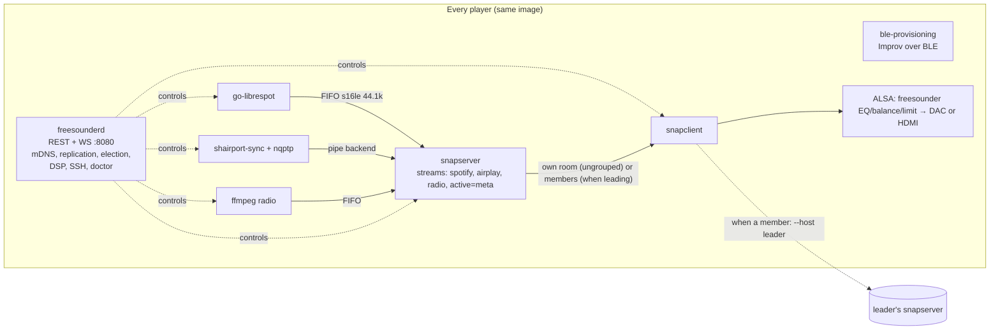

# FreeSounder v2: equal players, native ingress, grouping

**Status:** proposal for review. Nothing here has been built yet. Written 11 November 2026, Australia/Melbourne (AEDT, UTC+11). It lives on the `dev/v2-equal-players` branch. The previous design is frozen at tag `ma-design-final` and described in [architecture.md](architecture.md).

**Decision (user, 11 November 2026, AEDT):** option 1. Every player is equal and runs the same small FreeSounder service. Players have no host role, no Music Assistant (MA) and no Docker. Grouping is a core requirement.

Release dates below come from the GitHub API and are converted to AEDT. "Estimate" marks a number we have not measured on our image. Phase 1 exists to measure those numbers.

---

## 0. Summary

- **One image, one service, every board.** The same arm64 image runs on the Pi Zero 2 W, Pi 3, Pi 4 and Pi 5. Each player runs `freesounderd` (our Python service, which merges today's control API and player agent), `snapserver`, `snapclient`, `go-librespot` (Spotify Connect), `shairport-sync` with `nqptp` (AirPlay 2), and `ffmpeg` for internet radio when it plays. The existing BLE Improv provisioning service stays as it is.
- **Snapcast is the sync layer.** Every player always runs its own snapserver. A room on its own plays from itself. When rooms are grouped, one of them is the **leader**, and every member's `snapclient` follows the leader's snapserver. Ungrouping points a member back at itself.
- **Each group appears once in Spotify and AirPlay, Sonos-style.** An ungrouped room appears as "Kitchen". A group appears once, on its leader, as "Kitchen + 1". Members hide their own Connect and AirPlay receivers while grouped.
- **Leadership is sticky.** The leader is the room whose source session (a Spotify Connect session, an AirPlay session or a radio stream) feeds the group. It stays leader until that session ends, even if its own room leaves the group. In that case it keeps serving the other rooms and its own speaker goes quiet. A new leader is elected only when the leader goes offline. Radio then resumes by itself, while Spotify and AirPlay have to be restarted from the phone.
- **The household is a small replicated document.** It's created invisibly when the first player is set up and copied to every player, so the app can talk to **any** player. Players and groups are found over mDNS.
- **Setup is just Bluetooth Wi-Fi, a room name, and done.** Users never see a "create" versus "join" choice.

---

## 1. Feasibility research

### 1.1 Hardware targets

| Board | CPU / RAM | Network | Role in v2 |
|---|---|---|---|
| Pi Zero 2 W | 4× Cortex-A53 @ 1 GHz, **512 MB** | 2.4 GHz 802.11n only, BLE 4.2, no Ethernet | Full player, and can lead a typical group ([product page](https://www.raspberrypi.com/products/raspberry-pi-zero-2-w/)) |
| Pi 3 B / B+ | 4× A53, 1 GB | B: 2.4 GHz only. B+: dual band, Ethernet | Full player |
| Pi 4 | 4× A72, 1–8 GB | Dual band, gigabit Ethernet | Full player, preferred leader |
| Pi 5 | 4× A76, 2–16 GB | Dual band, gigabit Ethernet | Full player, preferred leader |

Raspberry Pi OS Lite (64-bit) supports all four. The original Pi Zero and Zero W are 32-bit ARMv6 boards and are out of scope.

### 1.2 Snapserver and snapclient on a Zero 2 W

- Snapcast works by having the server timestamp audio chunks. Each client syncs its clock to the server and adds or drops single samples, keeping "typically the deviation below 0.2ms" ([Snapcast README](https://github.com/snapcast/snapcast)).
- The client is light. One maintainer-thread report has snapclient at about 0.5% CPU when idle and 8–10% while playing on a single-core Milk-V Duo 256, which is a far weaker board than a Zero 2 W. Another has snapserver idling at 0.7–1.4% on an original Pi Model A ([snapcast#1336](https://github.com/snapcast/snapcast/issues/1336)). The maintainer describes both programs as asynchronous and event-driven (boost asio) ([discussion #1442](https://github.com/snapcast/snapcast/discussions/1442)). XDA runs snapclients on Zero 2 W boards ([XDA](https://www.xda-developers.com/run-snapcast-on-raspberry-pis-instead-of-paying-for-sonos/)).
- **Leader cost.** A leader encodes each stream once (FLAC by default, about 26 ms codec latency) and sends a copy to each member. FLAC at 44.1 kHz/16-bit stereo usually runs well under the 1.4 Mbit/s of raw PCM. *Estimate:* about 0.7–1 Mbit/s per member, so a Zero 2 W leading 5 members sends roughly 4–5 Mbit/s over 2.4 GHz. That should be within reach, but airtime on 2.4 GHz is the real limit, so Phase 3 measures it.
- **Versions.** Debian trixie ships Snapcast 0.31.0. Upstream **v0.35.0** (released 11 March 2026, 1:35 am AEDT) publishes `snapserver`/`snapclient` `arm64_trixie.deb` packages of about 1.5 MB and 0.54 MB ([release](https://github.com/snapcast/snapcast/releases/tag/v0.35.0)). We should pin the upstream 0.35 debs.
- **Known limitation.** A snapclient can't switch servers without a restart. The maintainer said "This is not possible" ([snapcast#527](https://github.com/snapcast/snapcast/issues/527)). Moving a room between groups therefore means restarting that room's snapclient, which leaves a gap of about 1–2 s **on that room only** (*estimate*: reconnect plus the 1000 ms default buffer). The rooms already playing aren't touched.

### 1.3 Spotify Connect: go-librespot into snapserver

- go-librespot has a `pipe` audio backend (`audio_output_pipe`, `s16le`), Zeroconf (Spotify Connect) discovery through either a built-in responder or Avahi, and a REST API with a WebSocket `/events` stream for control and now-playing ([README](https://github.com/devgianlu/go-librespot), [API.md](https://github.com/devgianlu/go-librespot/blob/master/API.md)). It's a single Go binary, and the arm64 release archive is about 6.1 MB (**v0.10.5**, 16 October 2026, 7:53 pm AEDT).
- The Snapcast docs include an official go-librespot recipe: pipe output to stdout at `44100:16:2`, with its API server on port 24879 ([Snapcast configuration](https://github.com/snapcast/snapcast/blob/develop/doc/configuration.md#go-librespot)). We'll have `freesounderd` run go-librespot itself, writing to a FIFO, rather than letting snapserver launch it. That way our service controls its name, visibility and restarts.
- Spotify Premium is required. go-librespot is GPL-3.0, so it runs as a separate process.
- **Major risk: newer Spotify accounts can't play.** Since a Spotify-side DRM change, accounts created after a cutoff (apparently 2024–2025) can't get audio keys, and playback fails with `audio key error 0 1`. This affects librespot and go-librespot alike, and no workaround is known ([librespot#1649](https://github.com/librespot-org/librespot/issues/1649), locked 7 November 2026; [go-librespot#279](https://github.com/devgianlu/go-librespot/issues/279)). The only official alternative is **Spotify Soloist**, a headless Linux client with Spotify Connect device mode and a WebSocket API. Its catches: each user must generate their own API key, the binaries can't be redistributed (the player would download them), and builds expire after 90 days ([Soloist](https://developer.spotify.com/documentation/soloist)). The MA design used Soloist through MA. In v2 it would be an optional engine that `freesounderd` downloads and runs. See the open questions in §8.

### 1.4 AirPlay 2: shairport-sync plus nqptp into snapserver

- shairport-sync 5.6+ supports AirPlay 2 from iOS, macOS 10.15+, HomePod minis and Apple TVs. It needs the companion `nqptp`, which must have exclusive use of UDP ports **319 and 320**. It can output to `stdout` or a Unix pipe, and offers metadata and remote control over MPRIS, D-Bus or MQTT ([AIRPLAY2.md](https://github.com/mikebrady/shairport-sync/blob/master/AIRPLAY2.md)). It also notes that timing is less critical when outputting to stdout or a pipe, which is exactly our case.
- **Power.** The current doc says "a Raspberry Pi B, or better". An earlier revision named the Pi Zero 2 W as a recommended minimum ([older AIRPLAY2.md](https://github.com/mikebrady/shairport-sync/blob/97fefb43/AIRPLAY2.md)). Community guides run AirPlay 2 on a Zero 2 W with a PCM5122 DAC and recommend `interpolation = "basic"` to save CPU ([guide](https://hannoeru.me/posts/install-shairport-sync-airplay-2-raspberry-pi-zero-2-w-waveshare-pcm5122)).
- **Packaging gap.** Debian **trixie** has shairport-sync **4.3.7, built without `--with-airplay-2`**, and has no `nqptp` package at all. Debian sid/forky has **5.6.2-3 with `--with-airplay-2 --with-ffmpeg`** and `nqptp` 1.2.9 ([sources.debian.org](https://sources.debian.org/src/shairport-sync/)). The Raspberry Pi archive carries neither. We should rebuild the sid source packages for trixie arm64 in CI (a native arm64 GitHub runner) and pin them. Upstream is at 5.6.3 (10 November 2026, 9:53 pm AEDT) and nqptp at 1.2.9 (14 October 2026, 9:46 pm AEDT).
- **Wi-Fi drop risk on a Zero 2 W running trixie.** One report describes 1–5 s audio drops on a Zero 2 W with trixie Lite, caused by Wi-Fi driver errors and not fixed by turning power saving off ([shairport-sync discussion #2140](https://github.com/mikebrady/shairport-sync/discussions/2140)). This affects Snapcast just as much, so it's a Phase 1 acceptance test.
- **Lip-sync.** AirPlay already buffers about 2 s, and iOS compensates for that with video. Snapcast adds its own buffer (1000 ms by default) after shairport-sync. Video played over AirPlay will be late unless we offset it, for example with shairport-sync's backend latency offset. This has to be checked on hardware in Phase 2 before we promise lip-sync.

### 1.5 Internet radio

- Use [Radio Browser](https://api.radio-browser.info/), which is free and open, with about 52,700 stations on 11 November 2026. Its documented etiquette is to find servers through a DNS lookup of `all.api.radio-browser.info`, send a descriptive User-Agent (for example `FreeSounder/0.6`), and call `/json/url` for each station played.
- The **player plays radio itself.** The leader's `freesounderd` runs `ffmpeg -i <stream url>` and outputs `s16le` at 44.1 kHz stereo into the leader's `radio` FIFO. shairport-sync already needs FFmpeg's libraries for AAC, so the extra CLI is small. Radio is also the only source that a new leader can **resume by itself** after a failover, because the station URL is in the replicated group state.

### 1.6 How Spotify and AirPlay should appear when rooms are grouped

**How Sonos does it**
- **Spotify Connect:** an ad-hoc group appears in the Spotify app as **one device**, "Bedroom + 1". Its members aren't listed separately while grouped, and Spotify itself has no idea of speaker groups ([r/sonos](https://www.reddit.com/r/sonos/comments/8lbuzo/stereo_pair_room_name_via_spotify/), [r/sonos 2026, Sonos staff reply](https://www.reddit.com/r/sonos/comments/1q66enz/speakersspeaker_groups_are_confusing_in_spotify/)).
- **AirPlay:** each AirPlay-capable speaker is listed separately, and you can't AirPlay to a named Sonos group. The AirPlay stream "terminates at the Group Coordinator" and the other members get the audio from it ([Sonos support](https://support.sonos.com/en-us/article/stream-airplay-audio-to-sonos), [Sonos Community](https://en.community.sonos.com/controllers-music-services-228995/airplay-with-sonos-6858304)).

**FreeSounder v2 proposal**
- **One Spotify Connect device and one AirPlay receiver per group, both on the leader.** An ungrouped room advertises its own room name. When grouped, members stop their go-librespot and shairport-sync, and the leader advertises "Kitchen + 1".
- **Renaming happens only when the leader is idle.** go-librespot and shairport-sync both take their name from config, so renaming means a restart, which would cut off a session that's playing. While the leader is playing, it keeps its current name. Whatever is playing carries on, and the name catches up once it's idle. *To verify:* whether go-librespot can rename itself at runtime through its API. If not, we could propose that upstream.
- **What we rejected:** keeping members' receivers visible and forwarding their audio to the leader (more moving parts, and two clocks), and keeping every room's receiver visible so that AirPlay to several rooms relies on Apple's own multi-room sync (it then bypasses our groups and volume).
- **One source at a time per group.** If a new source starts on a leader, `freesounderd` pauses the old one through the go-librespot API, shairport-sync over D-Bus/MPRIS, or by stopping ffmpeg. The snapserver `meta` stream is only a backup arbiter.

### 1.7 Leader election and handover

**Choosing a leader** (deterministic, so every player reaches the same answer):
1. A room that **owns an active source session** leads its group. "Play here too" adds rooms to that room's group, so nothing that's already playing gets interrupted.
2. If none is playing (for example, two idle rooms are grouped), the leader is the room the user started from in the app, the "anchor".
3. As a tie-break and for failover, the highest **capability score** wins: wired Ethernet, then 5 GHz Wi-Fi, then 2.4 GHz, then Pi 5 > Pi 4 > Pi 3 > Zero 2 W, then the lowest player ID.

**Sticky leadership, "relay mode":** if the user removes the leader's room from a playing group, the leader **keeps serving** the remaining rooms, but moves its own snapclient to a separate, silent Snapcast group on its own server. Nobody else's audio is interrupted, and there's no transfer to get wrong. That fixes the problem MA had to solve with queue transfer ([MA PR #4412](https://github.com/music-assistant/server/pull/4412)) without moving any session. Relay mode ends when the session stops. If the user then starts something new in the relaying room, the app asks: "Kitchen is still playing for Living + Office. Stop it there?" A Spotify Connect device can't take on a second session, so that question is unavoidable.

**Leader offline** (power cut or Wi-Fi loss):
- **Detection.** Each member watches its snapclient's connection state and the leader's peer heartbeat (WS ping every 2 s). If neither is seen for **6 s**, the leader is suspect (*target*). A clean shutdown sends an mDNS goodbye and is noticed immediately.
- **Election.** The remaining members apply the §1.7 tie-break to the group record they already share, and the winner announces itself. Members only accept a leader with a higher term number, so two winners can't fight. The others point their snapclients at the new leader.
- **Resuming.** Radio restarts by itself on the new leader from the replicated station URL. Spotify and AirPlay sessions were tied to the lost device, so the group goes idle and shows "Kitchen went offline. Start Spotify again on Living + 1". The new leader advertises the group's Connect and AirPlay names.
- *Estimate:* about 8–12 s of silence (6 s to detect, then the restart and buffer), plus the user restarting Spotify or AirPlay.
- **Return.** A leader that comes back rejoins as an ordinary **member** and doesn't take leadership back.
- **Split brain.** Each player is the only writer of its own membership (§3.2). If the network splits, each side may elect a leader. When it heals, the leader with an active session wins, then the higher term, then the tie-break. The other leader's session stops.

**Sonos comparison:** when the group coordinator is removed, Sonos promotes another speaker and keeps playing, because it owns its whole playback stack and can move the queue ([Sonos staff](https://en.community.sonos.com/controllers-music-services-228995/sonos-group-coordinator-question-6803946)). We can only do that for radio, because Spotify and AirPlay sessions belong to the phone or Spotify's cloud. Relay mode covers the common case where someone leaves a group.

### 1.8 Latency budget

| Action | Expected delay | Why |
|---|---|---|
| Play, pause, skip or volume from the app | about 1.0–1.1 s for audio, under 100 ms for the UI | Snapcast `buffer` 1000 ms by default. We can tune it down to 500–800 ms once Phase 3 measures Wi-Fi stability. |
| Spotify Connect play from the phone | about 1–2 s | Spotify start-up plus the buffer |
| AirPlay start | about 2–3 s | AirPlay's own buffer plus Snapcast |
| A room joins a playing group | about 1–2 s on that room only | Snapclient restart (§1.2) |
| A room leaves a group | about 1–2 s on that room | Snapclient restart to its own server |
| Leader goes offline | about 8–12 s (*estimate*) | 6 s detection plus the restart |

The UI shows "Syncing…" on a room until its snapclient reports it's connected and buffered.

### 1.9 Household identity

- **Household ID:** a random UUIDv4. **Household key:** 32 random bytes, used to authenticate player-to-player sync with HMAC and to stop two households on the same LAN mixing.
- **Where they come from.** The app, during setup, without asking the user anything (§4.3). If mDNS finds players with a household ID, the app reuses it. If it finds none, the app creates a new ID and key and keeps them. Either way, after the player joins Wi-Fi, the app sends `{household_id, household_key, room_name, country, timezone}` to it in one call.
- **Where they're kept.** In `/var/lib/freesounder/household.json` on every player (mode 0600, owned by root), and in the app's secure storage. A player in the household advertises the ID in its mDNS TXT record. It never advertises the key.
- **A lost phone.** A new phone discovers the household from any player's TXT record and can control it. LAN control stays **unauthenticated in v1**, as today. App pairing (getting the key onto a new phone) is a Phase 5 item, and §8 asks whether that's acceptable.

---

## 2. Sync layer: Snapcast versus the alternatives

| Option | Sync quality | Fits "equal players" on a Zero 2 W? | Verdict |
|---|---|---|---|
| **Snapcast** (server on the leader, clients on members) | Typically < 0.2 ms ([README](https://github.com/snapcast/snapcast)) | Yes. Light on CPU and RAM (§1.2), GPL-3.0 as a separate process, already used by our image | **Recommended** |
| Sendspin (MA's protocol) | No published figures. Spec repo active, still a **technical preview** ([MA docs](https://www.music-assistant.io/player-support/sendspin/), [spec](https://github.com/Sendspin/spec)) | The server role lives in the MA ecosystem | Revisit when it's stable |
| AirPlay 2 multi-room (shairport-sync on every room) | Apple-grade sync between AirPlay 2 receivers | Receivers only. We'd also need an AirPlay 2 *sender* for Spotify and radio (for example OwnTone, GPL-2.0, a server-shaped program), and it only syncs Apple's way | No |
| Squeezelite plus Lyrion (LMS) | Good, with no sub-millisecond claim ([wiki](https://wiki.lyrion.org/index.php/Synchronization.html)) | Needs an LMS server (Perl, heavy), so a host role again | No |
| PipeWire plus ROC/RTP | Drift compensation, no sample-timed playout | Not a rooms product, and resync is painful | No |
| Our own RTP plus PTP | Whatever we manage to build | Months of work to rebuild Snapcast | No |

Snapcast wins because it's mature, light enough for the Zero 2 W, keeps working with any input we can write to a pipe, and the `dev/` simulator already runs it.

---

## 3. Service, API and data model

### 3.1 Processes on every player



- **snapserver.** Its config is fixed at build time: three `pipe://` sources (`spotify`, `airplay`, `radio`, all `44100:16:2`) plus `meta:///spotify/airplay/radio?name=active`, FLAC, buffer 1000 ms. JSON-RPC (port 1705) is bound to the LAN, because a leader's `freesounderd` moves members' Snapcast clients between groups on its own server, for example in relay mode.
- **snapclient.** `freesounderd` manages it as a systemd unit with `--host 127.0.0.1` when ungrouped, or `--host <leader ip>` when it's a member. It keeps `--soundcard freesounder`, so per-room DSP always applies.
- **Volume** is set **in each room's own ALSA chain**, driven by its own `freesounderd`, so it doesn't change on regroup. Group master volume scales members in proportion, and the leader works that out. Volume changes from Spotify or AirPlay on the leader are mapped onto the group master.
- **Python processes.** Merging the control API and player agent into one **`freesounderd`** saves one Python interpreter, which is about 30–50 MB on a Zero 2 W (*estimate*). Whether to fold BLE provisioning in as well is a Phase 1 measurement. It's kept separate for now because it works on hardware.

**Zero 2 W RAM budget** (*estimates, to be measured in Phase 1*): OS, systemd, NetworkManager, Avahi and BlueZ about 90 MB; `freesounderd` about 50–70 MB; `ble-provisioning` about 35 MB; snapserver plus snapclient about 15–25 MB; go-librespot about 30–60 MB; shairport-sync plus nqptp about 20–40 MB; ffmpeg while playing radio about 20–30 MB. That's about **260–350 MB of 512 MB**, with `gpu_mem=16` and zram swap as a safety net. If the measurement comes in over 380 MB, the first fixes are to fold BLE into `freesounderd` and to start go-librespot and shairport-sync only when their room advertises them.

### 3.2 Household and group data model

State is a single JSON document. **Every record has exactly one writer**, so most conflicts can't happen at all:

```text
household          writer: last-writer-wins (LWW) via hybrid logical clock (HLC)
  id: uuid, name: "Home", created_hlc, schema: 2

players/{player_id}          writer: that player only
  id (from CPU serial), room_name, hostname (fs-<room>), model ("pi-zero-2w"),
  ram_mb, uplink ("eth"|"wifi5"|"wifi24"), addresses[], version,
  capabilities {spotify, airplay, radio, dac, hdmi},
  settings {volume_limit, bass, treble, balance, loudness, dac, output},
  volume, muted, online (derived), hlc

groups/{group_id}            writer: the group's current leader
  id: uuid, leader_id, term: int, member_ids[] (includes leader unless relaying),
  relay: bool, name ("Kitchen + 1"), master_volume,
  source {kind: none|spotify|airplay|radio, station?, started_hlc},
  now_playing {title, artist, album, art_url, position_ms, state}, hlc

membership (inside players/{id}): group_id   writer: that player
presets/{id}, favourites/radio/{id}           writer: LWW via HLC, with tombstones
```

- A **group** is defined by its members: the players whose `group_id` points to it. A command to change a group goes to the leader, which tells each joining or leaving player to update its own `group_id` and repoint its snapclient. Then it updates the group record.
- Every room is always in a group, even a group of one with itself as leader, just as Sonos does it. That way the app has a single code path.
- **Replication.** Peers are found over mDNS. When a peer's advertised `rev` (a hash of the state) changes, the player pulls its records with `GET /api/v2/peer/state?since=<hlc>`, and pushes its own changes over a peer WebSocket. Records merge by highest HLC per record, and tombstones last 30 days. The whole document is a few KB for a home with up to 32 players, so exchanging all of it is fine. Peer calls carry an HMAC made with the household key.

### 3.3 Discovery

- **mDNS** `_freesounder._tcp` on port 8080. TXT: `v=2`, `id=<player_id>`, `hh=<household_id or empty>`, `room=<name>`, `model=`, `state=unclaimed|ready`, `rev=<state hash>`, `leader=<group leader id>`.
- An **unclaimed** player (`hh` empty, or `state=unclaimed`) is offered under "Add a player". Players without Wi-Fi are found over BLE Improv, as today.
- The **app** connects to the **nearest ready player** in its household, preferring the one it used last, and opens the WebSocket. If that player disappears, it reconnects to another. All players have the same state, so any of them can answer, and commands are forwarded to the right owner.
- The **web app** can't use mDNS from a browser. Any player could serve the Flutter web build at `http://fs-<room>.local:8080/` (a few MB). That's an open question in §8.
- `_snapcast._tcp` stays unadvertised, so third-party Snapcast apps don't fight our grouping.

### 3.4 Per-player API (v2)

Every player serves the whole API. **The app never needs to know which player leads.** The player that receives a command forwards it to the owner: the leader for group playback, or the room for its settings.

**REST (`/api/v2`)**

| Method and path | Purpose |
|---|---|
| `GET /health` | Liveness, version, `state` |
| `GET /api/v2/info` | This player: id, room, model, capabilities, household id, unclaimed or ready |
| `POST /api/v2/setup` | **Only while unclaimed.** `{household_id, household_key, household_name?, room_name, country, timezone}`. Sets the hostname to `fs-<room>`, saves the household, starts replication and advertises `ready`. Can safely be repeated with the same body. |
| `POST /api/v2/rooms/{id}/reset` | Leave the household and return to unclaimed (asks for confirmation) |
| `GET /api/v2/household` | The whole replicated document (players, groups, presets, favourites) |
| `GET /api/v2/rooms`, `GET /api/v2/groups` | Convenience views of the above |
| `PUT /api/v2/groups/{gid}/members` | `{member_ids[], anchor_id?}`. Sets membership in one go, covering grouping, ungrouping and presets. |
| `POST /api/v2/rooms/{id}/join` | `{group_id}`, "Play here too" |
| `POST /api/v2/rooms/{id}/leave` | Leave a group. For a playing leader this means relay mode. |
| `POST /api/v2/groups/{gid}/{play\|pause\|stop\|next\|previous}` | Passed to the active source |
| `PUT /api/v2/groups/{gid}/volume` | `{volume}`, the master volume that scales members |
| `PUT /api/v2/rooms/{id}/volume` | `{volume, muted}` |
| `GET /api/v2/groups/{gid}/now-playing` | Track, art, position, source |
| `POST /api/v2/groups/{gid}/radio` | `{station_uuid}` or `{url, name, favicon}` |
| `GET /api/v2/radio/search?q=&country=&tag=&limit=` | Radio Browser proxy, cached, with the proper User-Agent |
| `GET/POST/DELETE /api/v2/radio/favourites[/{id}]` | Shared household favourites |
| `GET/PATCH /api/v2/rooms/{id}/settings` | Name, DSP, volume limit, DAC, output (`auto\|dac\|hdmi`), `spotify_enabled`, `airplay_enabled` (kept from today) |
| `GET/POST /api/v2/rooms/{id}/developer/ssh` | Kept from today |
| `GET /api/v2/rooms/{id}/doctor` | Doctor file as JSON (kept) |
| `GET/POST /api/v2/peer/state` | Player-to-player only, signed with the household key's HMAC |

**WebSocket `/api/v2/ws`.** It sends `household.snapshot` on connect, then `player.updated`, `player.online`, `player.offline`, `group.updated` (members, leader, term, relay), `group.now_playing`, `group.volume`, `room.volume`, `room.sync` (`syncing\|synced\|unreachable`), `source.changed` and `notice` (for example "Kitchen went offline"). Commands can also be sent over the socket as `{op, path, body, req_id}` for low latency, and the reply comes back with the same `req_id`.

**Errors.** Every failure says what failed in plain words, which carries on what app 0.5.3 does: `{"step": "Joining Kitchen", "detail": "...", "retry": true}`.

---

## 4. Setup flow (unchanged where it works)

1. Flash the image and power on. The tty1 status screen shows `fs-new`, and the player advertises `FreeSounder-XXXX` over BLE.
2. In the app, tap **Add a player**. Bluetooth finds it, the user picks a country (filled in from the phone's region), picks a network from the list or chooses **Other network…**, and Improv joins Wi-Fi. All of this exists already and works on hardware.
3. Type the room name. The app calls `POST /api/v2/setup` with the household ID and key it found or created. The player becomes `fs-<room>`, starts replicating, and appears in the Rooms list. **Done.** Nothing on screen says "Create" or "Join": the very first player simply creates the household without asking.
4. Optional: the app offers "Play a radio station here" so the user hears something straight away.

---

## 5. Keep, change, remove

### 5.1 Services

| Item | Action |
|---|---|
| `services/ble-provisioning` (Improv, country extension, tty1 status, doctor) | **Keep.** Replace the MA, host and role lines on the status screen and doctor with snapserver, leader/member, group and source. Add a Zero 2 W check for BLE and Wi-Fi coexistence. |
| `services/player-agent`: `dsp.py`, `ssh.py`, `store.py`, `mdns.py`, settings models | **Keep and move** into `services/freesounderd` |
| `services/player-agent`: adopt, `host`, `role`, `RoleChoice`, `AdoptBody` | **Remove** |
| `services/control-api`: `ma_backend.py`, `ma_bootstrap.py`, `ma_compat.py`, `ma_music_services.py`, `music_catalog.py`, `music_sessions.py`, `players.py` (adopt-to-host) | **Remove.** The code stays recoverable at tag `ma-design-final`. |
| `services/control-api`: `app.py`, `backend.py`, `mock_backend.py`, `models.py`, `mdns.py`, `config.py` | **Rewrite** as `freesounderd` (v2 API, replication, election, Snapcast/go-librespot/shairport-sync/ffmpeg supervisors). Keep the mock backend so the app and CI run without hardware. |
| `services/setup` (stub) | **Remove.** `/api/v2/setup` replaces it. |
| Tests: `test_ma_*`, `test_music_services.py`, `test_first_player.py` | **Remove.** Add tests for replication merges, election, regroup sequencing and the API contract. |

### 5.2 Flutter app

| Item | Action |
|---|---|
| `api/improv.dart`, `ble_steps.dart`, `ble_nearby_io.dart`, `nearby*.dart`, `wifi_countries.dart` | **Keep** |
| `ui/add_player_sheet.dart` | **Change** the final step to room name, then `POST /setup`. Remove the "Create your system" path. |
| `api/first_player.dart` | **Replace** with `setup_flow.dart` (find or create the household, then set up) |
| `api/control_client.dart`, `discovery_io.dart`, `state/playback_store.dart`, `models/room.dart`, `now_playing.dart` | **Change** to the v2 API, the household snapshot over WS, and TXT parsing |
| `ui/rooms_panel.dart`, `mini_player.dart`, `room_settings_sheet.dart`, `app_shell.dart`, `theme/tokens.dart`, `models/player_settings.dart` | **Keep.** Add group chips, Syncing pills, relay notices and the "Kitchen + 1" naming. |
| `ui/music_services_screen.dart`, `music_service_form.dart`, `music_auth.dart`, `models/music_service.dart` | **Remove.** Replace with a **Sources** screen: per-room Spotify Connect and AirPlay on or off, the Spotify account-limit notice, radio search and favourites. |
| `ui/service_branding.dart` | **Keep** for the Spotify, AirPlay and radio icons |
| `ui/settings_screen.dart` | **Change.** Remove the host and system items, and keep developer mode (tap the version 7 times). |
| `api/mock_data.dart`, tests | **Update** to v2. Drop `music_services_test.dart` and `first_player_test.dart` and add setup-flow and grouping tests. |
| TestFlight workflow | **Keep unchanged** |

### 5.3 Image (`images/player`)

| Item | Action |
|---|---|
| Stage `04-music-assistant`, `tools/fetch-docker-archive.py`, `run-music-assistant`, `freesounder-music-assistant.service`, `etc/freesounder/music-assistant-image` | **Remove** |
| `docker.io` in `00-packages` | **Remove** |
| `detect-role`, `freesounder-role.service`, `etc/freesounder/role`, `etc/freesounder/host`, the host and role commands in `freesounder-setup` | **Remove** |
| `apply-runtime-config`, `etc/default/snapclient`, `snapclient.service.d` | **Change.** `freesounderd` now owns `--host`. |
| `02-control-api` | **Change** to install `freesounderd` and `ble-provisioning` into one venv |
| New stage `04-audio-ingress` | **Add** upstream snapcast 0.35 trixie debs (server and client), the go-librespot arm64 binary, our trixie rebuilds of shairport-sync 5.6 (AirPlay 2) and nqptp 1.2.9, `ffmpeg` (CLI), a fixed `snapserver.conf`, and FIFOs in `/run/freesounder`. All versions and checksums are pinned in a manifest. |
| Wi-Fi unblock, country, hostname, appliance lockdown, sanitize-imager, SSH reset, boot doctor, tty1 status, DAC overlay, `select-audio-output` (HDMI fallback), ALSA DSP chain | **Keep** |
| `config.txt` | **Add** settings for the Zero 2 W and Pi 3: `gpu_mem=16`, zram swap, Wi-Fi power saving off (NetworkManager `802-11-wireless.powersave 2`). One image covers all boards: Pi 5 uses `kernel_2712.img` and the others use `kernel8.img`, both already in Lite. |
| `rpi-image-gen/config.toml` (stub with a host profile) | **Change** to one profile, or remove it |
| `dev/docker-compose.yml` (MA plus two snapclients) | **Replace** with three simulated players, each running `freesounderd`, snapserver and snapclient, so grouping and failover can be tested on a laptop |
| Docs: `architecture.md`, `music-services.md`, `README.md`, `images/player/README.md` | Mark `architecture.md` as superseded by this doc, remove `music-services.md`, and update the READMEs in Phase 1 |

### 5.4 Image size estimate

| Image | Size (`.img.xz`) | Source |
|---|---|---|
| Raspberry Pi OS Lite 64-bit (6 October 2026) | **550 MB** download, 3.08 GB extracted | [Imager OS list](https://downloads.raspberrypi.com/os_list_imagingutility_v4.json) |
| FreeSounder v0.4.4 (before MA was bundled, with docker.io) | **723 MB** | GitHub release asset |
| FreeSounder v0.4.5 (MA bundled) | **1,422 MB** | GitHub release asset |
| **FreeSounder v2** (*estimate*) | **about 620–680 MB**, about 3.3 GB on the card | v0.4.4 minus docker.io and containerd, plus ffmpeg (about 20–40 MB compressed), snapserver (1.5 MB), go-librespot (6 MB) and shairport-sync plus nqptp (about 1 MB) |

That's less than half of v0.4.5. Pi OS Lite is most of what's left. Trimming that down (rpi-image-gen, dropping unused firmware) could get to about 450 MB later, but that isn't v1 work.

---

## 6. Phased plan

Each phase ends with something the user can test on a **Pi 5 and a Zero 2 W**. Everything happens on `dev/v2-equal-players`, and CI stays green on every push.

**Phase 0: branch housekeeping (about half a day).** Point CI at the branch. Mark `architecture.md` as superseded. Remove the MA code, tests and image stage, keeping the code recoverable at `ma-design-final`.
*Test:* none on hardware. CI passes.

**Phase 1: one equal player, radio and setup (about 1 week).**
- Image: drop Docker and MA, add the `04-audio-ingress` stage (snapserver and snapclient on localhost, and ffmpeg for now), Zero 2 W tuning, and the updated status screen and doctor.
- `freesounderd`: a skeleton merging the agent and control API, with `/info`, `/setup`, household storage, `/rooms/{id}/settings`, DSP, developer SSH, radio search and play through the local snapserver, and room volume.
- App: the setup flow ending in a room name (no create or join), the Sources screen with radio only, and the room list for a single player.
- Measurements: RAM and CPU on the Zero 2 W, and Wi-Fi drop-outs over a 2-hour radio soak (the shairport-sync discussion #2140 risk).
- *Test:* flash both boards, set each up as its own room in the same household, play radio on each, adjust DSP and volume, and turn developer SSH on and off. The Zero 2 W must stay under 380 MB used.

**Phase 2: Spotify Connect and AirPlay on each room (about 1 week).**
- go-librespot and shairport-sync 5.6 (AirPlay 2) with nqptp, both built in CI, running under `freesounderd` and feeding the local snapserver. Now-playing and transport controls come from the go-librespot API and shairport-sync over D-Bus/MPRIS. One source at a time, with the newest winning.
- *Test:* both rooms appear in the Spotify app and the AirPlay picker under their room names. Play on each and control it from the FreeSounder app. Check AirPlay lip-sync with a video. Try Spotify with an account created after 2024 and record the result.

**Phase 3: grouping (about 1–2 weeks).**
- Replication (HLC, peer WebSocket, HMAC), group records, `PUT /groups/{gid}/members`, join and leave, snapclient retargeting, group master volume, "Kitchen + 1" names on the leader with members' receivers hidden, the Syncing pill, relay mode, and the three-player `dev/` simulator.
- *Test:* group the Pi 5 and the Zero 2 W in both directions (each as leader) for radio, Spotify and AirPlay. Ungroup and regroup while playing. Remove the leader's room while playing, which should trigger relay mode with no drop-out on the other room. Measure the gap when a room joins and the leader's Wi-Fi throughput with the Zero 2 W leading.

**Phase 4: leader loss and resilience (about 1 week).**
- Heartbeats, election with terms, automatic radio resume, notices in the app, healing after a network split, and returning players rejoining as members. The app fails over to another player when the one it's using drops.
- *Test:* pull the power on the leader mid-song. Radio should resume on the other board within about 12 s, and Spotify should show the "start again" notice. Power the leader back on and it should rejoin as a member. Close the app, change something from a second phone, and check that both stay in step.

**Phase 5: polish (ongoing).**
- Presets, the "Everywhere" group, sleep timer and alarms, app pairing and LAN authentication, the web app served from players, an optional Soloist engine, tuning the Snapcast buffer down, and Android internal testing.
- *Test:* each item gets its own checklist.

**Roadmap after v1:** line-in (a USB audio capture or ALSA source into snapserver, Sonos-style, playing in any group), Bluetooth audio input (a BlueZ A2DP sink feeding the FIFO), in-app music-service browsing (optionally MA as an add-on on one capable player, kept off the critical path), and stereo pairs.

---

## 7. Key trade-offs

- **No in-app catalogue in v1.** Without MA there is no browsing or searching of Spotify, Tidal, Qobuz, Apple Music or local and NAS libraries inside FreeSounder, no shared queue, and no library database. Music is started from the **Spotify app (Connect)**, any **Apple device (AirPlay)**, or **radio inside our app**. Tidal and Qobuz only work if they're AirPlayed from an Apple device, and local files only through an app that can AirPlay them. Lossless tops out at AirPlay's ALAC 16/44.1 or 24/48 into Snapcast at 44.1/16.
- **Spotify for newer accounts.** Spotify Connect through go-librespot **doesn't play** for many accounts created since about 2024 (§1.3). AirPlay from the Spotify app on iOS is the fallback, and Soloist is the possible fix.
- **Handover is less smooth than Sonos.** A room joining or leaving has a gap of about 1–2 s on that room. A Spotify or AirPlay session can't survive its leader going offline, though radio can.
- **Gains:** one image for every board, a Zero 2 W kit at about A$97 is a full player, no 1.4 GB image, no hidden MA login or schema clashes, no host to lose, and much less code.

## 8. Open questions for the user

1. Is v1 without in-app Spotify, Tidal or local-library browsing acceptable, given the Spotify Connect account limit? Or should an optional **Soloist** engine (your own Spotify developer key, auto-downloaded and refreshed every 90 days) come earlier than Phase 5?
2. AirPlay: is one receiver per group ("Kitchen + 1"), with members hidden, what you want? The alternative is listing every room, as Sonos does.
3. Is an unauthenticated LAN API acceptable for the alpha (it is today), with app pairing in Phase 5?
4. Should players serve the web app (`http://fs-<room>.local:8080/`)?
5. Which DAC HATs should we officially support on the Zero 2 W? HiFiBerry DAC+ Zero or the PCM5102 boards?
6. Should the Pi 5 keep a slightly higher leader preference even when it's on Wi-Fi?

## 9. Sources

- Snapcast: [README](https://github.com/snapcast/snapcast), [configuration (sources, go-librespot, airplay, meta)](https://github.com/snapcast/snapcast/blob/develop/doc/configuration.md), [JSON-RPC control API](https://github.com/snapcast/snapcast/blob/develop/doc/json_rpc_api/control.md), [v0.35.0 release](https://github.com/snapcast/snapcast/releases/tag/v0.35.0), [#527 server switch](https://github.com/snapcast/snapcast/issues/527), [#1336 CPU on Pi](https://github.com/snapcast/snapcast/issues/1336), [discussion #1442](https://github.com/snapcast/snapcast/discussions/1442)
- [XDA: Snapcast on Raspberry Pis](https://www.xda-developers.com/run-snapcast-on-raspberry-pis-instead-of-paying-for-sonos/)
- go-librespot: [README](https://github.com/devgianlu/go-librespot), [API.md](https://github.com/devgianlu/go-librespot/blob/master/API.md), [#279 audio key](https://github.com/devgianlu/go-librespot/issues/279); [librespot#1649](https://github.com/librespot-org/librespot/issues/1649); [Spotify Soloist](https://developer.spotify.com/documentation/soloist)
- shairport-sync: [AIRPLAY2.md (current)](https://github.com/mikebrady/shairport-sync/blob/master/AIRPLAY2.md), [AIRPLAY2.md (earlier, Zero 2 W)](https://github.com/mikebrady/shairport-sync/blob/97fefb43/AIRPLAY2.md), [nqptp](https://github.com/mikebrady/nqptp), [discussion #2140 (Zero 2 W on trixie)](https://github.com/mikebrady/shairport-sync/discussions/2140), [Zero 2 W AirPlay 2 guide](https://hannoeru.me/posts/install-shairport-sync-airplay-2-raspberry-pi-zero-2-w-waveshare-pcm5122); Debian packages: [shairport-sync](https://sources.debian.org/src/shairport-sync/), [snapcast](https://sources.debian.org/src/snapcast/), [nqptp](https://sources.debian.org/src/nqptp/)
- Sonos: [AirPlay](https://support.sonos.com/en-us/article/stream-airplay-audio-to-sonos), [group and ungroup](https://support.sonos.com/en-us/article/group-and-ungroup-rooms), [group coordinator (staff)](https://en.community.sonos.com/controllers-music-services-228995/sonos-group-coordinator-question-6803946), [AirPlay ends at the GC](https://en.community.sonos.com/controllers-music-services-228995/airplay-with-sonos-6858304), [Spotify "+1" naming](https://www.reddit.com/r/sonos/comments/8lbuzo/stereo_pair_room_name_via_spotify/), [Sonos staff on Spotify groups](https://www.reddit.com/r/sonos/comments/1q66enz/speakersspeaker_groups_are_confusing_in_spotify/)
- [MA PR #4412 (leader transfer)](https://github.com/music-assistant/server/pull/4412), [MA Sendspin](https://www.music-assistant.io/player-support/sendspin/), [Sendspin spec](https://github.com/Sendspin/spec), [Lyrion sync](https://wiki.lyrion.org/index.php/Synchronization.html)
- [Radio Browser API](https://api.radio-browser.info/); [Raspberry Pi Zero 2 W](https://www.raspberrypi.com/products/raspberry-pi-zero-2-w/); [Raspberry Pi Imager OS list](https://downloads.raspberrypi.com/os_list_imagingutility_v4.json)
