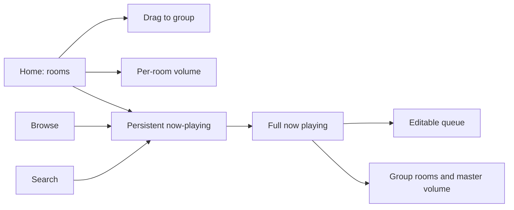
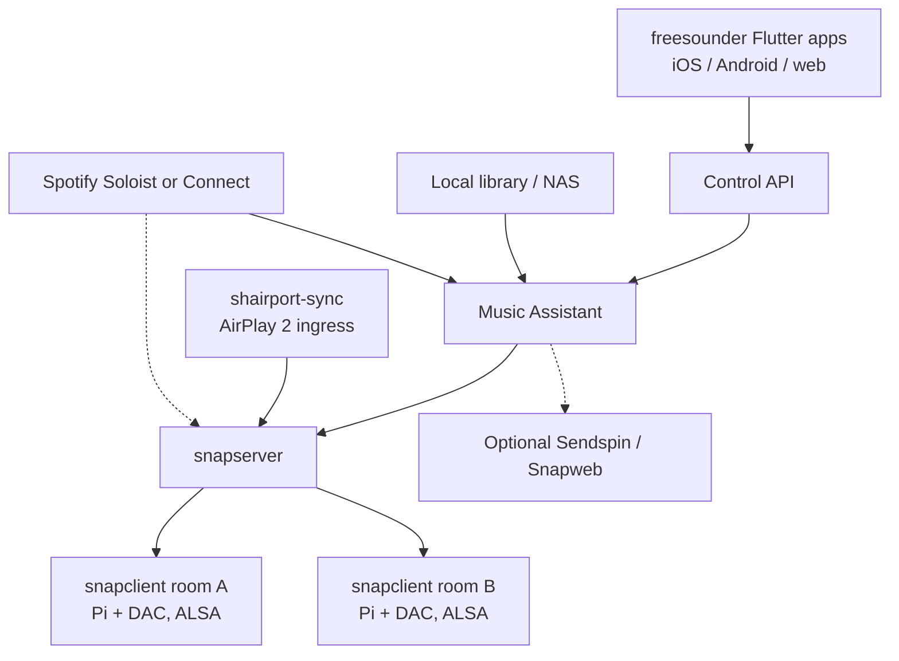

# freesounder – Architecture Research & Recommended Stack

Research snapshot as of **10 November 2026, Australia/Melbourne**. GitHub star counts and release metadata were looked up from the GitHub API on that date unless another source is named. Timestamps originally in UTC are converted to Australia/Melbourne (UTC+11). Prices are GST-inclusive AUD from named retailers fetched the same day. Numbers are cited, not invented.

**Public repo:** [https://github.com/mhatzis/freesounder](https://github.com/mhatzis/freesounder) (Apache License 2.0).

A companion Page with the same findings is here: [freesounder – Architecture Research & Recommended Stack](https://cursor.com/canvas/store-1e1f00a9-5a68-4935-844e-05e60d7c3684/36256424-0c34-4af8-91ca-18271424bb71).

---

## 1. Recommendation

freesounder should not clone the Sonos app. The product is a **cleaner, rooms-first redesign** of multi-room control: very clear now-playing, one-tap per-room and group volume, and grouping that takes a couple of seconds.

**Recommended stack**

| Layer | Choice |
|---|---|
| Control apps (iOS, Android, web) | **Flutter**, one custom design system. Do not ship Music Assistant, Iris, Snapweb, Volumio or Lyrion UIs as the product face. |
| Server / library / streaming sources | **Music Assistant** (Apache-2.0), unmodified, separate process. Talk to its WebSocket API, with an optional thin freesounder facade later. |
| Sync layer | **Snapcast** (GPL-3.0), unmodified, separate process. `snapclient` on each room, **ALSA** to a DAC, **Ethernet** where possible. |
| AirPlay 2 ingress | **shairport-sync** + NQPTP, audio fed into a Snapcast source. |
| Spotify | Music Assistant **Soloist** where it works, and/or a **Connect** sidecar (raspotify/librespot). Both have Terms-of-Service caveats. |
| Discovery | mDNS / Avahi for server findability, AirPlay and Connect. Snapcast clients connect to snapserver on the LAN. |

Avoid Bluetooth and PulseAudio/PipeWire hops on synced room players. Do not use PipeWire/ROC or Pulse RTP as the house clock. Do not build on Volumio as the core (multi-room is a Premium feature). Treat Lyrion + squeezelite + piCorePlayer as a mature *alternative* architecture, not the default.

---

## 2. UI/UX redesign (top priority)

The user finds the Sonos app unfriendly. That is the design brief: **much cleaner, simpler, more intuitive, modern and minimal**, with easy multi-room control, very clear now-playing, and simple group management. It is not a request to imitate Sonos.

### 2.1 What the 2024 Sonos app backlash documented

On 7 May 2024 Sonos replaced the S2 controller with a redesigned app. The public record is consistent:

- [The Verge, 8 May 2024](https://www.theverge.com/2024/5/8/24151704/sonos-new-app-bad-reviews-missing-features) reported missing sleep timers, broken or unusable local-library search, no in-app queue editing, and a **regression in accessibility**. System control had “taken somewhat of a backseat to music control.” There was **no way to downgrade** to the previous S2 app on iPhone.
- [WIRED, “Many People Do Not Like the New Sonos App”](https://www.wired.com/story/people-do-not-like-the-new-sonos-app/) described almost total condemnation on Reddit and audio forums. Missing or broken: sleep timers, alarms, **precise volume**, add-to-end-of-queue, Wi-Fi management, adding speakers, and local library search. A VoiceOver user called it “an accessibility disaster”: “As a blind guy, I now have a system that I can hardly use.”
- [The Verge, 14 May 2024](https://www.theverge.com/2024/5/14/24156703/sonos-app-redesign-new-ama-complaints) covered a community AMA. Customers asked why the app shipped below parity after **private beta testers had already raised concerns**, with **no open beta** and no warning in launch emails that features were gone. Alarms had been remotely disabled on launch morning because of a data-corruption bug.
- More than two months later, CEO Patrick Spence apologised and listed overdue work on library browse/search, **volume responsiveness**, alarm reliability and playlist edit mode ([WIRED](https://www.wired.com/story/sonos-admits-its-recent-app-update-was-a-colossal-mistake/)).

Some reviewers noted the new app felt sleeker or more responsive for large systems. The failures that matter for freesounder are: a music-store home that demoted rooms and volume, shipping a redesign that *removed* working features, accessibility regressions, and a forced cutover with no downgrade.

### 2.2 Design principles

1. **Rooms and volume first, not a music-store home.** Everyday use is: which rooms are on, what is playing, how loud, who is grouped. Discovery is one tap away, never the only screen.
2. **Do not ship a redesign that removes working features.** Queue edit, local library search, add-a-speaker, sleep timer, alarms and precise volume belong in the first release. No forced, un-downgradeable cutover.
3. **Volume is a primary control.** Immediate, precise, one-tap per room, plus a group master. Never hide numeric volume behind a gesture-only slider with no value.
4. **Now-playing is persistent and obvious.** Artwork, title, artist, rooms in the group, transport and volume stay visible on every tab.
5. **Grouping is a two-second task.** Drag one room onto another, or an equally obvious tap/checklist. Ungroup is just as easy.
6. **Accessibility is a launch requirement.** VoiceOver, TalkBack, Dynamic Type, captions, keyboard and large hit targets are tested before release.
7. **Local libraries are first-class.** Browse and search of a NAS or server library must work as well as a streamer catalogue.
8. **Minimal, not empty.** A calm, modern layout. Power features (EQ, sleep timer, queue edit) are findable, not deleted in the name of simplicity.

### 2.3 How existing controllers compare on UX

Ratings below are a **qualitative assessment** by this research as of 10 November 2026, Australia/Melbourne. They are not a user study. They judge closeness to a clean, rooms-first household remote — not audiophile depth or feature count.

| Controller | UX for household control | Strengths | Why it is not the freesounder UI |
|---|---|---|---|
| Music Assistant web UI + official mobile app | Strongest current OSS baseline | The 2.10 player bar puts select, group and volume up front ([MA 2.10 blog](https://www.music-assistant.io/blog/2026/08/26/music-assistant-2-10/)). Official [KMP iOS/Android app](https://github.com/music-assistant/mobile-app) (Apache-2.0). Strong multi-source library. | Still a power-user / Home Assistant music engine. Use as **backend**, not as the face of freesounder. |
| Volumio Nova | Visually strong, paid for multi-room | Large artwork, large targets, one-tap grouping, accessibility settings (docs claim 56px targets, text size, screen reader) — [volumio.com/nova](https://volumio.com/nova/). | [Multi-room sits behind Premium](https://help.volumio.com/en/articles/121-how-does-the-multiroom-work) (up to 6 devices on a paid plan). Not acceptable as the core of a free public project. |
| Lyrion Material Skin | Good music-player UI | Modern Material web UI; mobile-first browse / now-playing / queue. Reviewers have called it one of the best non-Roon player skins ([Ryan Feeley interview](https://ryanfeeley.com/squeezing-every-last-drop-with-material-skin/); [Antipodes forum](https://antipodes.support/t/material-web-player/43)). Repo: [CDrummond/lms-material](https://github.com/CDrummond/lms-material) (410 stars; 6.4.14 published 16 October 2026, 4:52 pm Australia/Melbourne). | LMS mental model, not rooms-first. Documented drag-and-drop pain on iPhone. Default LMS skin is dated. |
| Mopidy Iris | Good, server-centric | Attractive web UI, queue, Snapcast client list and per-client volume ([jaedb/Iris](https://github.com/jaedb/Iris)). | Feels like a music server with a nice face. Snapcast is a panel, not a rooms home. |
| Snapweb | Functional, narrow | Groups, per-client volume, browser playback. | Not a library or now-playing product. The browser tab must stay open to keep playing ([MA Snapcast notes](https://www.music-assistant.io/player-support/snapcast/)). |
| moOde WebUI | Functional, specialist | Deep renderer and DSP controls; actively maintained (10.3.7). | Built for a single audiophile player (plus moOde’s own sender/receiver mode), not a household rooms remote. |
| Snapdroid / older LMS remotes (Squeezer, iPeng) | Uneven or stale | Snapdroid can be an Android Snapcast endpoint. iPeng is a mature but commercial iOS LMS controller. | Snapdroid lags current Snapcast (v0.29.0.2, 3 December 2024). Music Assistant documents the **iOS Snapcast app as broken**. Squeezer-class apps are not a modern design system. |

### 2.4 Client technology — why Flutter

The iOS, Android and web clients must share one visual language: typography, spacing, room tiles, grouping gestures and now-playing.

- **Flutter** draws its own widgets and lists [web as a supported target](https://docs.flutter.dev/platform-integration/web) for app-like UIs. That is the most direct way to keep a custom, non-Material-clone design identical on every client. Flutter web is the right fit for a LAN control surface, not for an SEO marketing site.
- **Kotlin Multiplatform + Compose** is excellent for Android-first teams and is what Music Assistant’s official app uses, but Compose for web is the less mature target (JetBrains still treats Compose for web as a beta-class target in public framework comparisons).
- **React Native + a separate React web app** shares language more than pixels, and tends toward native widgets rather than one designed system.
- **Pure Swift / Kotlin + a third web app** would give the best platform conventions, at the cost of three implementations of grouping and now-playing — too easy to drift for an early public project.

**Recommendation:** one Flutter workspace for iOS, Android and web, with a small in-repo design-system package (tokens, room tile, now-playing bar, volume control, grouping gestures). Use Flutter’s accessibility APIs (Semantics, screen readers, text scaling) from day one. Low-level audio on a phone (if the handset later becomes a synced speaker) can be a thin platform plugin; control UX stays in Dart.

### 2.5 Information architecture

Four top-level destinations, **always with a persistent now-playing bar**:

- **Home** — rooms first
- **Browse** — library and services
- **Search**
- **You** — favourites, queue, playlists (a small shelf, not a fifth “providers” tab)

Settings and speaker setup live behind a single gear on Home, and in first-run onboarding. No tab named “Providers”, “Players” or “Sources” in the main chrome.

**Home.** One large tile per room: name, playing or idle, a short track line if active, and volume on the tile. Grouped tiles share a visual bind (outline or a joined block). Tapping a tile selects that room and expands now-playing for its group. A **group master volume** appears whenever two or more rooms are bound.

**Grouping.** Primary gesture: drag one room tile onto another to group; drag out or tap Ungroup to split. On phones, a long-press also opens a simple checklist (“Play also in…”). Pinch-to-group is a welcome extra on tablets, not the only path. Offer undo for a few seconds after a group change.

**Persistent now-playing.** Mini bar on every screen: artwork, title, artist, room or group name, play/pause, compact volume. Tap the bar for a full sheet: large art, scrubber, **editable queue**, lyrics if present, sleep timer, and the rooms in this group with per-room volumes plus master. Lock-screen and OS media controls show the same title and transport.

**Onboarding / add speaker**

1. Connect to the home network. The app looks for a freesounder server over mDNS. If none, it offers setup instructions or a first-server wizard.
2. Name the house and the first room. **No account is required.** Cloud login is never a gate.
3. Find speakers. New Pi players advertise themselves; the user names the room and can test a chime.
4. Add music. Local folder or NAS first, then optional streaming sign-in. Each service states limits and Terms-of-Service risks in plain language before connect.
5. Play something. End on Home with one room selected and a suggested album or radio station, so the first session is a successful play.

**Accessibility.** Every room tile, volume control and group action has a spoken name and value (“Kitchen, 40 percent, grouped with Living”). Colour is never the only group cue. Hit targets at least 44 pt (iOS) and 48 dp (Android); text scales with the system; reduce-motion is honoured. Keyboard on web: space to play/pause, arrows for skip and volume, a shortcuts sheet.

### 2.6 Early wireframes

Home, rooms-first, with a persistent bar. Grouped rooms share a bracket:

```
+--------------------------------------+
|  freesounder              (settings) |
|  Home    Browse    Search            |
|                                      |
|  [ Kitchen    PLAYING          40% ] |
|  [ Living     PLAYING          25% ] |  <- same group
|  [ Office     idle              0% ] |
|                                      |
|  Group: Kitchen + Living      35%    |
|                                      |
+--------------------------------------+
|  art   Night Moves — Bob Seger  |>   |
|        Kitchen + Living         35%  |
+--------------------------------------+
```

Full now-playing sheet:

```
+--------------------------------------+
|  v  Now playing                      |
|         [  album art  ]              |
|      Night Moves                     |
|      Bob Seger · Beautiful Loser     |
|      ========o--------------  1:21   |
|      <<         ||          >>       |
|                                      |
|  Playing in                          |
|  Kitchen                     40% === |
|  Living                      25% ==  |
|  [ + Add room ]   [ Ungroup all ]    |
|  Group master                    35% |
|                                      |
|  Up next (drag to reorder, swipe)    |
|  • Mainstreet                        |
|  • You'll Accomp'ny Me               |
+--------------------------------------+
```

Information architecture:



---

## 3. Building blocks (2025–2026)

### 3.1 Snapcast — recommended sync layer

- **Role:** Client–server distribution. Not a music library. Several sources can run in parallel; clients group onto a stream. [README](https://github.com/snapcast/snapcast).
- **Sync:** Server timestamps encoded chunks over TCP. Clients keep server time and add/drop samples. Soft correction is limited to about ±0.05% of sample rate; hard resync triggers if drift exceeds documented thresholds (around 2–50 ms depending on the window, or 500 ms absolute age).
- **Accuracy / latency:** README: typical deviation **below 0.2 ms**. Default **end-to-end buffer 1000 ms**, which *is* the start/stop latency ([configuration](https://github.com/snapcast/snapcast/blob/master/doc/configuration.md); [MA Snapcast provider](https://www.music-assistant.io/player-support/snapcast/) exposes 200–6000 ms). Default FLAC codec latency ~26 ms; PCM has none; Opus may resample to 48 kHz.
- **Grouping:** Groups, per-client volume and mute, JSON-RPC on port 1705. Stream 1704, Snapweb 1780. Music Assistant may also use dynamic ports in 4953–5153.
- **Clients:** snapclient on Linux (ALSA recommended), macOS, Windows, FreeBSD; [Snapweb](https://github.com/snapcast/snapweb); [Snapdroid](https://github.com/snapcast/snapdroid). Music Assistant: the **iOS Snapcast app is broken** (old snapclient).
- **Licence:** GPL-3.0 — run as a **separate process**.
- **Maintenance:** [snapcast/snapcast](https://github.com/snapcast/snapcast) **8,056** stars. **v0.35.0** published 11 March 2026, 1:35 am Australia/Melbourne. Last push 3 November 2026, 6:55 pm Australia/Melbourne. Actively maintained; one main author.
- **Weaknesses:** The 1 s default buffer is audible on play/pause/skip. Pause is awkward (MA implements stop/resume). Bluetooth and PulseAudio/PipeWire output can drift ([discussion #1487](https://github.com/snapcast/snapcast/discussions/1487)). MA: do not use Snapcast **0.30.0** with Music Assistant; 0.28.0 is 64-bit only.

### 3.2 Music Assistant — recommended server

- **Role:** Combined library, queues, streaming providers, player grouping, WebSocket API, optional Home Assistant. Built-in or external Snapcast; Sendspin is its own sync preview.
- **Sync / grouping:** Can drive Snapcast groups. [Sendspin](https://www.music-assistant.io/player-support/sendspin/) aims to keep rooms close enough to avoid an echo; **no numeric accuracy published**; status **technical preview**. 2.10 redesigned the player bar around select, group and volume. Per-player delay 0–5000 ms where supported.
- **Clients:** Vue [frontend](https://github.com/music-assistant/frontend); official [mobile-app](https://github.com/music-assistant/mobile-app) (Kotlin Multiplatform, Apache-2.0, 719 stars; iOS 1.0 build 54 and Android 0.16.0 published 27 October 2026, 12:28 pm / 12:11 pm Australia/Melbourne — not treated as store-listed in this research); official [desktop-app](https://github.com/music-assistant/desktop-app) 0.7.4 (2 November 2026, 10:09 am Australia/Melbourne).
- **Licence:** Apache-2.0.
- **Maintenance:** [music-assistant/server](https://github.com/music-assistant/server) **3,298** stars. Stable **2.10.9** published 31 October 2026, 12:01 am Australia/Melbourne. 2.11.0 in beta (b8 on 3 November 2026, 12:35 am). Very active nightlies.
- **Weaknesses:** Power-user UX. Some providers unofficial or ToS-grey. Sendspin still preview. Built-in snapserver only accepts connections from MA if used in that mode.

### 3.3 Mopidy + Iris

- **Role:** Python music server (GStreamer, MPD + JSON-RPC) plus a polished web UI. Classic pattern: Mopidy → `snapfifo` → snapserver.
- **Sync:** None on its own; Snapcast does the rooms. Iris has a Snapcast panel (volume, mute, groups).
- **Licence:** Apache-2.0 for both.
- **Maintenance:** [mopidy/mopidy](https://github.com/mopidy/mopidy) **8,608** stars, **v4.0.5** on 16 October 2026, 9:46 pm Australia/Melbourne. [jaedb/Iris](https://github.com/jaedb/Iris) **1,240** stars; last release **3.70.0** on 3 May 2025, 7:50 pm Australia/Melbourne, but still pushed (1 November 2026).
- **Weaknesses:** One local output unless you add Snapcast. Mopidy-Spotify has been fragile since libspotify was withdrawn. Less complete as an all-in-one engine than Music Assistant in 2026. Fallback, not the default.

### 3.4 Lyrion Music Server + squeezelite (+ piCorePlayer)

- **Role:** The Squeezebox line (formerly Logitech Media Server). LMS is the server; squeezelite is a headless player. [piCorePlayer 11.1.0](https://docs.picoreplayer.org/releases/pcp1110/) (1 March 2026) is a dedicated player image and documents Squeezelite 2.0.0-1542.
- **Sync:** Server compares reported elapsed time and issues skip-ahead / adjust commands; network latency measured or set manually ([Synchronization wiki](https://wiki.lyrion.org/index.php/Synchronization.html)). **No official sub-millisecond figure** found. Community reports generally good results on a stable network; poor Wi-Fi can desync a group.
- **Grouping:** First-class Synchronize / unsync. One server can also feed different queues to different players. WiiM documents a **maximum of two** WiiM devices in one LMS group ([WiiM FAQ](https://faq.wiimhome.com/en/support/solutions/articles/72000660942-how-to-use-lms-group-playback-on-wiim-devices)).
- **Clients:** Web (default + Material Skin), squeezelite / piCorePlayer, many remotes (some commercial, e.g. iPeng).
- **Licence:** LMS Perl code is **GPL-2.0** ([License.txt](https://github.com/LMS-Community/slimserver/blob/master/License.txt); some bundled components differ). squeezelite is **GPL-3.0**.
- **Maintenance:** [LMS-Community/slimserver](https://github.com/LMS-Community/slimserver) **1,819** stars. Tag **9.1.1**, commit 27 May 2026, 4:12 am Australia/Melbourne; [lyrion.org/downloads](https://lyrion.org/downloads/) lists 9.1.1 (26 May 2026). No GitHub Releases feed. [ralph-irving/squeezelite](https://github.com/ralph-irving/squeezelite) **513** stars, no GitHub Releases, pushed 29 October 2026, 5:45 am Australia/Melbourne.
- **Weaknesses:** Default UI is dated (Material Skin helps). Spotify plugins have had Connect breakage (community reports; some workarounds via library integration). Weaker published sync-accuracy claims than Snapcast. Alternative architecture if the team prefers that ecosystem.

### 3.5 PipeWire, PulseAudio RTP, ROC

- **Role:** Desktop audio fabric. [PipeWire](https://gitlab.freedesktop.org/pipewire/pipewire) has ROC sink/source modules. [ROC Toolkit](https://roc-streaming.org/toolkit/docs/about_project/features.html) streams RTP with FEC and clock-drift compensation.
- **Sync:** Configurable target latency and drift compensation. Community multi-room guides stress matching `sess.latency.msec` and manual delays; this is **not** Snapcast-style sample-timed play-out, and resync after restarts is a known pain.
- **Licence:** PipeWire source is **MIT** except some LGPL (e.g. libspa-alsa) and GPL bits (e.g. libjackserver) ([LICENSE](https://github.com/PipeWire/pipewire/blob/master/LICENSE)). ROC is **MPL-2.0**.
- **Maintenance:** GitHub mirror [PipeWire/pipewire](https://github.com/PipeWire/pipewire) **2,167** stars; tag **1.6.11** on 29 October 2026, 8:58 pm Australia/Melbourne. [roc-streaming/roc-toolkit](https://github.com/roc-streaming/roc-toolkit) **1,263** stars; last tag **v0.4.0** (14 June 2024) though the repo was still pushed in November 2026.
- **Weaknesses:** Not a rooms product. Do not use as the primary sync layer. Also avoid using PipeWire/Pulse as the *output* path of snapclient if you want stable lock.

### 3.6 shairport-sync (AirPlay 2)

- **Role:** AirPlay / AirPlay 2 speaker. In this stack, **ingress**: an iPhone or Mac hands off into shairport-sync, which feeds Snapcast so the rest of the house can join under freesounder grouping.
- **Sync:** Companion **NQPTP** (exclusive UDP **319/320**). Can stay in step with other AirPlay 2 devices in the same Apple session ([AIRPLAY2.md](https://github.com/mikebrady/shairport-sync/blob/master/AIRPLAY2.md)). Multiple instances on one host, one NQPTP.
- **Latency:** Docs reviewed do not publish a numeric multi-room figure. AirPlay buffered audio is not a low-latency path.
- **Licence:** Core files **MIT**; some bundled third-party code differs ([LICENSES](https://github.com/mikebrady/shairport-sync/blob/master/LICENSES)). Recheck if vendoring.
- **Maintenance:** [mikebrady/shairport-sync](https://github.com/mikebrady/shairport-sync) **9,016** stars. **5.6.2** published 26 October 2026, 1:17 am Australia/Melbourne (security fix + long-session timestamps). 5.6 added AirPlay 2 remote control, metadata, macOS and multiple instances. Pushed 10 November 2026, 5:15 am Australia/Melbourne.

### 3.7 librespot, raspotify, go-librespot, Spotifyd

- **Role:** Unofficial Spotify Connect receivers, or libraries others embed. Raspotify packages librespot for Debian/Pi.
- **Licence:** librespot and raspotify **MIT**; go-librespot **GPL-3.0** (do not link into the Apache binary); Spotifyd **GPL-3.0**.
- **Maintenance:** [librespot-org/librespot](https://github.com/librespot-org/librespot) **7,382** stars, **v0.8.0** on 11 November 2025, 3:58 am Australia/Melbourne, still pushed 7 November 2026. [dtcooper/raspotify](https://github.com/dtcooper/raspotify) **5,236** stars, **0.48.4** on 23 October 2026, 1:29 am Australia/Melbourne. [devgianlu/go-librespot](https://github.com/devgianlu/go-librespot) **389** stars, **v0.10.5** on 16 October 2026, 7:53 pm Australia/Melbourne. [Spotifyd/spotifyd](https://github.com/Spotifyd/spotifyd) **10,832** stars, **v0.4.2** on 19 November 2025; last push 29 May 2026, 4:31 am Australia/Melbourne (quieter).
- **Weaknesses:** [librespot disclaimer](https://github.com/librespot-org/librespot): “Using this code to connect to Spotify's API is probably forbidden by them. Use at your own risk.” Premium only. Spotify changed key delivery: **accounts created after an apparent cutoff often cannot decrypt audio** (`audio key error 0 1`); no known workaround in the README warning. Music Assistant documents the same split and offers official **Soloist** as the path for newer accounts (see §4).

### 3.8 Reference distros: Volumio, moOde, piCorePlayer

These are useful images to learn from, **not** engines to fork as the product UI.

| Distro | Notes | Maintenance |
|---|---|---|
| **Volumio** | Polished Nova UI. Multi-room, and some services, require [Premium](https://help.volumio.com/en/articles/100-what-is-volumio-premium-plan) (up to 6 devices). Backend [volumio/volumio3-backend](https://github.com/volumio/volumio3-backend) is GPL-3.0; the Volumio2 repo is stale. | Unsuitable as the core of a free public project. |
| **moOde** | [moode-player/moode](https://github.com/moode-player/moode) **1,456** stars, GPL-3.0. **10.3.7** (tag r1037) published 2 November 2026, 2:10 am Australia/Melbourne. Own sender/receiver multi-room (docs: 16-bit / 48 kHz Opus), plus AirPlay / Spotify renderers. Specialist WebUI. | Excellent Pi audio appliance; not a rooms-first consumer app. |
| **piCorePlayer** | Tiny LMS player image. **11.1.0**, 1 March 2026; 32-bit for Pi 0–3, 64-bit for Pi 4/5. Auto-discovered by Lyrion. | Use if choosing the LMS path for room players. |

### 3.9 Other notable projects

| Project | Role | Stars / release (10 Nov 2026 lookup) |
|---|---|---|
| [OwnTone](https://github.com/owntone/owntone-server) | Server that can play to AirPlay 1+2 speakers, Cast, local output; Spotify, radio, files, MPD. A *different* architecture (Apple speakers as rooms). GPL-2.0. | 2,588 stars; **29.3** on 23 July 2026, 7:50 am Australia/Melbourne |
| [AirConnect](https://github.com/philippe44/AirConnect) | Bridge AirPlay to UPnP/Sonos & Chromecast. Useful interop, not the core. | 4,229 stars; **1.12.4** on 27 September 2026, 4:08 am Australia/Melbourne |
| [Esparagus](https://github.com/sonocotta/esparagus-media-center) | Cheap ESP32 Snapcast-class room boards. Apache-2.0 media center (287 stars, pushed 5 November 2026, 9:00 am Australia/Melbourne; no GitHub Releases). snapclient helper is BSD-3-Clause. | Later-phase hardware experiment |
| Sendspin | MA’s own sync, used by the web player and official mobile app. Spec at [github.com/Sendspin/spec](https://github.com/Sendspin/spec). **Technical preview.** | Candidate to revisit once it leaves preview |

---

## 4. Streaming services — realistic paths

An open-source project can use official APIs, official Connect-style partner programs, or unofficial reverse-engineered clients. The last group can break or be blocked at any time and may conflict with a service’s terms. freesounder should label unofficial paths clearly, never ship ripped or decrypted files, and prefer official engines when they exist.

### Spotify

- **Path A — Music Assistant Soloist.** Official playback engine for screenless devices, downloaded from Spotify during setup. MA documents lossless up to **24-bit / 44.1 kHz**, one player at a time per account, works with accounts created since December 2024. Setup needs a personal API key and pairing. [MA Spotify docs](https://www.music-assistant.io/music-providers/spotify/): Spotify’s terms **do not clearly allow** using Soloist this way; use at your own risk. MA may not distribute Soloist itself.
- **Path B — Connect receiver** (raspotify/librespot) so the official Spotify app can target a room, with audio fed into Snapcast. Typically Ogg Vorbis up to 320 kbps. **Premium required.** Often **fails on newer accounts** (librespot README warning; MA “Key Error” notes).
- **Recommendation:** Treat Soloist as the in-app catalogue path where the user accepts the ToS warning; keep Connect as handoff from the official Spotify app. Do not rely on librespot alone. Disclose this in the app before the user signs in.

### Apple Music

- **Primary:** AirPlay 2 from an iPhone, iPad or Mac into shairport-sync, then Snapcast. This is Apple’s supported speaker model.
- **Secondary:** [MA Apple Music provider](https://www.music-assistant.io/music-providers/apple-music/) for in-app browse and play. Paid subscription required. MA: **AAC 256 kbps** maximum; lossless and Atmos are not available; playback is **not officially supported by Apple**; tokens expire after 180 days; gaps of up to five seconds between tracks.
- Third-party **MusicKit** integrations (e.g. Bluesound’s October 2026 native support) are widely reported as capped at 256 kbps AAC ([SoundGuys](https://www.soundguys.com/apple-music-lossless-third-party-apps-165683/), [MacRumors](https://www.macrumors.com/2026/10/21/bluesound-adds-native-apple-music-support/)). Some vendors document a Mac *system output* AirPlay path at 16/44.1 ALAC; that workaround is not available on iPhone.

### Tidal

- **In-app:** MA’s OAuth [Tidal provider](https://www.music-assistant.io/music-providers/tidal/) — catalogue, favourites, up to **FLAC 192 kHz / 24-bit** on Max.
- **Tidal Connect:** [Official docs](https://developer.tidal.com/documentation/connect) state integrations are **for device partners only**. The public SDK player module is documented as **preview playback** for third parties, not Connect. Community Docker images wrap unofficial binaries; moOde maintainers have declined them as not open source. **Do not ship those binaries.**

### Qobuz

- MA provider with username/password in current docs; up to **FLAC 192 kHz / 24-bit** ([MA Qobuz](https://www.music-assistant.io/music-providers/qobuz/)). Official Qobuz API access is partner-issued (app id and secret; [API terms](https://static.qobuz.com/apps/api/QobuzAPI-TermsofUse.pdf)). Store credentials locally and document the login model.

### Deezer

- Listed as a [MA music source](https://www.music-assistant.io/faq/listen-to/). Prefer official OAuth. Treat unofficial tokens (ARL, etc.) as brittle and possibly against terms. This research did not treat a secondary summary as enough evidence for a bitrate number; confirm against the live MA Deezer provider page at implementation time.

### TuneIn / radio and local library

- Internet radio via MA or similar directories, plus **local files and NAS** (optional Jellyfin/Plex). Local libraries must remain first-class (a direct lesson from the 2024 Sonos app). Radio directory terms vary.

---

## 5. Reference architecture

One server (a Pi 5, a mini PC, or later a NAS) runs Music Assistant, snapserver, shairport-sync and optional Spotify ingress, **each as its own process**. Each room runs snapclient to a DAC or amp over ALSA, on Ethernet if at all possible. Flutter apps talk to a documented control API (Music Assistant’s WebSocket API first; a thin freesounder facade if the rooms model needs it).



**Phones as synced speakers** are a nice extra, not MVP. Sendspin (preview) can do it in the MA web player and official mobile app. Snapweb works if the tab stays open. Snapdroid is behind. The iOS Snapcast app should not be relied on. Official Spotify and Apple apps remain **ingress** (they push audio in), not freesounder room endpoints.

---

## 6. Hardware bill of materials — one room

Approximate **AUD, GST inclusive**, from named Australian retailers fetched on **10 November 2026, Australia/Melbourne**. Shipping is not included. Speakers, RCA cables and an external amplifier are not included. Stock moves quickly; do not treat this as a live cart.

| Item | AUD inc GST | Stock when fetched | Source |
|---|---:|---|---|
| Raspberry Pi 5 Model B 4GB (CE09785) | 178.42 | 25 to 35 day lead time | [Core Electronics](https://core-electronics.com.au/raspberry-pi-5-model-b-4gb.html) |
| Alternative: Raspberry Pi 5 8GB (CE09786) | 283.85 | Listed as available, delivery from 12 Nov 2026 | [Pi 5 boards list](https://core-electronics.com.au/raspberry-pi/raspberry-pi-5-boards-kits-and-accessories/raspberry-pi-5-boards.html) |
| Alternative: Raspberry Pi 5 2GB (CE09784) | 125.52 | 30 to 45 day lead time | Same list |
| Official Raspberry Pi 27W USB-C PSU, white (CE09787) | 21.07 | In stock | [Core Electronics](https://core-electronics.com.au/raspberry-pi-5-power-supply-usb-c-pd-27w-white.html) |
| Official Raspberry Pi 5 case, red/white (CE09789) | 16.90 | In stock. Integrated fan; note compatibility with the official active cooler | [Core Electronics](https://core-electronics.com.au/raspberry-pi-5-case-red-white-official.html) |
| Official Raspberry Pi 32GB A2 microSD (CE09939) | 32.18 | Out of stock | [Core Electronics](https://core-electronics.com.au/raspberry-pi-a2-class-sd-card-32gb.html) |
| HiFiBerry DAC2 Pro (CE08661) | 94.10 | In stock. Hardware volume, RCA, headphone amp | [Core Electronics](https://core-electronics.com.au/hifiberry-dac2-pro.html) |
| Cheaper DAC: HiFiBerry DAC+ Light | 66.65 | Out of stock at Pakronics. No ALSA hardware volume — use software or a preamp | [Pakronics](https://www.pakronics.com.au/products/hifiberry-dac-light-pakr-a0484) |
| Optional cheaper client board: Raspberry Pi Zero 2 W (CE08211) | 28.50 | Out of stock, limit 1 per customer when available. Needs its own 5V supply (the 27W PSU above is for Pi 5; a Zero supply was not priced in this pass) | [Core Electronics](https://core-electronics.com.au/raspberry-pi-zero-2-w-wireless.html) |

Suggested kit on a Pi 5 4GB with official PSU, official case, official 32GB card and DAC2 Pro:

**178.42 + 21.07 + 16.90 + 32.18 + 94.10 = 342.67 AUD inc GST**, before shipping, amp and speakers.

If the 4GB board is on lead time, wait, pay 283.85 for the in-stock 8GB board, or use a 2GB board (125.52) for a dedicated room player. Prefer Ethernet. A first server can be this same Pi, or a separate used mini PC if you also run Home Assistant and heavy library scans.

---

## 7. Licence compatibility (Apache-2.0 already chosen)

freesounder is already licensed under the [Apache License 2.0](https://github.com/mhatzis/freesounder/blob/main/LICENSE). That is compatible with this stack **if GPL software is not statically linked or combined into a single Apache-licensed binary**.

- **Apache-2.0** components can be used in-process or as libraries: Music Assistant (calling its API is even further from a combined work), Mopidy, Iris, Esparagus media center, official MA apps (as reference).
- **MIT** components (librespot, raspotify, most of PipeWire, shairport-sync core, Material Skin) are compatible. Preserve notices. Recheck bundled third-party files in shairport-sync if we ever vendor it.
- **GPL-3.0** Snapcast, squeezelite, Volumio backend, go-librespot, moOde, Snapdroid, Snapweb, and **GPL-2.0** Lyrion Perl code and OwnTone must run as **separate processes** (or remain unmodified system packages). Talking to snapserver over TCP/JSON-RPC does not require relicensing freesounder. Do not vendor and link go-librespot into an Apache binary; if a Connect helper is needed, prefer MIT raspotify/librespot as a sidecar, or a separate GPL helper repo.
- **ROC** is MPL-2.0 (file-level copyleft). Not required for the recommended stack.

This matches the project README: third-party GPL programs keep their own licences and run as separate programs.

---

## 8. Proposed monorepo layout

Suggested layout for [github.com/mhatzis/freesounder](https://github.com/mhatzis/freesounder) after the current README-only tree. All first-party code stays Apache-2.0.

```
freesounder/
  LICENSE, NOTICE, README.md
  docs/                  architecture.md, ux, api
  apps/
    client/              Flutter app (iOS, Android, web)
  packages/
    design/              tokens, room tile, now-playing, volume
    api_client/          generated or hand-written API client
  server/                optional thin facade (Apache-2.0)
  deploy/
    compose/             snapserver, music-assistant, shairport, avahi
    pi-player/           cloud-init or script for snapclient + ALSA
  third_party/README.md  runbooks only; no vendored GPL sources
```

---

## 9. Open questions and decisions

1. Confirm Music Assistant as the backend versus a from-scratch server or a Lyrion-based path. This research recommends **MA + Snapcast + a new Flutter UI**.
2. **Spotify policy:** enable Soloist (official engine, ToS grey area, works for newer accounts) and/or Connect via librespot/raspotify (unofficial, often broken on post-2024 accounts). This should be an explicit, disclosed project decision.
3. Whether a phone must be a synced speaker in MVP (Sendspin preview vs Snapweb vs control-only). Recommendation: **control-only for MVP**.
4. Where the server runs (one Pi 5 for server + first room, versus a dedicated mini PC) and whether Ethernet can be provided in every room.
5. How much of Music Assistant’s surface (providers, Home Assistant) to hide so the app stays rooms-first.

---

## 10. Phased build plan

Status as of 10 November 2026, Australia/Melbourne: **design only**; no product code in the repo yet. This is a plan, not a live tracker.

1. **MVP — two rooms, local library, groups, volume, web client.** snapserver + two ALSA snapclients; Music Assistant or a minimal queue; Flutter web on the design system; rooms-first Home, persistent now-playing, drag or checklist grouping, per-room and master volume, editable queue, local search.
2. **Phase 2 — native iOS and Android** from the same Flutter app. Accessibility audit, onboarding and add-speaker flow, lock-screen controls.
3. **Phase 3 — ingress and services.** shairport-sync into Snapcast; Spotify path per the ToS decision; radio; document Apple Music and Tidal limits honestly.
4. **Phase 4 — polish and extras.** Sleep timer and alarms without regressions; optional Sendspin phone playback; ESP32/Esparagus experiments; optional Home Assistant; store listings only when features and accessibility are at parity.

---

## 11. Key sources

- [freesounder repository](https://github.com/mhatzis/freesounder)
- [Snapcast README](https://github.com/snapcast/snapcast) (sync mechanism, 0.2 ms)
- [Snapcast configuration](https://github.com/snapcast/snapcast/blob/master/doc/configuration.md)
- [Music Assistant Snapcast provider](https://www.music-assistant.io/player-support/snapcast/)
- [Music Assistant Sendspin](https://www.music-assistant.io/player-support/sendspin/)
- [Music Assistant 2.10 blog](https://www.music-assistant.io/blog/2026/08/26/music-assistant-2-10/)
- [WIRED: Many People Do Not Like the New Sonos App](https://www.wired.com/story/people-do-not-like-the-new-sonos-app/)
- [The Verge, 8 May 2024: missing features](https://www.theverge.com/2024/5/8/24151704/sonos-new-app-bad-reviews-missing-features)
- [The Verge, 14 May 2024: AMA](https://www.theverge.com/2024/5/14/24156703/sonos-app-redesign-new-ama-complaints)
- [WIRED: Sonos admits the update was a colossal mistake](https://www.wired.com/story/sonos-admits-its-recent-app-update-was-a-colossal-mistake/)
- [Flutter web](https://docs.flutter.dev/platform-integration/web)
- [shairport-sync AIRPLAY2.md](https://github.com/mikebrady/shairport-sync/blob/master/AIRPLAY2.md)
- [librespot](https://github.com/librespot-org/librespot)
- [TIDAL Connect is partner-only](https://developer.tidal.com/documentation/connect)
- [Lyrion downloads](https://lyrion.org/downloads/)
- [Lyrion Synchronization wiki](https://wiki.lyrion.org/index.php/Synchronization.html)
- [Core Electronics Raspberry Pi 5 boards](https://core-electronics.com.au/raspberry-pi/raspberry-pi-5-boards-kits-and-accessories/raspberry-pi-5-boards.html)
- GitHub API lookups for stargazers and releases, 10 November 2026, Australia/Melbourne, for the repositories named in the sections above.
