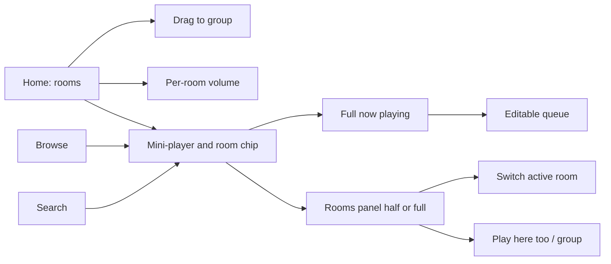
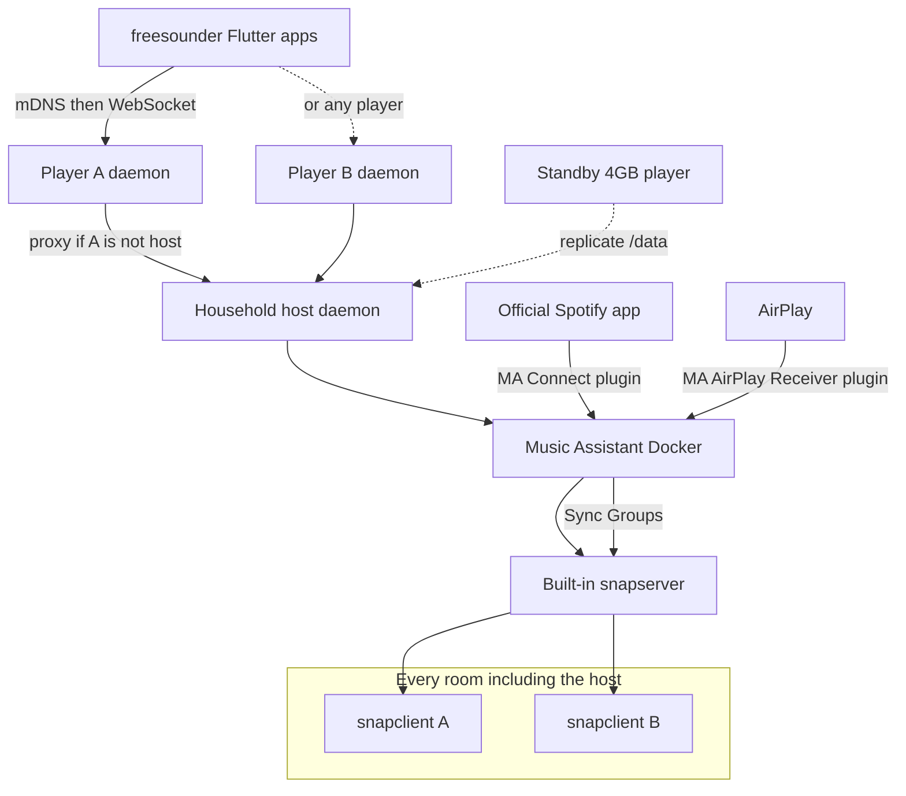

# freesounder – Architecture Research & Recommended Stack

Research snapshot as of **10 November 2026, Australia/Melbourne**, revised later the same day so v1 keeps a **full in-app catalogue** with Music Assistant **embedded on an elected household-host player** — still no separate server box. GitHub star counts and release metadata were looked up from the GitHub API on that date unless another source is named. Timestamps originally in UTC are converted to Australia/Melbourne (UTC+11). Hardware prices are GST-inclusive AUD from named retailers, fetched or re-checked the same day. Numbers are cited, not invented.

**Public repo:** [https://github.com/mhatzis/freesounder](https://github.com/mhatzis/freesounder) (Apache License 2.0).

A companion Page with the same findings is here: [freesounder – Architecture Research & Recommended Stack](https://cursor.com/canvas/store-1e1f00a9-5a68-4935-844e-05e60d7c3684/36256424-0c34-4af8-91ca-18271424bb71).

---

## 1. Recommendation

freesounder should not clone the Sonos *app*, but it should stay Sonos-shaped: **no separate server box**. Everything that must stay on for music runs on the room players and in the Flutter app. v1 **must** offer a full in-app catalogue (browse and search Spotify, Tidal, Qobuz, radio, local files, and the other providers Music Assistant already has) in that Flutter app. The user accepts **4 GB-class** players for that.

**Superseded (later on 10 November 2026, Australia/Melbourne):**

- The earlier **dedicated Music Assistant + snapserver host** (a cupboard PC/NAS/Pi that is not a room player) remains withdrawn.
- The short-lived **ingress-only v1** (Connect/AirPlay/radio/files, no in-app catalogue, MA out of the runtime) is also withdrawn. Catalogue in the app is a v1 requirement.

The hybrid principle is unchanged: reuse mature programs as separate processes; own the control API, apps, setup and player image.

**Recommended stack (player-only, MA on an elected household host, locked for v1)**

| Layer | Choice |
|---|---|
| System shape | **Sonos-shaped, with one household library.** Every player ships the same image. Exactly **one** 4 GB-class player at a time is the **household host**: it runs Music Assistant (Docker, official image) and MA’s **built-in snapserver**. All rooms, including the host, run `snapclient` pointed at that host. A second 4 GB player can be a **standby** and receive a replica of MA’s `/data`. Cheaper boards may be **members only** (`snapclient` + daemon). The app talks to **any** player; that player **proxies** to the current host’s MA API. |
| Control apps | **Flutter**, rooms-first UI and global rooms panel (§2.7). Browse/search/queue in-app against MA via our facade. Do not ship the MA/Iris/Snapweb UIs as the product face. |
| Player daemon / control API | Python daemon on **every** player: mDNS, household-host election, `/data` replication, starting/stopping MA Docker **only** on the elected host, pointing `snapclient` at the host, and a facade over the host’s Music Assistant WebSocket API plus our own setup/household endpoints. |
| Library / providers | **Music Assistant**, unmodified, official Docker image, **only on the household host**. One library, one set of provider logins, MA queues and Sync Groups. |
| Sync layer | **MA’s built-in Snapcast server** on the household host (default in the [Snapcast provider](https://www.music-assistant.io/player-support/snapcast/)). Groups are MA Sync Groups, which move clients between groups/streams on **one** snapserver — no `snapclient` host change on ordinary regroup. Built-in server is **48 kHz / 16-bit**. Sendspin remains a technical preview. |
| Ingress | **MA Spotify Connect** and **MA AirPlay Receiver** plugins on the host, exposing each MA player (or group) in the official Spotify and Apple AirPlay pickers ([Spotify Connect plugin](https://www.music-assistant.io/plugins/spotify-connect/), [AirPlay Receiver](https://www.music-assistant.io/plugins/airplay-receiver/) — the latter still early). Advertisements come from the household host, not each Pi’s IP; audio still plays in the chosen room via Snapcast. Do not also run a second shairport-sync/librespot stack on every member in v1 (duplicate devices, conflicting NQPTP). |
| Discovery | **mDNS / DNS-SD**: every player, plus a stable name for the current household host (so apps and Home Assistant do not depend on a raw DHCP IP). |
| Shared state | Room/household setup in the daemon; library, tokens, queues and MA settings in MA’s `/data` on the host. **First beta: backup and restore of `/data`** (no live replication, no automatic failover). |
| Home Assistant | **Optional.** Point the official [`music_assistant`](https://www.home-assistant.io/integrations/music_assistant/) integration at the household host (mDNS/URL). Do not install MA as an HAOS app on a separate HA box as the *required* path. Note the failover/address caveat in §5. |
| Hardware | **At least one Pi 4 4GB or Pi 5 4GB** (Ethernet preferred) per home as host-capable. Other rooms may be cheaper snapclient members. See §6. |
| What we build vs reuse | **Hybrid.** Own the daemon/facade, Flutter apps, setup and player image. Reuse Music Assistant (Docker), its built-in snapserver, and `snapclient` as separate processes. See §7. |

Avoid Bluetooth and Pulse/PipeWire hops on synced players. Do not use PipeWire/ROC as the house clock. Prefer Ethernet on the household host. Beta distribution and next steps: [docs/development.md](development.md).

---

## 2. UI/UX redesign (top priority)

The user finds the Sonos app unfriendly. That is the design brief: **much cleaner, simpler, more intuitive, modern and minimal**, with easy multi-room control, very clear now-playing, and simple group management. It is not a request to imitate Sonos.

### 2.1 What the 2024 Sonos app backlash documented

On 7 May 2024 Sonos replaced the S2 controller with a redesigned app. The public record is consistent:

- [The Verge, 8 May 2024](https://www.theverge.com/2024/5/8/24151704/sonos-new-app-bad-reviews-missing-features) reported missing sleep timers, broken or unusable local-library search, no in-app queue editing, and a **regression in accessibility**. System control had “taken somewhat of a backseat to music control.” There was **no way to downgrade** to the previous S2 app on iPhone.
- [WIRED, “Many People Do Not Like the New Sonos App”](https://www.wired.com/story/people-do-not-like-the-new-sonos-app/) described almost total condemnation on Reddit and audio forums. Missing or broken: sleep timers, alarms, **precise volume**, add-to-end-of-queue, Wi-Fi management, adding speakers, and local library search. A VoiceOver user called it “an accessibility disaster”: “As a blind guy, I now have a system that I can hardly use.”
- [The Verge, 14 May 2024](https://www.theverge.com/2024/5/14/24156703/sonos-app-redesign-new-ama-complaints) covered a community AMA. Customers asked why the app shipped below parity after **private beta testers had already raised concerns**, with **no open beta** and no warning in launch emails that features were gone. Alarms had been remotely disabled on launch morning because of a data-corruption bug.
- More than two months later, CEO Patrick Spence apologised and listed overdue work on library browse/search, **volume responsiveness**, alarm reliability and playlist edit mode ([WIRED](https://www.wired.com/story/sonos-admits-its-recent-app-update-was-a-colossal-mistake/)).

Some reviewers noted the new app felt sleeker or more responsive for large systems. The failures that matter for freesounder are: a music-store home that demoted rooms and volume, shipping a redesign that *removed* working features, accessibility regressions, and a forced cutover with no downgrade.

### 2.2 Design principles

1. **Rooms and volume first, not a music-store home.** Everyday use is: which rooms are on, what is playing, how loud, who is grouped. Discovery is one tap away, never the only screen.
2. **Do not ship a redesign that removes working features.** Queue edit, local library search, add-a-speaker, sleep timer, alarms and precise volume belong in the first release. No forced, un-downgradeable cutover.
3. **Volume is a primary control.** Immediate, precise, one-tap per room, plus a group master. Never hide numeric volume behind a gesture-only slider with no value.
4. **Now-playing is persistent and obvious.** Artwork, title, artist, rooms in the group, transport and volume stay visible on every tab.
5. **Grouping is a two-second task.** The rooms panel is available from every screen. Drag a room onto another, or use Play here too, checkboxes or presets. Ungroup is just as easy.
6. **Accessibility is a launch requirement.** VoiceOver, TalkBack, Dynamic Type, captions, keyboard and large hit targets are tested before release.
7. **Local libraries are first-class.** Browse and search of a NAS or server library must work as well as a streamer catalogue.
8. **Minimal, not empty.** A calm, modern layout. Power features (EQ, sleep timer, queue edit) are findable, not deleted in the name of simplicity.

### 2.3 How existing controllers compare on UX

Ratings below are a **qualitative assessment** by this research as of 10 November 2026, Australia/Melbourne. They are not a user study. They judge closeness to a clean, rooms-first household remote — not audiophile depth or feature count.

| Controller | UX for household control | Strengths | Why it is not the freesounder UI |
|---|---|---|---|
| Music Assistant web UI + official mobile app | Strongest current OSS baseline | The 2.10 player bar puts select, group and volume up front ([MA 2.10 blog](https://www.music-assistant.io/blog/2026/08/26/music-assistant-2-10/)). Official [KMP iOS/Android app](https://github.com/music-assistant/mobile-app) (Apache-2.0). Strong multi-source library. | Still a power-user / Home Assistant music engine. Use as **backend**, not as the face of freesounder. |
| Volumio Nova | Visually strong, paid for multi-room | Large artwork, large targets, one-tap grouping, accessibility settings (docs claim 56px targets, text size, screen reader) — [volumio.com/nova](https://volumio.com/nova/). | [Multi-room sits behind Premium](https://help.volumio.com/en/articles/121-how-does-the-multiroom-work) (up to 6 devices on a paid plan). Not acceptable as the core of a free public project. |
| Lyrion Material Skin | Good music-player UI | Modern Material web UI; mobile-first browse / now-playing / queue. Reviewers have called it one of the best non-Roon player skins ([Ryan Feeley interview](https://ryanfeeley.com/squeezing-every-last-drop-with-material-skin/); [Antipodes forum](https://antipodes.support/t/material-web-player/43)). Repo: [CDrummond/lms-material](https://github.com/CDrummond/lms-material) (410 stars; 6.4.14 published 16 October 2026, 4:52 pm Australia/Melbourne). | LMS mental model, not rooms-first. Documented drag-and-drop pain on iPhone. Default LMS skin is dated. |
| Mopidy Iris | Good, server-centric | Attractive web UI, queue, Snapcast client list and per-client volume ([jaedb/Iris](https://github.com/jaedb/Iris)). | Feels like a music server with a nice face. Snapcast is a panel, not a rooms home. |
| Snapweb | Functional, narrow | Groups, per-client volume, browser playback. | Not a library or now-playing product. The browser tab must stay open to keep playing ([MA Snapcast notes](https://www.music-assistant.io/player-support/snapcast/)). |
| moOde WebUI | Functional, specialist | Deep renderer and DSP controls; actively maintained (10.3.7). | Built for a single audiophile player (plus moOde’s own sender/receiver mode), not a household rooms remote. |
| Snapdroid / older LMS remotes (Squeezer, iPeng) | Uneven or stale | Snapdroid can be an Android Snapcast endpoint. iPeng is a mature but commercial iOS LMS controller. | Snapdroid lags current Snapcast (v0.29.0.2, 3 December 2024). Music Assistant documents the **iOS Snapcast app as broken**. Squeezer-class apps are not a modern design system. |

### 2.4 Client technology — why Flutter

The iOS, Android and web clients must share one visual language: typography, spacing, room tiles, grouping gestures and now-playing.

- **Flutter** draws its own widgets and lists [web as a supported target](https://docs.flutter.dev/platform-integration/web) for app-like UIs. That is the most direct way to keep a custom, non-Material-clone design identical on every client. Flutter web is the right fit for a LAN control surface, not for an SEO marketing site.
- **Kotlin Multiplatform + Compose** is excellent for Android-first teams and is what Music Assistant’s official app uses, but Compose for web is the less mature target (JetBrains still treats Compose for web as a beta-class target in public framework comparisons).
- **React Native + a separate React web app** shares language more than pixels, and tends toward native widgets rather than one designed system.
- **Pure Swift / Kotlin + a third web app** would give the best platform conventions, at the cost of three implementations of grouping and now-playing — too easy to drift for an early public project.

**Recommendation:** one Flutter workspace for iOS, Android and web, with a small in-repo design-system package (tokens, room tile, now-playing bar, volume control, grouping gestures). Use Flutter’s accessibility APIs (Semantics, screen readers, text scaling) from day one. Low-level audio on a phone (if the handset later becomes a synced speaker) can be a thin platform plugin; control UX stays in Dart.

### 2.5 Information architecture

Four top-level destinations, **always with a persistent now-playing bar**:

- **Home** — rooms first
- **Browse** — library and services
- **Search**
- **You** — favourites, queue, playlists (a small shelf, not a fifth “providers” tab)

Settings and speaker setup live behind a single gear on Home, and in first-run onboarding. No tab named “Providers”, “Players” or “Sources” in the main chrome.

**Home.** One large tile per room: name, playing or idle, a short track line if active, and volume on the tile. Grouped tiles share a visual bind (outline or a joined block). Tapping a tile selects that room and expands now-playing for its group. A **group master volume** appears whenever two or more rooms are bound.

**Grouping.** The rooms panel (§2.7) is the always-reachable control for this. On Home, drag one room tile onto another to group, or use Play here too, checkboxes and presets in the panel. Ungroup is just as easy. Offer undo for a few seconds after a group change. Pinch-to-group is a welcome extra on tablets, not the only path.

**Persistent now-playing.** Mini bar on every screen: artwork, title, artist, play/pause, compact volume, plus a dedicated **room or group chip**. Tapping the artwork or title opens the full now-playing sheet (large art, scrubber, **editable queue**, lyrics, sleep timer). Tapping the room chip, or swiping the bar upward, opens the rooms and grouping panel (§2.7) — it does not leave the current screen. Lock-screen and OS media controls show the same title and transport.

**Onboarding / add speaker**

1. Connect to the home network. The app looks for a freesounder server over mDNS. If none, it offers setup instructions or a first-server wizard.
2. Name the house and the first room. **No account is required.** Cloud login is never a gate.
3. Find speakers. New Pi players advertise themselves; the user names the room and can test a chime.
4. Add music. Local folder or NAS first, then optional streaming sign-in. Each service states limits and Terms-of-Service risks in plain language before connect.
5. Play something. End on Home with one room selected and a suggested album or radio station, so the first session is a successful play.

**Accessibility.** Every room tile, volume control and group action has a spoken name and value (“Kitchen, 40 percent, grouped with Living”). Colour is never the only group cue. Hit targets at least 44 pt (iOS) and 48 dp (Android); text scales with the system; reduce-motion is honoured. Keyboard on web: space to play/pause, arrows for skip and volume, a shortcuts sheet.

### 2.6 Early wireframes

Home, rooms-first, with a persistent bar. Grouped rooms share a bracket:

```
+--------------------------------------+
|  freesounder              (settings) |
|  Home    Browse    Search            |
|                                      |
|  [ Kitchen    PLAYING          40% ] |
|  [ Living     PLAYING          25% ] |  <- same group
|  [ Office     idle              0% ] |
|                                      |
|  Group: Kitchen + Living      35%    |
|                                      |
+--------------------------------------+
|  art   Night Moves — Bob Seger  |>   |
|        Kitchen + Living         35%  |
+--------------------------------------+
```

Full now-playing sheet:

```
+--------------------------------------+
|  v  Now playing                      |
|         [  album art  ]              |
|      Night Moves                     |
|      Bob Seger · Beautiful Loser     |
|      ========o--------------  1:21   |
|      <<         ||          >>       |
|                                      |
|  Playing in                          |
|  Kitchen                     40% === |
|  Living                      25% ==  |
|  [ + Add room ]   [ Ungroup all ]    |
|  Group master                    35% |
|                                      |
|  Up next (drag to reorder, swipe)    |
|  • Mainstreet                        |
|  • You'll Accomp'ny Me               |
+--------------------------------------+
```

Information architecture:



### 2.7 Rooms and grouping panel — always reachable

A specific complaint about Sonos is that **changing players and grouping is terrible**: those controls are buried, inconsistent, or require leaving the screen you are on. freesounder should put room selection and grouping in a panel that is reachable from Home, Browse, Search, Now Playing and Settings, without losing your place.

**Recommended mobile pattern:** a hybrid. A persistent mini-player with a room or group chip expands into a **bottom sheet with three detents** (collapsed, half, full). On tablets and landscape, and on desktop web, the same list becomes a persistent trailing side rail. Do not use a phone side drawer as the primary pattern, and do not make Rooms a place you have to navigate to in order to switch.

#### Why this pattern, and not the alternatives

On a phone, the lower third of the screen is where the thumb already rests. Media apps (Apple Music, Spotify, YouTube Music, Material 3 sheets) already teach “swipe up the mini-player.” A bottom sheet with detents keeps Browse or Search visible behind a scrim, so switching Office while looking at an album does not reset navigation. iOS sheet detents and Android Material 3 modal bottom sheets are the platform-native containers for this.

A leading side drawer is a poor primary control on a phone: the handle sits in a hard-to-reach corner, it fights the back affordance, and it is not how people expect to change speakers. A rooms-only tab repeats the Sonos problem — you leave Search to change rooms. A fully persistent list that steals a third of a phone screen is too heavy. The hybrid keeps the list one gesture away, and uses the extra width of a tablet or desktop for an always-on rail instead.

#### The three detents on a phone

**Collapsed** (always visible, sitting above the tab bar): mini-player (artwork, title, artist, play/pause, compact volume) plus a room chip labelled with the active room or “Kitchen + 2”, a grab handle, and a group cue when rooms are bound. Tap artwork or title for Now Playing. Tap the chip, swipe up, or swipe left/right on the bar to work with rooms.

```
+--------------------------------------+
|  Browse: albums                      |
|  ... current screen stays here ...   |
+--------------------------------------+
|  = handle                            |
|  [art] Night Moves        [Kitchen+] |  <- room chip
|        Bob Seger     35%       ||    |
+--------------------------------------+
|  Home     Browse     Search     You  |
+--------------------------------------+
```

**Half sheet** (about half the screen): the room list. The active room is clearly selected. Each row has name, playing or idle, a short track line, a Play here too control, and an optional checkbox. Tapping the row name switches the active room and can auto-collapse the sheet. Grouped rows share artwork, a common outline and a text label (colour is never the only cue). A status pill shows Synced, Syncing, or Can’t reach Kitchen.

```
+--------------------------------------+
|  Browse still dimmed behind          |
+--------------------------------------+
|  = Rooms                    [Edit]   |
|  Now controlling Kitchen + 2         |
|                                      |
|  [*] Kitchen     Night Moves    40%  |
|      Playing here                    |
|  [*] Living      Night Moves    25%  |
|      Play here too          [on]     |
|  [ ] Office      idle                |
|      Play here too          [  ]     |
|                                      |
|  Presets: Evening   House   Upstairs |
+--------------------------------------+
```

**Full sheet:** group master volume, per-room sliders with numeric values, Ungroup, Save as preset, and room health. This is also where a user fine-balances a party without opening Home.

```
+--------------------------------------+
|  = Rooms                             |
|  Group master                    35% |
|  =================================   |
|  Kitchen                         40% |
|  Living                          25% |
|  [ Ungroup all ]  [ Save preset ]    |
|  Evening · House · Upstairs          |
|  Kitchen + Living    Synced          |
|  Office              idle, reachable |
+--------------------------------------+
```

#### Fast switching, without leaving the screen

- Tap the room chip to open the half sheet; tap another room to make it the active control target. The album, search results or settings page stay put. The chip label updates immediately.
- Swipe left or right on the collapsed mini-player to cycle rooms or existing groups, with a light haptic. A short toast or chip animation confirms the new target.
- Long-press the chip for a shortcut list: recent rooms and group presets, so a two-room household can switch in one hold.
- On Home, tapping a room tile still selects that room; it is the same store, not a second notion of “current player.”

#### Intuitive grouping

Offer more than one way in, and keep them consistent. **Checkboxes** and **Play here too** are the primary phone methods, because they are accurate one-handed and accessible. **Drag** is excellent on tablets and the web, and remains available on Home tiles and in the sheet.

- **Play here too:** one tap on a room row joins it to the current group and starts the same queue; tap again to leave. This is the fastest “I walked into the kitchen” action.
- **Multi-select:** Edit or a checkbox on each row, then the selected rooms become the group. Good for setting three rooms at once.
- **Drag** a room row onto another (or a Home tile onto another) to group; drag out to leave. Show a drop target and a short haptic on success.
- **Group presets or scenes** (Evening, House, Upstairs) pin at the top of the half sheet. Tapping a preset applies membership only; it does not have to change the track unless the user has saved it that way later.
- After every group change, an **undo snackbar** stays up for about eight seconds (“Living joined Kitchen + Living” / Undo).
- **Visual feedback:** grouped rows share now-playing artwork, a linked outline and a written group name. A sync pill tells the truth if a room cannot be reached. **Group master** volume sits above per-room sliders in the full sheet; moving the master scales members, a member slider then diverges on purpose.

#### Consistent access from every screen

In the Flutter app the mini-player and rooms sheet are a **shell overlay**, not a page in the navigation stack. Tabs and pushed routes (album, search, settings, the full Now Playing sheet) render underneath. Opening the rooms panel does not dispose the route you were on. Now Playing can still open the same rooms sheet from its own chip — there is one panel, not a second copy with different rules.

All screens read **one rooms-and-playback store**. The store is the source of truth for the active room, group membership, volumes, now-playing metadata and sync health. It subscribes to the control API WebSocket so a second phone, a hardware button or a Home Assistant automation updates the chip and list in real time.

#### Web, tablet and keyboard

From a medium breakpoint upward (tablet landscape and desktop web, roughly 900 px and above), use a **persistent trailing rooms rail** — right-hand in left-to-right layout — instead of a sheet. The rail shows the same rows, Play here too, presets, and a compact group master. Narrow web widths collapse to the phone bottom sheet so a phone-sized browser window does not grow a cramped sidebar. Drag and drop is a first-class grouping method on the rail and on the Home grid.

Keyboard shortcuts: `R` opens or focuses Rooms, `1`–`9` select a room, `[` and `]` cycle, `G` toggles Play here too on the focused room, `Shift+G` ungroups, plus the existing space / arrows for play and volume. A shortcuts sheet lists these.

#### Key interaction flows

1. **Switch room while browsing an album.** You are on an album in Browse. Tap the Kitchen chip (or swipe up). The half sheet lists rooms; Browse stays dimmed behind. Tap Office. The chip reads Office, the sheet collapses, the album is still on screen. Play now starts in Office, not Kitchen.
2. **Play this in the kitchen too.** Living is playing. Walk in with the phone, swipe up, tap Play here too on Kitchen. Kitchen joins, both rows show the same art, a snackbar offers Undo. You never left whatever screen you had open.
3. **Build a house group, then undo.** Open the half sheet, turn on Edit, check Kitchen, Living and Office, done. The chip reads Kitchen + 2. A snackbar offers Undo for eight seconds. Full detent is available if you want to balance volumes.
4. **Balance volume in a group.** Swipe the sheet to full. Move Group master to set the house level, then trim Living down. Numeric values stay visible. The collapsed chip can show the master value while a group is active.

#### Accessibility and haptics

- Do not require drag to group. VoiceOver and TalkBack **custom actions** on each room row: Switch to this room, Play here too, Leave group, Adjust volume. The row name and value are spoken (“Kitchen, 40 percent, grouped with Living, synced”).
- Hit targets at least 44 pt on iOS and 48 dp on Android, including the room chip and Play here too. The chip is a real control, not only a label.
- Light haptics on room switch, successful group, and volume tick marks, honouring system haptic and reduce-motion settings. Announce group changes so a screen-reader user hears “Living joined Kitchen and Living.”
- Focus order in the sheet is handle, group name, presets, then rooms. Escape or a downward swipe closes to collapsed without changing the selection.

#### Architecture and stack implications

The panel is a reason to treat the Flutter client as a real-time control surface, not a page that refetches on navigate. Put a rooms-and-playback store in `packages/api_client` (or a sibling package) and keep the sheet widgets in `packages/design` so web and mobile share them.

- **Control API:** subscribe to WebSocket events for player added or removed, group membership, per-room and group volume, now-playing, and reachability. Commands needed: set active control target, join or leave a group, replace group membership, set member volume, set group master volume, list and apply presets. If Music Assistant’s API is awkward for “active target” versus “play here too”, add a thin freesounder facade rather than bending the UI.
- **Optimistic UI:** the chip, selection and group outline update on tap, before the server replies. If the command fails or a later event disagrees, revert and show a short error. Volume sliders move immediately; send updates while dragging (about 30–50 ms debounce) and do not wait for a round trip to paint the thumb.
- **Design targets, not measured backend figures:** switching the active room should feel instant (aim to paint the new chip within about 100 ms). Volume should feel continuous. Group join may take longer on the audio path because Snapcast’s default end-to-end buffer is 1000 ms — the UI must not pretend the new room is already audible if it is still buffering; show Syncing until the server reports the room is in lock.
- Two phones can change the same group. Last accepted server state wins; both clients follow the event stream. An offline room stays in the list, marked unreachable, and cannot be the silent victim of a group change.

---

## 3. Building blocks (2025–2026)

### 3.1 Snapcast — recommended sync layer

- **Role:** Client–server distribution. Not a music library. Several sources can run in parallel; clients group onto a stream. [README](https://github.com/snapcast/snapcast).
- **Sync:** Server timestamps encoded chunks over TCP. Clients keep server time and add/drop samples. Soft correction is limited to about ±0.05% of sample rate; hard resync triggers if drift exceeds documented thresholds (around 2–50 ms depending on the window, or 500 ms absolute age).
- **Accuracy / latency:** README: typical deviation **below 0.2 ms**. Default **end-to-end buffer 1000 ms**, which *is* the start/stop latency ([configuration](https://github.com/snapcast/snapcast/blob/master/doc/configuration.md); [MA Snapcast provider](https://www.music-assistant.io/player-support/snapcast/) exposes 200–6000 ms). Default FLAC codec latency ~26 ms; PCM has none; Opus may resample to 48 kHz.
- **Grouping:** Groups, per-client volume and mute, JSON-RPC on port 1705. Stream 1704, Snapweb 1780. Music Assistant may also use dynamic ports in 4953–5153.
- **Clients:** snapclient on Linux (ALSA recommended), macOS, Windows, FreeBSD; [Snapweb](https://github.com/snapcast/snapweb); [Snapdroid](https://github.com/snapcast/snapdroid). Music Assistant: the **iOS Snapcast app is broken** (old snapclient).
- **Licence:** GPL-3.0 — run as a **separate process**.
- **Maintenance:** [snapcast/snapcast](https://github.com/snapcast/snapcast) **8,056** stars. **v0.35.0** published 11 March 2026, 1:35 am Australia/Melbourne. Last push 3 November 2026, 6:55 pm Australia/Melbourne. Actively maintained; one main author.
- **Weaknesses:** The 1 s default buffer is audible on play/pause/skip. Pause is awkward (MA implements stop/resume). Bluetooth and PulseAudio/PipeWire output can drift ([discussion #1487](https://github.com/snapcast/snapcast/discussions/1487)). MA: do not use Snapcast **0.30.0** with Music Assistant; 0.28.0 is 64-bit only.

### 3.2 Music Assistant — household-host engine (embedded, not a separate box)

MA is designed as an always-on **server** ([installation guide](https://www.music-assistant.io/installation/): 2 GB RAM minimum, **4 GB+ if anything else shares the box**, Pi 4 or newer). In this architecture that server **is a room player**: the elected 4 GB household host, officially in **Docker** (native/pip installs are unsupported). It is not a cupboard appliance and not an in-process library we fork.

- **Role:** Combined library, queues, streaming providers, player grouping, WebSocket API, optional Home Assistant. Built-in or external Snapcast; Sendspin is its own sync preview.
- **Sync / grouping:** Can drive Snapcast groups. [Sendspin](https://www.music-assistant.io/player-support/sendspin/) aims to keep rooms close enough to avoid an echo; **no numeric accuracy published**; status **technical preview**. 2.10 redesigned the player bar around select, group and volume. Per-player delay 0–5000 ms where supported.
- **Clients:** Vue [frontend](https://github.com/music-assistant/frontend); official [mobile-app](https://github.com/music-assistant/mobile-app) (Kotlin Multiplatform, Apache-2.0, 719 stars; iOS 1.0 build 54 and Android 0.16.0 published 27 October 2026, 12:28 pm / 12:11 pm Australia/Melbourne — not treated as store-listed in this research); official [desktop-app](https://github.com/music-assistant/desktop-app) 0.7.4 (2 November 2026, 10:09 am Australia/Melbourne).
- **Licence:** Apache-2.0.
- **Maintenance:** [music-assistant/server](https://github.com/music-assistant/server) **3,298** stars. Stable **2.10.9** published 31 October 2026, 12:01 am Australia/Melbourne. 2.11.0 in beta (b8 on 3 November 2026, 12:35 am). Very active nightlies.
- **Weaknesses:** Power-user UX. Some providers unofficial or ToS-grey. Sendspin still preview. Built-in snapserver only accepts connections from MA if used in that mode.

### 3.3 Mopidy + Iris

- **Role:** Python music server (GStreamer, MPD + JSON-RPC) plus a polished web UI. Classic pattern: Mopidy → `snapfifo` → snapserver.
- **Sync:** None on its own; Snapcast does the rooms. Iris has a Snapcast panel (volume, mute, groups).
- **Licence:** Apache-2.0 for both.
- **Maintenance:** [mopidy/mopidy](https://github.com/mopidy/mopidy) **8,608** stars, **v4.0.5** on 16 October 2026, 9:46 pm Australia/Melbourne. [jaedb/Iris](https://github.com/jaedb/Iris) **1,240** stars; last release **3.70.0** on 3 May 2025, 7:50 pm Australia/Melbourne, but still pushed (1 November 2026).
- **Weaknesses:** One local output unless you add Snapcast. Mopidy-Spotify has been fragile since libspotify was withdrawn. Less complete as an all-in-one engine than Music Assistant in 2026. Fallback, not the default.

### 3.4 Lyrion Music Server + squeezelite (+ piCorePlayer)

- **Role:** The Squeezebox line (formerly Logitech Media Server). LMS is the server; squeezelite is a headless player. [piCorePlayer 11.1.0](https://docs.picoreplayer.org/releases/pcp1110/) (1 March 2026) is a dedicated player image and documents Squeezelite 2.0.0-1542.
- **Sync:** Server compares reported elapsed time and issues skip-ahead / adjust commands; network latency measured or set manually ([Synchronization wiki](https://wiki.lyrion.org/index.php/Synchronization.html)). **No official sub-millisecond figure** found. Community reports generally good results on a stable network; poor Wi-Fi can desync a group.
- **Grouping:** First-class Synchronize / unsync. One server can also feed different queues to different players. WiiM documents a **maximum of two** WiiM devices in one LMS group ([WiiM FAQ](https://faq.wiimhome.com/en/support/solutions/articles/72000660942-how-to-use-lms-group-playback-on-wiim-devices)).
- **Clients:** Web (default + Material Skin), squeezelite / piCorePlayer, many remotes (some commercial, e.g. iPeng).
- **Licence:** LMS Perl code is **GPL-2.0** ([License.txt](https://github.com/LMS-Community/slimserver/blob/master/License.txt); some bundled components differ). squeezelite is **GPL-3.0**.
- **Maintenance:** [LMS-Community/slimserver](https://github.com/LMS-Community/slimserver) **1,819** stars. Tag **9.1.1**, commit 27 May 2026, 4:12 am Australia/Melbourne; [lyrion.org/downloads](https://lyrion.org/downloads/) lists 9.1.1 (26 May 2026). No GitHub Releases feed. [ralph-irving/squeezelite](https://github.com/ralph-irving/squeezelite) **513** stars, no GitHub Releases, pushed 29 October 2026, 5:45 am Australia/Melbourne.
- **Weaknesses:** Default UI is dated (Material Skin helps). Spotify plugins have had Connect breakage (community reports; some workarounds via library integration). Weaker published sync-accuracy claims than Snapcast. Alternative architecture if the team prefers that ecosystem.

### 3.5 PipeWire, PulseAudio RTP, ROC

- **Role:** Desktop audio fabric. [PipeWire](https://gitlab.freedesktop.org/pipewire/pipewire) has ROC sink/source modules. [ROC Toolkit](https://roc-streaming.org/toolkit/docs/about_project/features.html) streams RTP with FEC and clock-drift compensation.
- **Sync:** Configurable target latency and drift compensation. Community multi-room guides stress matching `sess.latency.msec` and manual delays; this is **not** Snapcast-style sample-timed play-out, and resync after restarts is a known pain.
- **Licence:** PipeWire source is **MIT** except some LGPL (e.g. libspa-alsa) and GPL bits (e.g. libjackserver) ([LICENSE](https://github.com/PipeWire/pipewire/blob/master/LICENSE)). ROC is **MPL-2.0**.
- **Maintenance:** GitHub mirror [PipeWire/pipewire](https://github.com/PipeWire/pipewire) **2,167** stars; tag **1.6.11** on 29 October 2026, 8:58 pm Australia/Melbourne. [roc-streaming/roc-toolkit](https://github.com/roc-streaming/roc-toolkit) **1,263** stars; last tag **v0.4.0** (14 June 2024) though the repo was still pushed in November 2026.
- **Weaknesses:** Not a rooms product. Do not use as the primary sync layer. Also avoid using PipeWire/Pulse as the *output* path of snapclient if you want stable lock.

### 3.6 shairport-sync (AirPlay 2)

- **Role:** AirPlay / AirPlay 2 speaker. In this stack, **ingress**: an iPhone or Mac hands off into shairport-sync, which feeds Snapcast so the rest of the house can join under freesounder grouping.
- **Sync:** Companion **NQPTP** (exclusive UDP **319/320**). Can stay in step with other AirPlay 2 devices in the same Apple session ([AIRPLAY2.md](https://github.com/mikebrady/shairport-sync/blob/master/AIRPLAY2.md)). Multiple instances on one host, one NQPTP.
- **Latency:** Docs reviewed do not publish a numeric multi-room figure. AirPlay buffered audio is not a low-latency path.
- **Licence:** Core files **MIT**; some bundled third-party code differs ([LICENSES](https://github.com/mikebrady/shairport-sync/blob/master/LICENSES)). Recheck if vendoring.
- **Maintenance:** [mikebrady/shairport-sync](https://github.com/mikebrady/shairport-sync) **9,016** stars. **5.6.2** published 26 October 2026, 1:17 am Australia/Melbourne (security fix + long-session timestamps). 5.6 added AirPlay 2 remote control, metadata, macOS and multiple instances. Pushed 10 November 2026, 5:15 am Australia/Melbourne.

### 3.7 librespot, raspotify, go-librespot, Spotifyd

- **Role:** Unofficial Spotify Connect receivers, or libraries others embed. Raspotify packages librespot for Debian/Pi.
- **Licence:** librespot and raspotify **MIT**; go-librespot **GPL-3.0** (do not link into the Apache binary); Spotifyd **GPL-3.0**.
- **Maintenance:** [librespot-org/librespot](https://github.com/librespot-org/librespot) **7,382** stars, **v0.8.0** on 11 November 2025, 3:58 am Australia/Melbourne, still pushed 7 November 2026. [dtcooper/raspotify](https://github.com/dtcooper/raspotify) **5,236** stars, **0.48.4** on 23 October 2026, 1:29 am Australia/Melbourne. [devgianlu/go-librespot](https://github.com/devgianlu/go-librespot) **389** stars, **v0.10.5** on 16 October 2026, 7:53 pm Australia/Melbourne. [Spotifyd/spotifyd](https://github.com/Spotifyd/spotifyd) **10,832** stars, **v0.4.2** on 19 November 2025; last push 29 May 2026, 4:31 am Australia/Melbourne (quieter).
- **Weaknesses:** [librespot disclaimer](https://github.com/librespot-org/librespot): “Using this code to connect to Spotify's API is probably forbidden by them. Use at your own risk.” Premium only. Spotify changed key delivery: **accounts created after an apparent cutoff often cannot decrypt audio** (`audio key error 0 1`); no known workaround in the README warning. Music Assistant documents the same split and offers official **Soloist** as the path for newer accounts (see §4).

### 3.8 Reference distros: Volumio, moOde, piCorePlayer

These are useful images to learn from, **not** engines to fork as the product UI.

| Distro | Notes | Maintenance |
|---|---|---|
| **Volumio** | Polished Nova UI. Multi-room, and some services, require [Premium](https://help.volumio.com/en/articles/100-what-is-volumio-premium-plan) (up to 6 devices). Backend [volumio/volumio3-backend](https://github.com/volumio/volumio3-backend) is GPL-3.0; the Volumio2 repo is stale. | Unsuitable as the core of a free public project. |
| **moOde** | [moode-player/moode](https://github.com/moode-player/moode) **1,456** stars, GPL-3.0. **10.3.7** (tag r1037) published 2 November 2026, 2:10 am Australia/Melbourne. Own sender/receiver multi-room (docs: 16-bit / 48 kHz Opus), plus AirPlay / Spotify renderers. Specialist WebUI. | Excellent Pi audio appliance; not a rooms-first consumer app. |
| **piCorePlayer** | Tiny LMS player image. **11.1.0**, 1 March 2026; 32-bit for Pi 0–3, 64-bit for Pi 4/5. Auto-discovered by Lyrion. | Use if choosing the LMS path for room players. |

### 3.9 Other notable projects

| Project | Role | Stars / release (10 Nov 2026 lookup) |
|---|---|---|
| [OwnTone](https://github.com/owntone/owntone-server) | Server that can play to AirPlay 1+2 speakers, Cast, local output; Spotify, radio, files, MPD. A *different* architecture (Apple speakers as rooms). GPL-2.0. | 2,588 stars; **29.3** on 23 July 2026, 7:50 am Australia/Melbourne |
| [AirConnect](https://github.com/philippe44/AirConnect) | Bridge AirPlay to UPnP/Sonos & Chromecast. Useful interop, not the core. | 4,229 stars; **1.12.4** on 27 September 2026, 4:08 am Australia/Melbourne |
| [Esparagus](https://github.com/sonocotta/esparagus-media-center) | Cheap ESP32 Snapcast-class room boards. Apache-2.0 media center (287 stars, pushed 5 November 2026, 9:00 am Australia/Melbourne; no GitHub Releases). snapclient helper is BSD-3-Clause. | Later-phase hardware experiment |
| Sendspin | MA’s own sync, used by the web player and official mobile app. Spec at [github.com/Sendspin/spec](https://github.com/Sendspin/spec). **Technical preview.** | Candidate to revisit once it leaves preview |

---

## 4. Streaming services — realistic paths

In the player-only model, Music Assistant on the **household host** owns the library and provider logins. The Flutter app browses that catalogue. Official Spotify / Apple apps can still push audio in through MA’s Connect and AirPlay Receiver plugins (which expose each room player).

An open-source project can use official APIs, official Connect-style partner programs, or unofficial reverse-engineered clients. The last group can break or be blocked at any time and may conflict with a service’s terms. freesounder should label unofficial paths clearly, never ship ripped or decrypted files, and prefer official engines when they exist.

### Spotify

- **Path A — Music Assistant Soloist.** Official playback engine for screenless devices, downloaded from Spotify during setup. MA documents lossless up to **24-bit / 44.1 kHz**, one player at a time per account, works with accounts created since December 2024. Setup needs a personal API key and pairing. [MA Spotify docs](https://www.music-assistant.io/music-providers/spotify/): Spotify’s terms **do not clearly allow** using Soloist this way; use at your own risk. MA may not distribute Soloist itself.
- **Path B — Connect receiver** (raspotify/librespot) so the official Spotify app can target a room, with audio fed into Snapcast. Typically Ogg Vorbis up to 320 kbps. **Premium required.** Often **fails on newer accounts** (librespot README warning; MA “Key Error” notes).
- **Decision (10 November 2026):** support **both**, **user-selectable**: Soloist for in-app catalogue play (ToS warning required) and go-librespot Connect for handoff from the official Spotify app (disclose the post-2024 account limits). Do not rely on either path alone.

### Apple Music

- **Primary:** AirPlay 2 from an iPhone, iPad or Mac into shairport-sync, then Snapcast. This is Apple’s supported speaker model.
- **Secondary:** [MA Apple Music provider](https://www.music-assistant.io/music-providers/apple-music/) for in-app browse and play. Paid subscription required. MA: **AAC 256 kbps** maximum; lossless and Atmos are not available; playback is **not officially supported by Apple**; tokens expire after 180 days; gaps of up to five seconds between tracks.
- Third-party **MusicKit** integrations (e.g. Bluesound’s October 2026 native support) are widely reported as capped at 256 kbps AAC ([SoundGuys](https://www.soundguys.com/apple-music-lossless-third-party-apps-165683/), [MacRumors](https://www.macrumors.com/2026/10/21/bluesound-adds-native-apple-music-support/)). Some vendors document a Mac *system output* AirPlay path at 16/44.1 ALAC; that workaround is not available on iPhone.

### Tidal

- **In-app:** MA’s OAuth [Tidal provider](https://www.music-assistant.io/music-providers/tidal/) — catalogue, favourites, up to **FLAC 192 kHz / 24-bit** on Max.
- **Tidal Connect:** [Official docs](https://developer.tidal.com/documentation/connect) state integrations are **for device partners only**. The public SDK player module is documented as **preview playback** for third parties, not Connect. Community Docker images wrap unofficial binaries; moOde maintainers have declined them as not open source. **Do not ship those binaries.**

### Qobuz

- MA provider with username/password in current docs; up to **FLAC 192 kHz / 24-bit** ([MA Qobuz](https://www.music-assistant.io/music-providers/qobuz/)). Official Qobuz API access is partner-issued (app id and secret; [API terms](https://static.qobuz.com/apps/api/QobuzAPI-TermsofUse.pdf)). Store credentials locally and document the login model.

### Deezer

- Listed as a [MA music source](https://www.music-assistant.io/faq/listen-to/). Prefer official OAuth. Treat unofficial tokens (ARL, etc.) as brittle and possibly against terms. This research did not treat a secondary summary as enough evidence for a bitrate number; confirm against the live MA Deezer provider page at implementation time.

### TuneIn / radio and local library

- Internet radio via MA or similar directories, plus **local files and NAS** (optional Jellyfin/Plex). Local libraries must remain first-class (a direct lesson from the 2024 Sonos app). Radio directory terms vary.

---

## 5. Reference architecture

There is still **no cupboard server**. There *is* one elected **household host player** that runs Music Assistant and the built-in snapserver. All other rooms are snapclients (the host also plays locally through a snapclient). The Flutter app discovers any player on the LAN and reaches MA through that player’s proxy.

### 5.1 Why exactly one Music Assistant process

Music Assistant is a **household-wide** service: one library, one set of provider logins, queues, and player/group state. Official install docs describe a single always-on server with its persistent store under the Docker **`/data`** volume ([installation](https://www.music-assistant.io/installation/)). Maintainers describe native/non-container production installs as **unsupported**; the supported standalone path is the official container with host networking.

| Topology | Verdict |
|---|---|
| **Exactly one household host** (recommended) | Matches how MA is built. Election prefers **Ethernet + most RAM** (then a stable tie-break). A second 4 GB player is a **standby**. Only one MA container is ever running, so SQLite in `/data` has a single writer. |
| MA on every player | Rejected. Duplicate libraries and logins, two writers, and 4 GB RAM on every room. |
| MA only on the current *group* audio coordinator | Rejected. Two rooms can play different queues at once from **one** MA; moving the whole library process whenever a group changes would drop the catalogue and every other group. Audio grouping and the library host are different jobs. |

**Failover (design; MA does not document an official HA/failover product).** While the host is healthy, the daemon **replicates `/data`** (provider tokens, `library.db` / settings — not a throw-away cache if data and cache are split) to every standby 4 GB player, over the LAN, with the store readable only by the daemon (tokens are secrets). On host failure: elect a new 4 GB host, start the official MA container on the latest replica, move the household mDNS name, and tell every `snapclient` to connect to the new address (this *is* a snapclient retarget, so a restart — [snapcast#527](https://github.com/badaix/snapcast/issues/527)). Never start a second MA against the same `/data` while the first is still writing.

**Expected failover time:** not published and not measured here. Playback **will stop**. If a current replica is already on the standby, a **rough judgement** is that recovery is in the **tens of seconds to a couple of minutes** (container start, providers reconnect, clients rebuffer the default 1000 ms Snapcast buffer). It is longer if `/data` is stale and a library rescan is needed. This is not a seamless Sonos coordinator handoff.

### 5.2 How MA drives playback and sync

**MVP: MA owns grouping, via its Snapcast provider and the built-in snapserver.**

- Enable the [Snapcast player provider](https://www.music-assistant.io/player-support/snapcast/). That **starts the built-in Snapserver**; no separate snapserver package is required on the host. An external snapserver is optional; the built-in one is the default and is fixed at **48 kHz / 16-bit**. Buffer default **1000 ms** (200–6000).
- Every room (including the host) runs `snapclient` pointed at the **household host**. The official docs’ own picture is a Pi running the server and a snapclient to local speakers, plus other rooms as clients.
- **Groups are MA Sync Groups** (or temporary sync groups). Snapcast supports “perfect sync.” The [groups FAQ](https://www.music-assistant.io/faq/groups/) notes that when adding a player to an already playing group, **AirPlay, Snapcast and Sonos keep playing** (other types may pause briefly). Ordinary regroup therefore stays on **one** snapserver and uses Snapcast group/stream membership — **much smoother than re-pointing snapclient at a new server**. Our daemon should not implement a second, competing group model; it should call MA (join/unjoin, sync groups) and expose that in the rooms panel.
- **Failover impact:** when the household host moves, the snapserver moves with it. All clients must reconnect; that is the one case where snapclient retarget/restart is required. Hide this behind “Syncing…” / “Can’t reach the house.”

**Sendspin** stays a [technical preview](https://www.music-assistant.io/player-support/sendspin/) and is a server/client protocol with MA as the server. It may later replace Snapcast without changing the “one household host” shape, but it is not MVP.

The previous “snapserver on whatever player is the group coordinator” plan is **dropped for v1** because it fights MA’s grouping and restarts clients on every regroup.

### 5.3 Spotify, AirPlay and the catalogue

- **In-app catalogue:** the Flutter app talks to MA (via our facade) for Spotify, Tidal, Qobuz, radio, local files and whatever else the user has enabled. Provider ToS caveats in §4 still apply. Tidal **Connect** remains partner-only; Tidal **in-app** via MA’s official provider is the v1 path.
- **Spotify ingress:** add MA’s [Spotify Connect plugin](https://www.music-assistant.io/plugins/spotify-connect/) once on the host. Select each MA player (or group) to expose. Each appears in the official Spotify app; audio plays on that MA player. Soloist is the documented recommended engine (ToS grey); go-librespot is the community engine with the known new-account limits.
- **AirPlay ingress:** MA’s [AirPlay Receiver plugin](https://www.music-assistant.io/plugins/airplay-receiver/) does the same for AirPlay, but is documented as **early** (limited, bugs possible, about **5 s** buffer delay on play/pause). Prefer it in v1 so AirPlay lands in MA queues; keep a documented fallback (shairport-sync on the host only) if the plugin is not ready enough.
- Processes for those plugins run **on the household host** (the AirPlay plugin’s implementation uses shairport-sync instances there). Device names still map to rooms. Members do not need their own Connect/AirPlay daemons in v1.

### 5.4 Resources, install method and storage

- **RAM:** official minimum **2 GB**, **4 GB+ if anything else shares the box**. The host also runs Docker, `snapclient`, our daemon, and MA’s built-in snapserver (and plugin helpers). **Pi 4 4GB or Pi 5 4GB is the host minimum we will ship for.** A Pi 4 “will manage far less than an i7” for huge queues ([installation](https://www.music-assistant.io/installation/)). Smart Fades wants 4 GB and is heavy — leave it off by default. [Queue audio buffer](https://www.music-assistant.io/settings/core/): **Balanced** (300 s) requires a nominal **4 GB**; **Maximum** (1200 s) requires **8 GB**. Use **Minimal or Balanced** on a 4 GB host, not Maximum.
- Baseline MA import RSS on a dev machine was reported around **95–107 MB** in a 2026 memory-reduction PR — that is **not** a Pi-under-load measurement. Community threads have also reported MA memory growth in some setups; we should measure on the real image and not assume 4 GB is spacious once a large library is indexed.
- **CPU:** Pi 5 4GB is the more comfortable host if lead time is acceptable; Pi 4 4GB is the in-stock default. This pass did not record a cited continuous-CPU figure for MA+Snapcast+plugins on either board.
- **Install:** official supported standalone method is **Docker** (`ghcr.io/music-assistant/server`, **host network**, `/data` volume). Put that in the player image. Do not rely on an unsupported bare-metal pip install.
- **Storage / SD wear:** `/data` holds the SQLite library DB, settings and tokens and is written often (scans, cache, logs). Running that for years on a microSD risks wear and sluggish DB I/O. **Recommendation:** keep the OS on the official microSD if needed, and put MA `/data` (or the whole root) on a **USB SSD** (Pi 4) or **NVMe** (Pi 5 + official M.2 HAT+). Member-only players can stay on microSD. Prices in §6; several official NVMe bits were **out of stock** when re-checked.

### 5.5 Control API

- Every player advertises `_freesounder._tcp` (name TBD).
- The household host also advertises a stable **MA/host** name (so DHCP changes and failover are less painful).
- Any player answers our API. Catalogue, queue, grouping and volume calls that belong to MA are **proxied to the host**. Setup, room naming, host election and “which player is host” are local daemon endpoints.
- Apps reconnect to any discovered player if the one they were using disappears. If the *host* disappears, the app shows an outage until failover finishes.



### 5.6 Home Assistant (optional)

Because MA is back on the household host, the official [`music_assistant`](https://www.home-assistant.io/integrations/music_assistant/) integration **can** be used again: it auto-discovers a running MA server or accepts a manual URL, requires MA **2.4+**, and creates media_player entities for MA players and groups. HA remains **optional** and is never required to play music.

**Failover/address caveat:** if the household host’s IP changes, discovery may need to run again, or the integration should be configured with a **stable hostname** we advertise, not a raw DHCP address. During failover the integration will see the server as unavailable until the standby has started MA. Do not also install MA as the HAOS app on a separate Home Assistant box as the required architecture — that would re-introduce a server. If someone already runs HA, they should point the integration at the **player host**. Do not dual-write groups from the Snapcast HA integration.

---

## 6. Hardware — 4 GB household host, cheaper members allowed

Prices are **AUD, GST inclusive**, from named Australian retailers. Board and accessory prices below were fetched or re-checked on **10 November 2026, Australia/Melbourne**. Shipping, speakers and cables are excluded. Stock moves quickly. The official 32GB microSD (**32.18**, out of stock at that list price when first fetched) is included in SD-based totals so kits compare; subtract 32.18 if you already have a card.

**Rule: at least one 4 GB host-capable player per home; other rooms can be cheaper snapclient members.** A house with only 2 GB or Zero 2 W boards cannot run the v1 catalogue.

Official MA guidance is why the host is 4 GB: **4 GB+ if anything else shares the box**, and the host also runs Docker, snapclient and our daemon. Pi 4 4GB was **in stock** at Core Electronics (limit 1 per customer). Pi 5 4GB was **178.42** with a **25–35 day lead time**.

| Role | Board | Notes |
|---|---|---|
| **Household host** (and optional standby) | **Pi 4 4GB** (default, in stock) or **Pi 5 4GB** (faster, lead time) | Ethernet preferred. Election: Ethernet, then most RAM. |
| **Member** | Pi 4 2GB, Pi 4 1GB, or Pi Zero 2 W | `snapclient` + daemon only. Zero 2 W is Wi-Fi only. |
| **Not a host** | Pi 4 2GB / 1GB / Zero / Pi 3 | Below the “4 GB if anything else is running” bar once MA + Docker + snapclient share the box. |

### 6.1 Per-room kit totals

DAC, PSU and case notes from the earlier research still apply (official DAC+ **31.40** in stock, PCM5122 hardware volume; official Pi 4 15.3W PSU **11.90**; official Pi 5 27W PSU **21.07**; official Pi 5 case **16.90**, lid often vs HAT; DigiAMP+ **51.30**; Little Bird Zero 2 W **34.99**). Sources in §12.

| Tier | What’s in it | AUD inc GST | Role |
|---|---|---:|---|
| **Recommended household host** | Pi 4 **4GB** (162.20, in stock, limit 1) + official DAC+ (31.40) + official 15.3W PSU (11.90) + official 32GB microSD (32.18) | **237.68** | Default in-stock 4 GB host. Put MA `/data` on a **USB SSD** if you can (SSD not priced in this pass — do not invent). Official case omitted (HAT / lid). [Pi 4 4GB](https://core-electronics.com.au/raspberry-pi-4-model-b-4gb.html) |
| **Pi 5 4GB host** | Pi 5 4GB (178.42, **25–35 day lead**) + official 27W PSU (21.07) + official DAC+ (31.40) + official 32GB microSD (32.18) | **263.07** | More comfortable CPU. Same SD-wear caveat unless you add NVMe. |
| **Pi 5 4GB + official 256GB NVMe** | Board + 27W PSU + DAC+ + [NVMe SSD kit with M.2 HAT+](https://core-electronics.com.au/raspberry-pi-nvme-ssd-kit-with-256gb-ssd-and-hat.html) **122.06** (HAT + 256GB SSD; **out of stock** when re-checked). Separate HAT **21.29** (in stock) + SSD **95.00** (**out of stock**) is 116.29 before the board. | **352.95** if you boot from NVMe and skip the microSD (178.42+21.07+122.06+31.40); or **385.13** if you also keep the 32.18 card | Best I/O for `/data` and lower SD wear. Check mechanical stacking of the M.2 HAT+ with a full-size DAC+. Both NVMe SKUs were OOS. |
| **Host with amp** | Pi 4 4GB (162.20) + DigiAMP+ (51.30) + 15.3W PSU (11.90) + microSD (32.18) | **257.58**, plus speakers and possibly a second, unpriced amp PSU | Host that also drives passive speakers. |
| **Member — Pi 4 2GB** | Pi 4 2GB (109.33) + official DAC+ (31.40) + 15.3W PSU (11.90) + microSD (32.18) | **184.81** | Comfortable snapclient member. Not the MA host. |
| **Member — ultra-budget** | Little Bird Zero 2 W (34.99) + 12.5W PSU (13.79) + Adafruit USB DAC (10.50) + microSD (32.18) + slim case (5.05) | **96.51** | Wi-Fi only member or single-room client. |
| **Pi 5 + DAC2 Pro** (earlier premium comparison) | 178.42 + 21.07 + 16.90 + 32.18 + HiFiBerry DAC2 Pro 94.10 | **342.67** | Still valid as a “nice” kit; not required. Lead time on the 4GB board. |

A second 4 GB kit as a **standby host** is **not** in the first public beta. That beta uses **backup and restore** of MA `/data`. Automatic replication and failover remain later work.

---

## 7. Build vs reuse

**Hybrid principle stands; restated later on 10 November 2026, Australia/Melbourne.** We own a small set of pieces and reuse Music Assistant and Snapcast as unmodified separate processes, **on an elected room player**, not on a cupboard server. The ingress-only (no MA) split is superseded.

**Own**

- The **player daemon and control API** on every player: host election, `/data` replication, MA Docker lifecycle on the host, snapclient pointing, facade over the host MA API, setup endpoints.
- The **Flutter apps and design system** (rooms panel plus in-app catalogue).
- **Setup / onboarding** and the **player image** (Docker + official MA image on 4 GB hosts, snapclient on every board, daemon).

**Reuse, unmodified, as separate programs:** official Music Assistant container (library, providers, queues, built-in snapserver, Connect and AirPlay Receiver plugins) and `snapclient`. Do not fork MA or link it in-process.

**MVP:** one 4 GB host (default **Pi 4 4GB**) running MA + built-in snapserver; all rooms as snapclients; daemon election + proxy; Flutter app on the facade. First beta: **backup/restore** of `/data`, not automatic failover. Both Spotify paths (Soloist and go-librespot Connect) are user-selectable.

The facade remains the escape hatch (later Sendspin or another sync layer, or even a different library engine) without changing the apps.

---

## 8. Licence compatibility (Apache-2.0 already chosen)

freesounder is already licensed under the [Apache License 2.0](https://github.com/mhatzis/freesounder/blob/main/LICENSE). That is compatible with this stack **if GPL software is not statically linked or combined into a single Apache-licensed binary**.

- **Apache-2.0** components can be used in-process or as libraries: Music Assistant (calling its API is even further from a combined work), Mopidy, Iris, Esparagus media center, official MA apps (as reference).
- **MIT** components (librespot, raspotify, most of PipeWire, shairport-sync core, Material Skin) are compatible. Preserve notices. Recheck bundled third-party files in shairport-sync if we ever vendor it.
- **GPL-3.0** Snapcast, squeezelite, Volumio backend, go-librespot, moOde, Snapdroid, Snapweb, and **GPL-2.0** Lyrion Perl code and OwnTone must run as **separate processes** (or remain unmodified system packages). Talking to snapserver over TCP/JSON-RPC does not require relicensing freesounder. Do not vendor and link go-librespot into an Apache binary; if a Connect helper is needed, prefer MIT raspotify/librespot as a sidecar, or a separate GPL helper repo.
- **ROC** is MPL-2.0 (file-level copyleft). Not required for the recommended stack.

This matches the project README: third-party GPL programs keep their own licences and run as separate programs.

---

## 9. Proposed monorepo layout

Suggested layout for [github.com/mhatzis/freesounder](https://github.com/mhatzis/freesounder) after the current README-only tree. All first-party code stays Apache-2.0. The first engineering slice is the **player daemon** on the image, not a central server. Details are in [development.md](development.md).

```
freesounder/
  LICENSE, NOTICE, README.md
  docs/                  architecture.md, development.md, ux, api
  apps/
    flutter/             Flutter app (iOS, Android, web)
  packages/
    design/              tokens, room tile, now-playing, volume
    api_client/          generated or hand-written API client
  services/
    player-daemon/       election, MA proxy, /data replication (Apache-2.0)
    setup/               mDNS, room naming, network onboarding
  images/player/         Pi OS image: snapclient + ALSA/DAC
  deploy/
    compose/             MA (host profile) + two snapclient players for local dev
  third_party/README.md  runbooks only; no vendored GPL sources
```

---

## 10. Open questions and decisions

1. ~~Central server vs player-only vs ingress-only catalogue.~~ **Decided later on 10 November 2026:** player-only **and** a full in-app catalogue, with Music Assistant on an elected 4 GB household host.
2. ~~Default host SKU.~~ **Decided 10 November 2026:** default household host is the **Pi 4 4GB** kit (in stock at Core Electronics when priced). Pi 5 4GB remains an option when lead time is acceptable. Rule: **one 4 GB host per home, cheaper members allowed**.
3. ~~Standby vs backup for first beta.~~ **Decided 10 November 2026:** the first public beta uses **backup and restore** of Music Assistant’s `/data`. There is **no automatic host failover** and no live `/data` replication in that beta. Automatic standby remains a later design.
4. ~~Spotify engine.~~ **Decided 10 November 2026:** support **both** paths, **user-selectable**: Music Assistant **Soloist** (in-app catalogue; ToS grey) and **go-librespot** Connect (handoff from the official Spotify app; accounts created around December 2024 and later often fail). Disclose both in the app before sign-in.
5. Whether MA’s **early AirPlay Receiver** plugin (about 5 s delay, limited) is acceptable, or we need a host-side shairport-sync fallback in v1.
6. Hide “household host” in the everyday UI; show a plain outage/Syncing state if the host is unreachable.

---

## 11. Phased build plan

Status as of 10 November 2026, Australia/Melbourne: architecture decisions locked as in §10; product code is starting in this repository. This phased list is a plan, not a live tracker.

1. **MVP — two players, no cupboard server, in-app catalogue, groups, volume, web client.** One 4 GB player elected as household host running official MA Docker + built-in snapserver; both rooms as snapclients; Python control-api (election, proxy; first beta: `/data` backup/restore); Flutter web rooms panel plus browse/search against MA; honest outage/Syncing state if the host fails over.
2. **Phase 2 — native iOS and Android** from the same Flutter app. Accessibility audit, onboarding and add-speaker flow, lock-screen controls.
3. **Phase 3 — ingress polish.** MA Spotify Connect and AirPlay Receiver plugins (or documented fallback); ToS disclosures; radio and local files already in the catalogue; document Apple Music and Tidal limits honestly.
4. **Phase 4 — polish and extras.** Sleep timer and alarms without regressions; optional Sendspin phone playback; ESP32/Esparagus experiments; optional Home Assistant; store listings only when features and accessibility are at parity.

---

## 12. Key sources

- [freesounder repository](https://github.com/mhatzis/freesounder)
- [freesounder development, beta distribution and next steps](development.md)
- [Sonos Discover (households, groups, coordinatorId)](https://docs.sonos.com/docs/discover)
- [SoCo speaker topologies](https://github.com/SoCo/SoCo/blob/v0.30.3/doc/advanced/topology.rst)
- [ZoneGroupTopology (community docs)](https://sonos.svrooij.io/services/zone-group-topology.html)
- [Sonos Community: group coordinator, staff reply](https://en.community.sonos.com/controllers-music-services-228995/sonos-group-coordinator-question-6803946)
- [snapcast#527 — snapclient cannot change server without restart](https://github.com/badaix/snapcast/issues/527)
- [shairport-sync AIRPLAY2.md](https://github.com/mikebrady/shairport-sync/blob/master/AIRPLAY2.md)
- [TIDAL Connect is partner-only](https://developer.tidal.com/documentation/connect)
- [Music Assistant installation / minimum hardware](https://www.music-assistant.io/installation/)
- [Sendspin (technical preview)](https://www.music-assistant.io/player-support/sendspin/)
- [Snapcast README](https://github.com/snapcast/snapcast) (sync mechanism, 0.2 ms)
- [Snapcast configuration](https://github.com/snapcast/snapcast/blob/master/doc/configuration.md)
- [Music Assistant Snapcast provider](https://www.music-assistant.io/player-support/snapcast/)
- [Music Assistant Sendspin](https://www.music-assistant.io/player-support/sendspin/)
- [Music Assistant 2.10 blog](https://www.music-assistant.io/blog/2026/08/26/music-assistant-2-10/)
- [WIRED: Many People Do Not Like the New Sonos App](https://www.wired.com/story/people-do-not-like-the-new-sonos-app/)
- [The Verge, 8 May 2024: missing features](https://www.theverge.com/2024/5/8/24151704/sonos-new-app-bad-reviews-missing-features)
- [The Verge, 14 May 2024: AMA](https://www.theverge.com/2024/5/14/24156703/sonos-app-redesign-new-ama-complaints)
- [WIRED: Sonos admits the update was a colossal mistake](https://www.wired.com/story/sonos-admits-its-recent-app-update-was-a-colossal-mistake/)
- [Flutter web](https://docs.flutter.dev/platform-integration/web)
- [shairport-sync AIRPLAY2.md](https://github.com/mikebrady/shairport-sync/blob/master/AIRPLAY2.md)
- [librespot](https://github.com/librespot-org/librespot)
- [TIDAL Connect is partner-only](https://developer.tidal.com/documentation/connect)
- [Lyrion downloads](https://lyrion.org/downloads/)
- [Lyrion Synchronization wiki](https://wiki.lyrion.org/index.php/Synchronization.html)
- [Core Electronics Raspberry Pi 5 boards](https://core-electronics.com.au/raspberry-pi/raspberry-pi-5-boards-kits-and-accessories/raspberry-pi-5-boards.html)
- [Core Electronics Raspberry Pi 4 1GB](https://core-electronics.com.au/raspberry-pi-4-model-b-1gb.html), [official DAC+](https://core-electronics.com.au/raspberry-pi-dac.html), [Pi 4 15.3W PSU](https://core-electronics.com.au/raspberry-pi-4-official-power-supply-usb-c-5v-15w-white.html), [audio catalogue](https://core-electronics.com.au/raspberry-pi/audio.html)
- [Little Bird Pi Zero 2 W](https://littlebirdcompany.myshopify.com/products/raspberry-pi-zero-2-w-1)
- [Music Assistant installation / minimum hardware](https://www.music-assistant.io/installation/)
- [eBay AU used Lenovo M710q example](https://www.ebay.com.au/itm/198616785017) (listing when fetched 10 November 2026; may expire)
- GitHub API lookups for stargazers, releases, and Music Assistant contributor count (`/repos/music-assistant/server/contributors?per_page=1&anon=true`, `Link` last page = 320), 10 November 2026, Australia/Melbourne, for the repositories named in the sections above.
