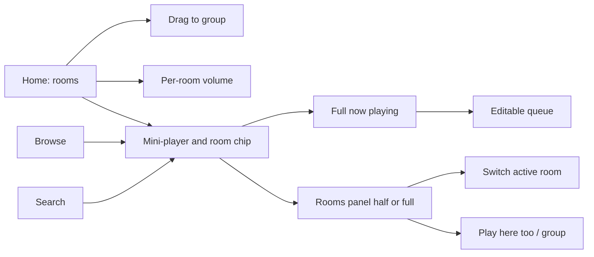
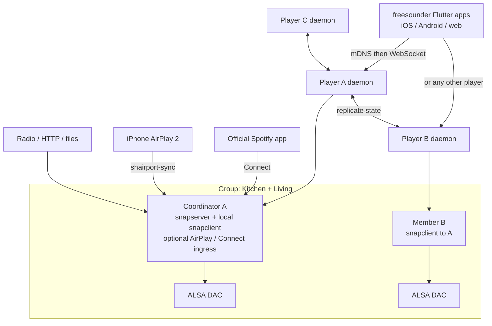

# freesounder – Architecture Research & Recommended Stack

Research snapshot as of **10 November 2026, Australia/Melbourne**, revised the same day for a **player-only** (no separate server) architecture. GitHub star counts and release metadata were looked up from the GitHub API on that date unless another source is named. Timestamps originally in UTC are converted to Australia/Melbourne (UTC+11). Hardware prices are GST-inclusive AUD from named retailers fetched earlier that day and are reused here where still valid. Numbers are cited, not invented.

**Public repo:** [https://github.com/mhatzis/freesounder](https://github.com/mhatzis/freesounder) (Apache License 2.0).

A companion Page with the same findings is here: [freesounder – Architecture Research & Recommended Stack](https://cursor.com/canvas/store-1e1f00a9-5a68-4935-844e-05e60d7c3684/36256424-0c34-4af8-91ca-18271424bb71).

---

## 1. Recommendation

freesounder should not clone the Sonos *app*. It should follow the Sonos *system* shape: **no separate server box**. Everything that must stay on for music runs on the room players (Raspberry Pi images) and in the Flutter mobile/web app. There is no required NAS, PC, Home Assistant host or Music Assistant server.

**Superseded (10 November 2026, Australia/Melbourne):** the earlier recommendation of a dedicated Music Assistant + snapserver host, with rooms running only `snapclient`, is withdrawn. That design is documented below only as historical context. The hybrid *principle* is unchanged: reuse mature programs as separate processes, and own the control API, apps, setup and player image.

**Recommended stack (player-only, locked for v1)**

| Layer | Choice |
|---|---|
| System shape | **Sonos-style.** Every player ships the same image. In each group, one player is the **coordinator** (group leader): it fetches or receives the stream and runs `snapserver` so members stay in sync. Any capable player can become coordinator. A standalone room is a group of one. The app talks to **any** player; that player forwards group-transport commands to the coordinator. |
| Control apps (iOS, Android, web) | **Flutter**, one custom design system, including the **global rooms panel** already specified in §2.7. Do not ship Music Assistant, Iris, Snapweb, Volumio or Lyrion UIs as the product face. |
| Player daemon / control API | A thin **freesounder daemon on every player** (Python for v1). It owns discovery, group membership, state replication, and the WebSocket API the apps speak. It starts, stops and re-points Snapcast and ingress processes. |
| Sync layer (MVP) | **Snapcast**, unmodified, as separate processes: `snapserver` on the current coordinator (plus a local `snapclient` to that server for the coordinator’s own speakers), `snapclient` on members pointed at the coordinator. See §5. |
| AirPlay 2 ingress | **shairport-sync** + NQPTP **on every player**. Apple’s own AirPlay 2 grouping can sync several of our players when the user groups them in iOS. For *freesounder* groups, AirPlay audio arriving at a player should make that player the coordinator and be fed into its `snapserver`. |
| Spotify | **Connect receiver on every player** (raspotify / librespot; go-librespot is GPL-3.0 and must stay a sidecar). The official Spotify app picks a room. If that room is in a freesounder group, that player becomes coordinator and tees audio into Snapcast. Soloist / in-app Spotify browse is **not** in v1 (it wanted a Music Assistant server). ToS caveats remain. |
| Other sources | Coordinator fetches **internet radio and simple HTTP(S) streams**. Optional **local files** from a USB stick, a user-provided network share (a NAS here is only file storage, not a freesounder server), or audio the phone casts to a player. **No official Tidal Connect** path to ship (partner-only). |
| Discovery | **mDNS / DNS-SD** for freesounder players (and Avahi for AirPlay / Connect advertisements). The app browses the LAN and can use any player as the entry point. |
| Shared state | **Simple leader-based replication** for MVP: room names, groups, favourites and settings are written by a household config leader and copied to every player. Not a CRDT for v1. |
| Home Assistant | **Optional, never required.** A future freesounder HA integration should talk to our player API. Do not assume a Music Assistant or always-on snapserver host. |
| What we build vs reuse | **Hybrid, restated for the player-only model (10 November 2026).** Own the daemon/API, Flutter apps, setup/onboarding and the player image. Reuse Snapcast, shairport-sync and a Spotify Connect sidecar as unmodified separate processes. Music Assistant is **not** part of the v1 runtime. See §7 and [development.md](development.md). |

Avoid Bluetooth and PulseAudio/PipeWire hops on synced room players. Do not use PipeWire/ROC or Pulse RTP as the house clock. Do not build on Volumio as the core. Prefer **Ethernet on any player that may be a coordinator**. Beta distribution is still in [docs/development.md](development.md).

**User decision still open:** v1 in-app music is **ingress-first** (Spotify app, AirPlay, radio, files, phone cast). A rich in-app catalogue like Music Assistant’s providers needs either a heavy process on a 4 GB-class player or a later from-scratch / official-API browse layer. See §10.

---

## 2. UI/UX redesign (top priority)

The user finds the Sonos app unfriendly. That is the design brief: **much cleaner, simpler, more intuitive, modern and minimal**, with easy multi-room control, very clear now-playing, and simple group management. It is not a request to imitate Sonos.

### 2.1 What the 2024 Sonos app backlash documented

On 7 May 2024 Sonos replaced the S2 controller with a redesigned app. The public record is consistent:

- [The Verge, 8 May 2024](https://www.theverge.com/2024/5/8/24151704/sonos-new-app-bad-reviews-missing-features) reported missing sleep timers, broken or unusable local-library search, no in-app queue editing, and a **regression in accessibility**. System control had “taken somewhat of a backseat to music control.” There was **no way to downgrade** to the previous S2 app on iPhone.
- [WIRED, “Many People Do Not Like the New Sonos App”](https://www.wired.com/story/people-do-not-like-the-new-sonos-app/) described almost total condemnation on Reddit and audio forums. Missing or broken: sleep timers, alarms, **precise volume**, add-to-end-of-queue, Wi-Fi management, adding speakers, and local library search. A VoiceOver user called it “an accessibility disaster”: “As a blind guy, I now have a system that I can hardly use.”
- [The Verge, 14 May 2024](https://www.theverge.com/2024/5/14/24156703/sonos-app-redesign-new-ama-complaints) covered a community AMA. Customers asked why the app shipped below parity after **private beta testers had already raised concerns**, with **no open beta** and no warning in launch emails that features were gone. Alarms had been remotely disabled on launch morning because of a data-corruption bug.
- More than two months later, CEO Patrick Spence apologised and listed overdue work on library browse/search, **volume responsiveness**, alarm reliability and playlist edit mode ([WIRED](https://www.wired.com/story/sonos-admits-its-recent-app-update-was-a-colossal-mistake/)).

Some reviewers noted the new app felt sleeker or more responsive for large systems. The failures that matter for freesounder are: a music-store home that demoted rooms and volume, shipping a redesign that *removed* working features, accessibility regressions, and a forced cutover with no downgrade.

### 2.2 Design principles

1. **Rooms and volume first, not a music-store home.** Everyday use is: which rooms are on, what is playing, how loud, who is grouped. Discovery is one tap away, never the only screen.
2. **Do not ship a redesign that removes working features.** Queue edit, local library search, add-a-speaker, sleep timer, alarms and precise volume belong in the first release. No forced, un-downgradeable cutover.
3. **Volume is a primary control.** Immediate, precise, one-tap per room, plus a group master. Never hide numeric volume behind a gesture-only slider with no value.
4. **Now-playing is persistent and obvious.** Artwork, title, artist, rooms in the group, transport and volume stay visible on every tab.
5. **Grouping is a two-second task.** The rooms panel is available from every screen. Drag a room onto another, or use Play here too, checkboxes or presets. Ungroup is just as easy.
6. **Accessibility is a launch requirement.** VoiceOver, TalkBack, Dynamic Type, captions, keyboard and large hit targets are tested before release.
7. **Local libraries are first-class.** Browse and search of a NAS or server library must work as well as a streamer catalogue.
8. **Minimal, not empty.** A calm, modern layout. Power features (EQ, sleep timer, queue edit) are findable, not deleted in the name of simplicity.

### 2.3 How existing controllers compare on UX

Ratings below are a **qualitative assessment** by this research as of 10 November 2026, Australia/Melbourne. They are not a user study. They judge closeness to a clean, rooms-first household remote — not audiophile depth or feature count.

| Controller | UX for household control | Strengths | Why it is not the freesounder UI |
|---|---|---|---|
| Music Assistant web UI + official mobile app | Strongest current OSS baseline | The 2.10 player bar puts select, group and volume up front ([MA 2.10 blog](https://www.music-assistant.io/blog/2026/08/26/music-assistant-2-10/)). Official [KMP iOS/Android app](https://github.com/music-assistant/mobile-app) (Apache-2.0). Strong multi-source library. | Still a power-user / Home Assistant music engine. Use as **backend**, not as the face of freesounder. |
| Volumio Nova | Visually strong, paid for multi-room | Large artwork, large targets, one-tap grouping, accessibility settings (docs claim 56px targets, text size, screen reader) — [volumio.com/nova](https://volumio.com/nova/). | [Multi-room sits behind Premium](https://help.volumio.com/en/articles/121-how-does-the-multiroom-work) (up to 6 devices on a paid plan). Not acceptable as the core of a free public project. |
| Lyrion Material Skin | Good music-player UI | Modern Material web UI; mobile-first browse / now-playing / queue. Reviewers have called it one of the best non-Roon player skins ([Ryan Feeley interview](https://ryanfeeley.com/squeezing-every-last-drop-with-material-skin/); [Antipodes forum](https://antipodes.support/t/material-web-player/43)). Repo: [CDrummond/lms-material](https://github.com/CDrummond/lms-material) (410 stars; 6.4.14 published 16 October 2026, 4:52 pm Australia/Melbourne). | LMS mental model, not rooms-first. Documented drag-and-drop pain on iPhone. Default LMS skin is dated. |
| Mopidy Iris | Good, server-centric | Attractive web UI, queue, Snapcast client list and per-client volume ([jaedb/Iris](https://github.com/jaedb/Iris)). | Feels like a music server with a nice face. Snapcast is a panel, not a rooms home. |
| Snapweb | Functional, narrow | Groups, per-client volume, browser playback. | Not a library or now-playing product. The browser tab must stay open to keep playing ([MA Snapcast notes](https://www.music-assistant.io/player-support/snapcast/)). |
| moOde WebUI | Functional, specialist | Deep renderer and DSP controls; actively maintained (10.3.7). | Built for a single audiophile player (plus moOde’s own sender/receiver mode), not a household rooms remote. |
| Snapdroid / older LMS remotes (Squeezer, iPeng) | Uneven or stale | Snapdroid can be an Android Snapcast endpoint. iPeng is a mature but commercial iOS LMS controller. | Snapdroid lags current Snapcast (v0.29.0.2, 3 December 2024). Music Assistant documents the **iOS Snapcast app as broken**. Squeezer-class apps are not a modern design system. |

### 2.4 Client technology — why Flutter

The iOS, Android and web clients must share one visual language: typography, spacing, room tiles, grouping gestures and now-playing.

- **Flutter** draws its own widgets and lists [web as a supported target](https://docs.flutter.dev/platform-integration/web) for app-like UIs. That is the most direct way to keep a custom, non-Material-clone design identical on every client. Flutter web is the right fit for a LAN control surface, not for an SEO marketing site.
- **Kotlin Multiplatform + Compose** is excellent for Android-first teams and is what Music Assistant’s official app uses, but Compose for web is the less mature target (JetBrains still treats Compose for web as a beta-class target in public framework comparisons).
- **React Native + a separate React web app** shares language more than pixels, and tends toward native widgets rather than one designed system.
- **Pure Swift / Kotlin + a third web app** would give the best platform conventions, at the cost of three implementations of grouping and now-playing — too easy to drift for an early public project.

**Recommendation:** one Flutter workspace for iOS, Android and web, with a small in-repo design-system package (tokens, room tile, now-playing bar, volume control, grouping gestures). Use Flutter’s accessibility APIs (Semantics, screen readers, text scaling) from day one. Low-level audio on a phone (if the handset later becomes a synced speaker) can be a thin platform plugin; control UX stays in Dart.

### 2.5 Information architecture

Four top-level destinations, **always with a persistent now-playing bar**:

- **Home** — rooms first
- **Browse** — library and services
- **Search**
- **You** — favourites, queue, playlists (a small shelf, not a fifth “providers” tab)

Settings and speaker setup live behind a single gear on Home, and in first-run onboarding. No tab named “Providers”, “Players” or “Sources” in the main chrome.

**Home.** One large tile per room: name, playing or idle, a short track line if active, and volume on the tile. Grouped tiles share a visual bind (outline or a joined block). Tapping a tile selects that room and expands now-playing for its group. A **group master volume** appears whenever two or more rooms are bound.

**Grouping.** The rooms panel (§2.7) is the always-reachable control for this. On Home, drag one room tile onto another to group, or use Play here too, checkboxes and presets in the panel. Ungroup is just as easy. Offer undo for a few seconds after a group change. Pinch-to-group is a welcome extra on tablets, not the only path.

**Persistent now-playing.** Mini bar on every screen: artwork, title, artist, play/pause, compact volume, plus a dedicated **room or group chip**. Tapping the artwork or title opens the full now-playing sheet (large art, scrubber, **editable queue**, lyrics, sleep timer). Tapping the room chip, or swiping the bar upward, opens the rooms and grouping panel (§2.7) — it does not leave the current screen. Lock-screen and OS media controls show the same title and transport.

**Onboarding / add speaker**

1. Connect to the home network. The app looks for a freesounder server over mDNS. If none, it offers setup instructions or a first-server wizard.
2. Name the house and the first room. **No account is required.** Cloud login is never a gate.
3. Find speakers. New Pi players advertise themselves; the user names the room and can test a chime.
4. Add music. Local folder or NAS first, then optional streaming sign-in. Each service states limits and Terms-of-Service risks in plain language before connect.
5. Play something. End on Home with one room selected and a suggested album or radio station, so the first session is a successful play.

**Accessibility.** Every room tile, volume control and group action has a spoken name and value (“Kitchen, 40 percent, grouped with Living”). Colour is never the only group cue. Hit targets at least 44 pt (iOS) and 48 dp (Android); text scales with the system; reduce-motion is honoured. Keyboard on web: space to play/pause, arrows for skip and volume, a shortcuts sheet.

### 2.6 Early wireframes

Home, rooms-first, with a persistent bar. Grouped rooms share a bracket:

```
+--------------------------------------+
|  freesounder              (settings) |
|  Home    Browse    Search            |
|                                      |
|  [ Kitchen    PLAYING          40% ] |
|  [ Living     PLAYING          25% ] |  <- same group
|  [ Office     idle              0% ] |
|                                      |
|  Group: Kitchen + Living      35%    |
|                                      |
+--------------------------------------+
|  art   Night Moves — Bob Seger  |>   |
|        Kitchen + Living         35%  |
+--------------------------------------+
```

Full now-playing sheet:

```
+--------------------------------------+
|  v  Now playing                      |
|         [  album art  ]              |
|      Night Moves                     |
|      Bob Seger · Beautiful Loser     |
|      ========o--------------  1:21   |
|      <<         ||          >>       |
|                                      |
|  Playing in                          |
|  Kitchen                     40% === |
|  Living                      25% ==  |
|  [ + Add room ]   [ Ungroup all ]    |
|  Group master                    35% |
|                                      |
|  Up next (drag to reorder, swipe)    |
|  • Mainstreet                        |
|  • You'll Accomp'ny Me               |
+--------------------------------------+
```

Information architecture:



### 2.7 Rooms and grouping panel — always reachable

A specific complaint about Sonos is that **changing players and grouping is terrible**: those controls are buried, inconsistent, or require leaving the screen you are on. freesounder should put room selection and grouping in a panel that is reachable from Home, Browse, Search, Now Playing and Settings, without losing your place.

**Recommended mobile pattern:** a hybrid. A persistent mini-player with a room or group chip expands into a **bottom sheet with three detents** (collapsed, half, full). On tablets and landscape, and on desktop web, the same list becomes a persistent trailing side rail. Do not use a phone side drawer as the primary pattern, and do not make Rooms a place you have to navigate to in order to switch.

#### Why this pattern, and not the alternatives

On a phone, the lower third of the screen is where the thumb already rests. Media apps (Apple Music, Spotify, YouTube Music, Material 3 sheets) already teach “swipe up the mini-player.” A bottom sheet with detents keeps Browse or Search visible behind a scrim, so switching Office while looking at an album does not reset navigation. iOS sheet detents and Android Material 3 modal bottom sheets are the platform-native containers for this.

A leading side drawer is a poor primary control on a phone: the handle sits in a hard-to-reach corner, it fights the back affordance, and it is not how people expect to change speakers. A rooms-only tab repeats the Sonos problem — you leave Search to change rooms. A fully persistent list that steals a third of a phone screen is too heavy. The hybrid keeps the list one gesture away, and uses the extra width of a tablet or desktop for an always-on rail instead.

#### The three detents on a phone

**Collapsed** (always visible, sitting above the tab bar): mini-player (artwork, title, artist, play/pause, compact volume) plus a room chip labelled with the active room or “Kitchen + 2”, a grab handle, and a group cue when rooms are bound. Tap artwork or title for Now Playing. Tap the chip, swipe up, or swipe left/right on the bar to work with rooms.

```
+--------------------------------------+
|  Browse: albums                      |
|  ... current screen stays here ...   |
+--------------------------------------+
|  = handle                            |
|  [art] Night Moves        [Kitchen+] |  <- room chip
|        Bob Seger     35%       ||    |
+--------------------------------------+
|  Home     Browse     Search     You  |
+--------------------------------------+
```

**Half sheet** (about half the screen): the room list. The active room is clearly selected. Each row has name, playing or idle, a short track line, a Play here too control, and an optional checkbox. Tapping the row name switches the active room and can auto-collapse the sheet. Grouped rows share artwork, a common outline and a text label (colour is never the only cue). A status pill shows Synced, Syncing, or Can’t reach Kitchen.

```
+--------------------------------------+
|  Browse still dimmed behind          |
+--------------------------------------+
|  = Rooms                    [Edit]   |
|  Now controlling Kitchen + 2         |
|                                      |
|  [*] Kitchen     Night Moves    40%  |
|      Playing here                    |
|  [*] Living      Night Moves    25%  |
|      Play here too          [on]     |
|  [ ] Office      idle                |
|      Play here too          [  ]     |
|                                      |
|  Presets: Evening   House   Upstairs |
+--------------------------------------+
```

**Full sheet:** group master volume, per-room sliders with numeric values, Ungroup, Save as preset, and room health. This is also where a user fine-balances a party without opening Home.

```
+--------------------------------------+
|  = Rooms                             |
|  Group master                    35% |
|  =================================   |
|  Kitchen                         40% |
|  Living                          25% |
|  [ Ungroup all ]  [ Save preset ]    |
|  Evening · House · Upstairs          |
|  Kitchen + Living    Synced          |
|  Office              idle, reachable |
+--------------------------------------+
```

#### Fast switching, without leaving the screen

- Tap the room chip to open the half sheet; tap another room to make it the active control target. The album, search results or settings page stay put. The chip label updates immediately.
- Swipe left or right on the collapsed mini-player to cycle rooms or existing groups, with a light haptic. A short toast or chip animation confirms the new target.
- Long-press the chip for a shortcut list: recent rooms and group presets, so a two-room household can switch in one hold.
- On Home, tapping a room tile still selects that room; it is the same store, not a second notion of “current player.”

#### Intuitive grouping

Offer more than one way in, and keep them consistent. **Checkboxes** and **Play here too** are the primary phone methods, because they are accurate one-handed and accessible. **Drag** is excellent on tablets and the web, and remains available on Home tiles and in the sheet.

- **Play here too:** one tap on a room row joins it to the current group and starts the same queue; tap again to leave. This is the fastest “I walked into the kitchen” action.
- **Multi-select:** Edit or a checkbox on each row, then the selected rooms become the group. Good for setting three rooms at once.
- **Drag** a room row onto another (or a Home tile onto another) to group; drag out to leave. Show a drop target and a short haptic on success.
- **Group presets or scenes** (Evening, House, Upstairs) pin at the top of the half sheet. Tapping a preset applies membership only; it does not have to change the track unless the user has saved it that way later.
- After every group change, an **undo snackbar** stays up for about eight seconds (“Living joined Kitchen + Living” / Undo).
- **Visual feedback:** grouped rows share now-playing artwork, a linked outline and a written group name. A sync pill tells the truth if a room cannot be reached. **Group master** volume sits above per-room sliders in the full sheet; moving the master scales members, a member slider then diverges on purpose.

#### Consistent access from every screen

In the Flutter app the mini-player and rooms sheet are a **shell overlay**, not a page in the navigation stack. Tabs and pushed routes (album, search, settings, the full Now Playing sheet) render underneath. Opening the rooms panel does not dispose the route you were on. Now Playing can still open the same rooms sheet from its own chip — there is one panel, not a second copy with different rules.

All screens read **one rooms-and-playback store**. The store is the source of truth for the active room, group membership, volumes, now-playing metadata and sync health. It subscribes to the control API WebSocket so a second phone, a hardware button or a Home Assistant automation updates the chip and list in real time.

#### Web, tablet and keyboard

From a medium breakpoint upward (tablet landscape and desktop web, roughly 900 px and above), use a **persistent trailing rooms rail** — right-hand in left-to-right layout — instead of a sheet. The rail shows the same rows, Play here too, presets, and a compact group master. Narrow web widths collapse to the phone bottom sheet so a phone-sized browser window does not grow a cramped sidebar. Drag and drop is a first-class grouping method on the rail and on the Home grid.

Keyboard shortcuts: `R` opens or focuses Rooms, `1`–`9` select a room, `[` and `]` cycle, `G` toggles Play here too on the focused room, `Shift+G` ungroups, plus the existing space / arrows for play and volume. A shortcuts sheet lists these.

#### Key interaction flows

1. **Switch room while browsing an album.** You are on an album in Browse. Tap the Kitchen chip (or swipe up). The half sheet lists rooms; Browse stays dimmed behind. Tap Office. The chip reads Office, the sheet collapses, the album is still on screen. Play now starts in Office, not Kitchen.
2. **Play this in the kitchen too.** Living is playing. Walk in with the phone, swipe up, tap Play here too on Kitchen. Kitchen joins, both rows show the same art, a snackbar offers Undo. You never left whatever screen you had open.
3. **Build a house group, then undo.** Open the half sheet, turn on Edit, check Kitchen, Living and Office, done. The chip reads Kitchen + 2. A snackbar offers Undo for eight seconds. Full detent is available if you want to balance volumes.
4. **Balance volume in a group.** Swipe the sheet to full. Move Group master to set the house level, then trim Living down. Numeric values stay visible. The collapsed chip can show the master value while a group is active.

#### Accessibility and haptics

- Do not require drag to group. VoiceOver and TalkBack **custom actions** on each room row: Switch to this room, Play here too, Leave group, Adjust volume. The row name and value are spoken (“Kitchen, 40 percent, grouped with Living, synced”).
- Hit targets at least 44 pt on iOS and 48 dp on Android, including the room chip and Play here too. The chip is a real control, not only a label.
- Light haptics on room switch, successful group, and volume tick marks, honouring system haptic and reduce-motion settings. Announce group changes so a screen-reader user hears “Living joined Kitchen and Living.”
- Focus order in the sheet is handle, group name, presets, then rooms. Escape or a downward swipe closes to collapsed without changing the selection.

#### Architecture and stack implications

The panel is a reason to treat the Flutter client as a real-time control surface, not a page that refetches on navigate. Put a rooms-and-playback store in `packages/api_client` (or a sibling package) and keep the sheet widgets in `packages/design` so web and mobile share them.

- **Control API:** subscribe to WebSocket events for player added or removed, group membership, per-room and group volume, now-playing, and reachability. Commands needed: set active control target, join or leave a group, replace group membership, set member volume, set group master volume, list and apply presets. If Music Assistant’s API is awkward for “active target” versus “play here too”, add a thin freesounder facade rather than bending the UI.
- **Optimistic UI:** the chip, selection and group outline update on tap, before the server replies. If the command fails or a later event disagrees, revert and show a short error. Volume sliders move immediately; send updates while dragging (about 30–50 ms debounce) and do not wait for a round trip to paint the thumb.
- **Design targets, not measured backend figures:** switching the active room should feel instant (aim to paint the new chip within about 100 ms). Volume should feel continuous. Group join may take longer on the audio path because Snapcast’s default end-to-end buffer is 1000 ms — the UI must not pretend the new room is already audible if it is still buffering; show Syncing until the server reports the room is in lock.
- Two phones can change the same group. Last accepted server state wins; both clients follow the event stream. An offline room stays in the list, marked unreachable, and cannot be the silent victim of a group change.

---

## 3. Building blocks (2025–2026)

### 3.1 Snapcast — recommended sync layer

- **Role:** Client–server distribution. Not a music library. Several sources can run in parallel; clients group onto a stream. [README](https://github.com/snapcast/snapcast).
- **Sync:** Server timestamps encoded chunks over TCP. Clients keep server time and add/drop samples. Soft correction is limited to about ±0.05% of sample rate; hard resync triggers if drift exceeds documented thresholds (around 2–50 ms depending on the window, or 500 ms absolute age).
- **Accuracy / latency:** README: typical deviation **below 0.2 ms**. Default **end-to-end buffer 1000 ms**, which *is* the start/stop latency ([configuration](https://github.com/snapcast/snapcast/blob/master/doc/configuration.md); [MA Snapcast provider](https://www.music-assistant.io/player-support/snapcast/) exposes 200–6000 ms). Default FLAC codec latency ~26 ms; PCM has none; Opus may resample to 48 kHz.
- **Grouping:** Groups, per-client volume and mute, JSON-RPC on port 1705. Stream 1704, Snapweb 1780. Music Assistant may also use dynamic ports in 4953–5153.
- **Clients:** snapclient on Linux (ALSA recommended), macOS, Windows, FreeBSD; [Snapweb](https://github.com/snapcast/snapweb); [Snapdroid](https://github.com/snapcast/snapdroid). Music Assistant: the **iOS Snapcast app is broken** (old snapclient).
- **Licence:** GPL-3.0 — run as a **separate process**.
- **Maintenance:** [snapcast/snapcast](https://github.com/snapcast/snapcast) **8,056** stars. **v0.35.0** published 11 March 2026, 1:35 am Australia/Melbourne. Last push 3 November 2026, 6:55 pm Australia/Melbourne. Actively maintained; one main author.
- **Weaknesses:** The 1 s default buffer is audible on play/pause/skip. Pause is awkward (MA implements stop/resume). Bluetooth and PulseAudio/PipeWire output can drift ([discussion #1487](https://github.com/snapcast/snapcast/discussions/1487)). MA: do not use Snapcast **0.30.0** with Music Assistant; 0.28.0 is 64-bit only.

### 3.2 Music Assistant — not part of the v1 runtime

Still an excellent library/provider engine, but it is designed as an always-on **server** ([installation guide](https://www.music-assistant.io/installation/): 2 GB RAM minimum, 4 GB+ if anything else shares the box, Pi 4 or newer). That conflicts with a player-only house, so it is **not in the v1 image**. It remains a possible later experiment on a 4 GB-class player, or a source of ideas — not an in-process library we fork.

- **Role:** Combined library, queues, streaming providers, player grouping, WebSocket API, optional Home Assistant. Built-in or external Snapcast; Sendspin is its own sync preview.
- **Sync / grouping:** Can drive Snapcast groups. [Sendspin](https://www.music-assistant.io/player-support/sendspin/) aims to keep rooms close enough to avoid an echo; **no numeric accuracy published**; status **technical preview**. 2.10 redesigned the player bar around select, group and volume. Per-player delay 0–5000 ms where supported.
- **Clients:** Vue [frontend](https://github.com/music-assistant/frontend); official [mobile-app](https://github.com/music-assistant/mobile-app) (Kotlin Multiplatform, Apache-2.0, 719 stars; iOS 1.0 build 54 and Android 0.16.0 published 27 October 2026, 12:28 pm / 12:11 pm Australia/Melbourne — not treated as store-listed in this research); official [desktop-app](https://github.com/music-assistant/desktop-app) 0.7.4 (2 November 2026, 10:09 am Australia/Melbourne).
- **Licence:** Apache-2.0.
- **Maintenance:** [music-assistant/server](https://github.com/music-assistant/server) **3,298** stars. Stable **2.10.9** published 31 October 2026, 12:01 am Australia/Melbourne. 2.11.0 in beta (b8 on 3 November 2026, 12:35 am). Very active nightlies.
- **Weaknesses:** Power-user UX. Some providers unofficial or ToS-grey. Sendspin still preview. Built-in snapserver only accepts connections from MA if used in that mode.

### 3.3 Mopidy + Iris

- **Role:** Python music server (GStreamer, MPD + JSON-RPC) plus a polished web UI. Classic pattern: Mopidy → `snapfifo` → snapserver.
- **Sync:** None on its own; Snapcast does the rooms. Iris has a Snapcast panel (volume, mute, groups).
- **Licence:** Apache-2.0 for both.
- **Maintenance:** [mopidy/mopidy](https://github.com/mopidy/mopidy) **8,608** stars, **v4.0.5** on 16 October 2026, 9:46 pm Australia/Melbourne. [jaedb/Iris](https://github.com/jaedb/Iris) **1,240** stars; last release **3.70.0** on 3 May 2025, 7:50 pm Australia/Melbourne, but still pushed (1 November 2026).
- **Weaknesses:** One local output unless you add Snapcast. Mopidy-Spotify has been fragile since libspotify was withdrawn. Less complete as an all-in-one engine than Music Assistant in 2026. Fallback, not the default.

### 3.4 Lyrion Music Server + squeezelite (+ piCorePlayer)

- **Role:** The Squeezebox line (formerly Logitech Media Server). LMS is the server; squeezelite is a headless player. [piCorePlayer 11.1.0](https://docs.picoreplayer.org/releases/pcp1110/) (1 March 2026) is a dedicated player image and documents Squeezelite 2.0.0-1542.
- **Sync:** Server compares reported elapsed time and issues skip-ahead / adjust commands; network latency measured or set manually ([Synchronization wiki](https://wiki.lyrion.org/index.php/Synchronization.html)). **No official sub-millisecond figure** found. Community reports generally good results on a stable network; poor Wi-Fi can desync a group.
- **Grouping:** First-class Synchronize / unsync. One server can also feed different queues to different players. WiiM documents a **maximum of two** WiiM devices in one LMS group ([WiiM FAQ](https://faq.wiimhome.com/en/support/solutions/articles/72000660942-how-to-use-lms-group-playback-on-wiim-devices)).
- **Clients:** Web (default + Material Skin), squeezelite / piCorePlayer, many remotes (some commercial, e.g. iPeng).
- **Licence:** LMS Perl code is **GPL-2.0** ([License.txt](https://github.com/LMS-Community/slimserver/blob/master/License.txt); some bundled components differ). squeezelite is **GPL-3.0**.
- **Maintenance:** [LMS-Community/slimserver](https://github.com/LMS-Community/slimserver) **1,819** stars. Tag **9.1.1**, commit 27 May 2026, 4:12 am Australia/Melbourne; [lyrion.org/downloads](https://lyrion.org/downloads/) lists 9.1.1 (26 May 2026). No GitHub Releases feed. [ralph-irving/squeezelite](https://github.com/ralph-irving/squeezelite) **513** stars, no GitHub Releases, pushed 29 October 2026, 5:45 am Australia/Melbourne.
- **Weaknesses:** Default UI is dated (Material Skin helps). Spotify plugins have had Connect breakage (community reports; some workarounds via library integration). Weaker published sync-accuracy claims than Snapcast. Alternative architecture if the team prefers that ecosystem.

### 3.5 PipeWire, PulseAudio RTP, ROC

- **Role:** Desktop audio fabric. [PipeWire](https://gitlab.freedesktop.org/pipewire/pipewire) has ROC sink/source modules. [ROC Toolkit](https://roc-streaming.org/toolkit/docs/about_project/features.html) streams RTP with FEC and clock-drift compensation.
- **Sync:** Configurable target latency and drift compensation. Community multi-room guides stress matching `sess.latency.msec` and manual delays; this is **not** Snapcast-style sample-timed play-out, and resync after restarts is a known pain.
- **Licence:** PipeWire source is **MIT** except some LGPL (e.g. libspa-alsa) and GPL bits (e.g. libjackserver) ([LICENSE](https://github.com/PipeWire/pipewire/blob/master/LICENSE)). ROC is **MPL-2.0**.
- **Maintenance:** GitHub mirror [PipeWire/pipewire](https://github.com/PipeWire/pipewire) **2,167** stars; tag **1.6.11** on 29 October 2026, 8:58 pm Australia/Melbourne. [roc-streaming/roc-toolkit](https://github.com/roc-streaming/roc-toolkit) **1,263** stars; last tag **v0.4.0** (14 June 2024) though the repo was still pushed in November 2026.
- **Weaknesses:** Not a rooms product. Do not use as the primary sync layer. Also avoid using PipeWire/Pulse as the *output* path of snapclient if you want stable lock.

### 3.6 shairport-sync (AirPlay 2)

- **Role:** AirPlay / AirPlay 2 speaker. In this stack, **ingress**: an iPhone or Mac hands off into shairport-sync, which feeds Snapcast so the rest of the house can join under freesounder grouping.
- **Sync:** Companion **NQPTP** (exclusive UDP **319/320**). Can stay in step with other AirPlay 2 devices in the same Apple session ([AIRPLAY2.md](https://github.com/mikebrady/shairport-sync/blob/master/AIRPLAY2.md)). Multiple instances on one host, one NQPTP.
- **Latency:** Docs reviewed do not publish a numeric multi-room figure. AirPlay buffered audio is not a low-latency path.
- **Licence:** Core files **MIT**; some bundled third-party code differs ([LICENSES](https://github.com/mikebrady/shairport-sync/blob/master/LICENSES)). Recheck if vendoring.
- **Maintenance:** [mikebrady/shairport-sync](https://github.com/mikebrady/shairport-sync) **9,016** stars. **5.6.2** published 26 October 2026, 1:17 am Australia/Melbourne (security fix + long-session timestamps). 5.6 added AirPlay 2 remote control, metadata, macOS and multiple instances. Pushed 10 November 2026, 5:15 am Australia/Melbourne.

### 3.7 librespot, raspotify, go-librespot, Spotifyd

- **Role:** Unofficial Spotify Connect receivers, or libraries others embed. Raspotify packages librespot for Debian/Pi.
- **Licence:** librespot and raspotify **MIT**; go-librespot **GPL-3.0** (do not link into the Apache binary); Spotifyd **GPL-3.0**.
- **Maintenance:** [librespot-org/librespot](https://github.com/librespot-org/librespot) **7,382** stars, **v0.8.0** on 11 November 2025, 3:58 am Australia/Melbourne, still pushed 7 November 2026. [dtcooper/raspotify](https://github.com/dtcooper/raspotify) **5,236** stars, **0.48.4** on 23 October 2026, 1:29 am Australia/Melbourne. [devgianlu/go-librespot](https://github.com/devgianlu/go-librespot) **389** stars, **v0.10.5** on 16 October 2026, 7:53 pm Australia/Melbourne. [Spotifyd/spotifyd](https://github.com/Spotifyd/spotifyd) **10,832** stars, **v0.4.2** on 19 November 2025; last push 29 May 2026, 4:31 am Australia/Melbourne (quieter).
- **Weaknesses:** [librespot disclaimer](https://github.com/librespot-org/librespot): “Using this code to connect to Spotify's API is probably forbidden by them. Use at your own risk.” Premium only. Spotify changed key delivery: **accounts created after an apparent cutoff often cannot decrypt audio** (`audio key error 0 1`); no known workaround in the README warning. Music Assistant documents the same split and offers official **Soloist** as the path for newer accounts (see §4).

### 3.8 Reference distros: Volumio, moOde, piCorePlayer

These are useful images to learn from, **not** engines to fork as the product UI.

| Distro | Notes | Maintenance |
|---|---|---|
| **Volumio** | Polished Nova UI. Multi-room, and some services, require [Premium](https://help.volumio.com/en/articles/100-what-is-volumio-premium-plan) (up to 6 devices). Backend [volumio/volumio3-backend](https://github.com/volumio/volumio3-backend) is GPL-3.0; the Volumio2 repo is stale. | Unsuitable as the core of a free public project. |
| **moOde** | [moode-player/moode](https://github.com/moode-player/moode) **1,456** stars, GPL-3.0. **10.3.7** (tag r1037) published 2 November 2026, 2:10 am Australia/Melbourne. Own sender/receiver multi-room (docs: 16-bit / 48 kHz Opus), plus AirPlay / Spotify renderers. Specialist WebUI. | Excellent Pi audio appliance; not a rooms-first consumer app. |
| **piCorePlayer** | Tiny LMS player image. **11.1.0**, 1 March 2026; 32-bit for Pi 0–3, 64-bit for Pi 4/5. Auto-discovered by Lyrion. | Use if choosing the LMS path for room players. |

### 3.9 Other notable projects

| Project | Role | Stars / release (10 Nov 2026 lookup) |
|---|---|---|
| [OwnTone](https://github.com/owntone/owntone-server) | Server that can play to AirPlay 1+2 speakers, Cast, local output; Spotify, radio, files, MPD. A *different* architecture (Apple speakers as rooms). GPL-2.0. | 2,588 stars; **29.3** on 23 July 2026, 7:50 am Australia/Melbourne |
| [AirConnect](https://github.com/philippe44/AirConnect) | Bridge AirPlay to UPnP/Sonos & Chromecast. Useful interop, not the core. | 4,229 stars; **1.12.4** on 27 September 2026, 4:08 am Australia/Melbourne |
| [Esparagus](https://github.com/sonocotta/esparagus-media-center) | Cheap ESP32 Snapcast-class room boards. Apache-2.0 media center (287 stars, pushed 5 November 2026, 9:00 am Australia/Melbourne; no GitHub Releases). snapclient helper is BSD-3-Clause. | Later-phase hardware experiment |
| Sendspin | MA’s own sync, used by the web player and official mobile app. Spec at [github.com/Sendspin/spec](https://github.com/Sendspin/spec). **Technical preview.** | Candidate to revisit once it leaves preview |

---

## 4. Streaming services — realistic paths

In the player-only model, streams are received or fetched **on a player** (usually the group coordinator), not on a household server. v1 is **ingress-first** for commercial catalogues (official Spotify / Apple apps push audio in) plus radio, files and phone-cast in our app.

An open-source project can use official APIs, official Connect-style partner programs, or unofficial reverse-engineered clients. The last group can break or be blocked at any time and may conflict with a service’s terms. freesounder should label unofficial paths clearly, never ship ripped or decrypted files, and prefer official engines when they exist.

### Spotify

- **Path A — Music Assistant Soloist.** Official playback engine for screenless devices, downloaded from Spotify during setup. MA documents lossless up to **24-bit / 44.1 kHz**, one player at a time per account, works with accounts created since December 2024. Setup needs a personal API key and pairing. [MA Spotify docs](https://www.music-assistant.io/music-providers/spotify/): Spotify’s terms **do not clearly allow** using Soloist this way; use at your own risk. MA may not distribute Soloist itself.
- **Path B — Connect receiver** (raspotify/librespot) so the official Spotify app can target a room, with audio fed into Snapcast. Typically Ogg Vorbis up to 320 kbps. **Premium required.** Often **fails on newer accounts** (librespot README warning; MA “Key Error” notes).
- **Recommendation:** Treat Soloist as the in-app catalogue path where the user accepts the ToS warning; keep Connect as handoff from the official Spotify app. Do not rely on librespot alone. Disclose this in the app before the user signs in.

### Apple Music

- **Primary:** AirPlay 2 from an iPhone, iPad or Mac into shairport-sync, then Snapcast. This is Apple’s supported speaker model.
- **Secondary:** [MA Apple Music provider](https://www.music-assistant.io/music-providers/apple-music/) for in-app browse and play. Paid subscription required. MA: **AAC 256 kbps** maximum; lossless and Atmos are not available; playback is **not officially supported by Apple**; tokens expire after 180 days; gaps of up to five seconds between tracks.
- Third-party **MusicKit** integrations (e.g. Bluesound’s October 2026 native support) are widely reported as capped at 256 kbps AAC ([SoundGuys](https://www.soundguys.com/apple-music-lossless-third-party-apps-165683/), [MacRumors](https://www.macrumors.com/2026/10/21/bluesound-adds-native-apple-music-support/)). Some vendors document a Mac *system output* AirPlay path at 16/44.1 ALAC; that workaround is not available on iPhone.

### Tidal

- **In-app:** MA’s OAuth [Tidal provider](https://www.music-assistant.io/music-providers/tidal/) — catalogue, favourites, up to **FLAC 192 kHz / 24-bit** on Max.
- **Tidal Connect:** [Official docs](https://developer.tidal.com/documentation/connect) state integrations are **for device partners only**. The public SDK player module is documented as **preview playback** for third parties, not Connect. Community Docker images wrap unofficial binaries; moOde maintainers have declined them as not open source. **Do not ship those binaries.**

### Qobuz

- MA provider with username/password in current docs; up to **FLAC 192 kHz / 24-bit** ([MA Qobuz](https://www.music-assistant.io/music-providers/qobuz/)). Official Qobuz API access is partner-issued (app id and secret; [API terms](https://static.qobuz.com/apps/api/QobuzAPI-TermsofUse.pdf)). Store credentials locally and document the login model.

### Deezer

- Listed as a [MA music source](https://www.music-assistant.io/faq/listen-to/). Prefer official OAuth. Treat unofficial tokens (ARL, etc.) as brittle and possibly against terms. This research did not treat a secondary summary as enough evidence for a bitrate number; confirm against the live MA Deezer provider page at implementation time.

### TuneIn / radio and local library

- Internet radio via MA or similar directories, plus **local files and NAS** (optional Jellyfin/Plex). Local libraries must remain first-class (a direct lesson from the 2024 Sonos app). Radio directory terms vary.

---

## 5. Reference architecture

There is **no always-on freesounder server**. Each room runs the same player image. The Flutter app discovers players on the LAN and opens a WebSocket to any one of them.

### 5.1 How Sonos does this (public reference)

Classic Sonos is a collection of identical players on the LAN, not a required server appliance:

- **Discovery and topology are local.** Players expose UPnP services (historically discovered with SSDP). The `ZoneGroupTopology` service’s `GetZoneGroupState` returns the household’s groups, and each group names a **coordinator** ([community documentation of the service](https://sonos.svrooij.io/services/zone-group-topology.html); [SoCo topology docs](https://github.com/SoCo/SoCo/blob/v0.30.3/doc/advanced/topology.rst)).
- **A group always has a coordinator.** Sonos’s own Control API models a household of groups of players; every player is in a group, even a standalone room (a group of size 1), and each group has a `coordinatorId` ([Sonos Discover](https://docs.sonos.com/docs/discover)).
- **The coordinator is the audio and control leader** for that group. Community and staff descriptions: the coordinator is the player others are grouped to; it “sync[s] the data and then send[s] it to every speaker in the group”; a **wired** coordinator is preferred because it reduces wireless hops ([Sonos Community thread, staff reply](https://en.community.sonos.com/controllers-music-services-228995/sonos-group-coordinator-question-6803946)).
- **Coordination can move.** `AVTransport` includes `DelegateGroupCoordinationTo` and `BecomeCoordinatorOfStandaloneGroup` ([SoCo UPnP function list](https://github.com/SoCo/SoCo/wiki/Sonos-UPnP-services-and-functions)). If the coordinator is removed from the group, Sonos promotes another member and playback continues (same community thread; SoCo mailing-list notes).
- The later **cloud** Control API (`api.ws.sonos.com`) is a partner/control plane on top of households. It is not the reason the speakers work offline on the LAN. freesounder should copy the *local* model, not a cloud account gateway.

We do not implement Sonos’s UPnP stack. We copy the roles: identical players, elected coordinator, app talks to any player, topology visible from any node.

### 5.2 Sync layer on the players

**MVP choice: Snapcast, with `snapserver` on the group coordinator.**

- The coordinator runs `snapserver` and a local `snapclient` (so its own DAC plays the same timed stream).
- Members run `snapclient` pointed at that coordinator (`snapclient` takes a server host / URL; current docs deprecate `--host`/`--port` in favour of a URL such as `tcp://192.168.1.1:1704`, then the client process must be running against that server).
- On regroup, the freesounder daemon elects a coordinator (prefer Ethernet, then RAM/CPU, then a stable tie-break), starts `snapserver` there if needed, and **re-points member `snapclient`s**.

**Known limitation (cite, do not over-claim):** Snapcast’s author stated in 2020 that changing the target server is **not possible without restarting** `snapclient` ([snapcast#527](https://github.com/badaix/snapcast/issues/527)). Community tools work around this by restarting the client (for example [snapclient-switcher](https://github.com/gilsdav/snapclient-switcher)). This pass did not find an official later API that retargets a live client. **MVP will restart or replace the `snapclient` process** when the coordinator changes. Combined with Snapcast’s default **1000 ms** end-to-end buffer, a regroup will not feel instantaneous — likely a short gap or “Syncing” state, which the rooms panel must show honestly. Prefer starting `snapserver` on every *capable* player and leaving it idle when the player is only a member, so promotion does not include a cold server start.

**Alternatives, not MVP:**

- **Sendspin** is Music Assistant’s newer sync protocol, still labelled a **technical preview** on [MA’s Sendspin page](https://www.music-assistant.io/player-support/sendspin/). The [specification](https://www.sendspin-audio.com/build/spec/) is a **server/client** WebSocket protocol, not a player mesh. Using it without a household MA server would mean running a Sendspin server on the coordinator — plausible later, not a v1 dependency.
- **PipeWire / ROC** remain the wrong house clock (see §3.5).
- **A small own sync protocol** stays the escape hatch behind the facade if Snapcast regroups stay too ugly.

### 5.3 Sources without a server

| Source | v1 path | Notes |
|---|---|---|
| Spotify | Connect receiver **on each player**; official Spotify app picks the room. If grouped, that player becomes coordinator and audio is teed into `snapserver`. | Unofficial clients; ToS risk; newer accounts may fail on librespot. Do not rely on Music Assistant Soloist in v1. |
| Apple Music / iOS audio | **AirPlay 2** via shairport-sync + NQPTP on each player. Apple can group several AirPlay 2 endpoints itself (“Audio synchronised with other AirPlay 2 devices,” [AIRPLAY2.md](https://github.com/mikebrady/shairport-sync/blob/master/AIRPLAY2.md)). For freesounder groups, feed the receiving player into Snapcast and elect it coordinator. | MusicKit in-app browse is not v1. shairport-sync docs recommend Pi-class hardware and exclusive use of UDP 319/320 for NQPTP (one NQPTP per host). |
| Tidal | No official Connect receiver we can ship. Tidal documents Connect as **device-partner only** ([developer.tidal.com/documentation/connect](https://developer.tidal.com/documentation/connect)). | Do not ship unofficial binaries or extracted device certificates. |
| Radio / HTTP(S) | Coordinator fetches the stream and writes it into Snapcast. | Fits the Sonos “leader pulls, members follow” shape. |
| Local library | Optional SMB/NFS/USB **mounted on the coordinator** (or a share path all capable players can reach). A NAS is storage, not a required freesounder node. Phone / app file or audio cast into a player is also in scope. | Indexing a huge library on a 2 GB Pi will be limited; keep v1 simple (browse a folder, not a second MA). |
| Qobuz / Deezer in-app | Not v1 without a provider engine. | Revisit only with official APIs or a later optional heavy player. |

### 5.4 Shared state without a server

**MVP: simple leader-based replication, not a CRDT.**

- Each player persists its own identity, room name, volume and output device.
- Household data (group membership, favourites, settings, library share path) is a versioned JSON document. One player is the **config leader** (prefer a wired, coordinator-capable node; may be the same as an audio coordinator or a longer-lived elected node).
- Members subscribe (WebSocket between daemons) and **replace** their copy when the leader’s generation increases. The app can read the same document from any player.
- If the config leader disappears, a capable survivor with the highest generation (then the usual tie-break) takes over and continues the sequence. Last writer on the *current* leader wins; concurrent edits from two apps are not formally merged in v1.
- Favourites and names must survive a power cycle: write through to flash on the leader, then to members.

This is enough for a household of a few Pis. CRDTs can wait until we have evidence of conflict pain.

### 5.5 Control API on every player

- The daemon advertises `_freesounder._tcp` (name TBD) over mDNS.
- Any player answers the same HTTP/WebSocket API (rooms, groups, volume, now-playing, events).
- Transport and grouping commands that belong to a group are **forwarded to that group’s coordinator**; the called player still streams events so the app need not reconnect.
- If the player the app is connected to goes away, the app reconnects to any other discovered player (same as “the Sonos app talks to a remaining speaker”).



### 5.6 Home Assistant integration (optional)

Home Assistant is still **optional and never required**. There is no Music Assistant server in the default v1 house, so the official [`music_assistant`](https://www.home-assistant.io/integrations/music_assistant/) integration is **not** the freesounder path.

Preferred later path: a small **freesounder HA integration** (or MQTT/REST published by a player) that discovers players via mDNS and talks to our API for media_player entities, join/unjoin, volume and announcements.

Interim, without a custom integration: HA can already see **AirPlay** and sometimes **Spotify Connect** endpoints, or a Snapcast server — but Snapcast’s own HA integration assumes a *stable* snapserver host, which is a poor fit when the coordinator moves. Do not dual-write groups from HA and from the app. Non-HA users are never asked to install HA. The Flutter apps remain the daily controller.

---

## 6. Hardware — cheapest practical players (no server box)

Prices below are **AUD, GST inclusive**, from named Australian retailers, fetched on **10 November 2026, Australia/Melbourne**, and reused here as still valid unless a row says otherwise. Shipping is not included. Speakers and cables are not in the totals. Stock moves quickly.

There is **no Music Assistant / snapserver appliance to buy**. Every kit is a room player. A player that may become **group coordinator** needs more headroom than a member-only `snapclient`.

Music Assistant’s published minimums (64-bit OS, **2 GB RAM minimum**, **4 GB+ if anything else shares the box**, **Pi 4 or newer** for an SBC — [installation guide](https://www.music-assistant.io/installation/)) are why MA is **not** in the default player image. A coordinator already runs our daemon, `snapserver`, `snapclient`, and typically shairport-sync + a Connect sidecar. That is “anything else.” A Pi Zero 2 W (512 MB) is clearly not an MA host and should not be a house coordinator.

This pass did not measure RSS for our (not-yet-written) daemon. Snapcast is widely run on small ARM boards; shairport-sync’s AirPlay 2 notes recommend “the power of a Raspberry Pi B, or better.” Until we measure, treat the following as **design minima**, not lab results.

| Role | Design minimum | Why |
|---|---|---|
| **Default player (can be coordinator)** | **Raspberry Pi 4 2GB**, Ethernet preferred | 2 GB gives headroom for daemon + snapserver + ingress without MA. Official 1 GB is tight and is not the recommended SKU. |
| **Light / measure-first** | Pi 4 1GB or Pi 3B+ (1 GB, slower Ethernet on the 3B+) | May work for a light stack; confirm before promising. Do not elect a struggling node as coordinator if a 2 GB (or better) player is in the group. |
| **Member or single-room only** | Pi Zero 2 W (512 MB, Wi-Fi only) | `snapclient` + a slim daemon may fit; do not make this the household coordinator or an MA host. Standalone Connect/AirPlay on a Zero is a best-effort extra. |
| **Comfortable / future MA-on-player experiments** | Pi 4 4GB or Pi 5 4GB | Only if we later try optional MA *on a player*. Not required for v1. |

**Same image on every board.** The daemon advertises capabilities (coordinator-eligible or member-only) from RAM, CPU and a wired-link flag. A house that mixes a Pi 4 2GB and a Zero 2 W still works: the Pi 4 leads groups.

### 6.1 Per-room kit totals

Accessories and DAC notes in the previous hardware research still apply (official DAC+ 31.40 in stock, PCM5122 hardware volume; official 15.3W Pi 4 PSU 11.90; official 12.5W micro-USB PSU 13.79; official 32GB microSD 32.18 **out of stock** at that list price; official Pi 4 case lid often blocks a HAT). Little Bird still had Pi Zero 2 W at 34.99. Sources are unchanged from §12 and the previous §6 tables.

The official 32GB card is included so kits are comparable; subtract 32.18 if you already have a card.

| Tier | What’s in it | AUD inc GST | Role |
|---|---|---:|---|
| **Recommended (coordinator-capable)** | Pi 4 **2GB** (109.33, in stock when fetched, temporary 1-per-customer limit) + official DAC+ (31.40) + official 15.3W PSU (11.90) + official 32GB microSD (32.18). Official case omitted (HAT / lid). | **184.81** | Default SKU. Gigabit Ethernet, hardware volume, can lead a group. |
| **Light Ethernet (measure first)** | Pi 4 **1GB** (64.88) + official DAC+ + 15.3W PSU + microSD | **140.36** | Cheaper wired player. Use as member, or as coordinator only after we measure the real image. Limit 1 board per customer at Core when fetched. |
| **Ultra-budget member / standalone** | Little Bird Zero 2 W (34.99) + 12.5W PSU (13.79) + Adafruit USB DAC (10.50) + microSD (32.18) + slim case (5.05) | **96.51** (59.28 without case/SD) | **Wi-Fi only**, not a house coordinator. Fine as a member or a single-room radio. |
| **With amp** (passive speakers) | Pi 4 2GB (109.33) + official DigiAMP+ (51.30) + 15.3W PSU (11.90) + microSD (32.18) | **204.71**, plus speakers and possibly a second, unpriced amp PSU | Same caveats as before. |
| **Pi 5 premium** (comparison) | Pi 5 4GB (178.42) + 27W PSU (21.07) + official case (16.90) + microSD (32.18) + HiFiBerry DAC2 Pro (94.10) | **342.67** | Comfortable, 25–35 day lead on the 4GB board when fetched. Unnecessary for v1 snapserver + ingress. |

A Pi 3B+ + DAC+ + 12.5W PSU + microSD still totals **142.16**. Treat it like the light Ethernet tier.

**Removed:** the dedicated Music Assistant server table (existing PC/NAS, used mini PC, Pi 4 as server). An existing NAS may still hold **files**. An existing Home Assistant box is optional automation, not part of playback.

Prefer Ethernet for at least one player in every group that you care about, and use that player as coordinator when possible (same reason Sonos staff give for a wired group coordinator).

---

## 7. Build vs reuse

**Hybrid principle stands; the split is restated for the player-only model (10 November 2026, Australia/Melbourne).** We still own a small set of pieces and reuse the hard audio programs as unmodified separate processes. We no longer reuse Music Assistant as a household server, because that forced a server box.

**Own**

- The **freesounder player daemon and control API** — on *every* player: room/group model, coordinator election, Snapcast process control, state replication, WebSocket API, mDNS.
- The **Flutter apps and design system**.
- The **setup / onboarding service** (first-boot Wi-Fi or Ethernet, room naming, pairing players into a household).
- The **player image** — Raspberry Pi OS with the daemon, `snapserver`, `snapclient`, ALSA/DAC config, shairport-sync + NQPTP, and a Connect sidecar.

**Reuse, unmodified, as separate programs:** Snapcast, shairport-sync, and the Spotify Connect sidecar (librespot/raspotify). Music Assistant is **out of v1**. Sendspin is a later candidate if it can run as a coordinator-side server without a separate MA host.

### Three ways to split the work

| Approach | Effort and time-to-a-working-system (qualitative; rough judgement) | What you get | Maintenance and licence |
|---|---|---|---|
| **1. Hybrid player-only (chosen for v1)** | First *one-room* sound can come up quickly (image + Connect or AirPlay, or a radio URL into local Snapcast). *Synced groups* take more work than the old “one snapserver in the cupboard” design, because we must elect a coordinator and re-point clients (including a `snapclient` restart — §5.2). The polished app is still app work. | Sonos-shaped system, no extra box, the UX we want. | Apache-2.0 first-party code stays clean (GPL Snapcast remains a separate process). We take on grouping/state ourselves. We do **not** take on streaming-provider maintenance in v1. |
| **2. Reuse a central Music Assistant + Snapcast server** | Faster to a full in-app library — and this was the previous recommendation. | **Rejected** by the product requirement: it needs a server box. | MA’s large contributor bench would still help providers, at the cost of a host the user does not want. |
| **3. From-scratch sync and providers on the players** | Slowest. Clock sync and provider APIs are continuous work. | Licence purity we do not need. | High. Still not justified. |

The facade/daemon remains the **escape hatch**: apps keep calling freesounder. Snapcast can later be replaced by Sendspin or an in-house sync layer without changing the apps.

**MVP:** identical player image + daemon + Flutter apps + setup. Reuse Snapcast and ingress. No separate server, no Music Assistant process.

How we beta-test the apps is still in [docs/development.md](development.md). That note now targets a **player daemon first**, still in Python, talking to Snapcast on the device rather than to a Music Assistant client library as the core of v1.

---

## 8. Licence compatibility (Apache-2.0 already chosen)

freesounder is already licensed under the [Apache License 2.0](https://github.com/mhatzis/freesounder/blob/main/LICENSE). That is compatible with this stack **if GPL software is not statically linked or combined into a single Apache-licensed binary**.

- **Apache-2.0** components can be used in-process or as libraries: Music Assistant (calling its API is even further from a combined work), Mopidy, Iris, Esparagus media center, official MA apps (as reference).
- **MIT** components (librespot, raspotify, most of PipeWire, shairport-sync core, Material Skin) are compatible. Preserve notices. Recheck bundled third-party files in shairport-sync if we ever vendor it.
- **GPL-3.0** Snapcast, squeezelite, Volumio backend, go-librespot, moOde, Snapdroid, Snapweb, and **GPL-2.0** Lyrion Perl code and OwnTone must run as **separate processes** (or remain unmodified system packages). Talking to snapserver over TCP/JSON-RPC does not require relicensing freesounder. Do not vendor and link go-librespot into an Apache binary; if a Connect helper is needed, prefer MIT raspotify/librespot as a sidecar, or a separate GPL helper repo.
- **ROC** is MPL-2.0 (file-level copyleft). Not required for the recommended stack.

This matches the project README: third-party GPL programs keep their own licences and run as separate programs.

---

## 9. Proposed monorepo layout

Suggested layout for [github.com/mhatzis/freesounder](https://github.com/mhatzis/freesounder) after the current README-only tree. All first-party code stays Apache-2.0. The first engineering slice is the **player daemon** on the image, not a central server. Details are in [development.md](development.md).

```
freesounder/
  LICENSE, NOTICE, README.md
  docs/                  architecture.md, development.md, ux, api
  apps/
    flutter/             Flutter app (iOS, Android, web)
  packages/
    design/              tokens, room tile, now-playing, volume
    api_client/          generated or hand-written API client
  services/
    player-daemon/       Python control API, election, Snapcast control (Apache-2.0)
    setup/               mDNS, room naming, network onboarding
  images/player/         Pi OS image: snapclient + ALSA/DAC
  deploy/
    compose/             two simulated players (daemon + snapserver/snapclient) for local dev
  third_party/README.md  runbooks only; no vendored GPL sources
```

---

## 10. Open questions and decisions

1. ~~Central Music Assistant + Snapcast server versus player-only.~~ **Decided 10 November 2026 (later the same day):** **player-only**, Sonos-shaped. No required server box. Hybrid split restated in §7.
2. **In-app catalogue vs ingress-first (needs a user decision).** v1 recommendation is ingress-first (Spotify Connect, AirPlay 2, radio, files, phone cast). A Music Assistant-class in-app browse would need a 4 GB-class player running a heavy process, or new official-API work. Confirm this is acceptable.
3. **Spotify policy:** Connect via librespot/raspotify on each player (unofficial, often broken on post-2024 accounts). Disclose in the app. Soloist is not v1.
4. Whether a phone must be a synced *speaker* in MVP. Recommendation remains **control-only** for the handset, plus optional AirPlay/Connect *into* a player.
5. Confirm **Pi 4 2GB** as the default coordinator-capable SKU, and whether mixed houses (2GB coordinator + Zero 2 W members) are in the first hardware kit story.
6. How aggressively to hide “coordinator” as a user-facing word (Sonos mostly hid it). Recommendation: hide it in the UI; show a plain “Syncing…” / “Can’t reach Kitchen” state.

---

## 11. Phased build plan

Status as of 10 November 2026, Australia/Melbourne: **design only**; no product code in the repo yet. This is a plan, not a live tracker.

1. **MVP — two players, no server box, groups, volume, web client.** Identical player image with the Python daemon; `snapserver` on the elected coordinator and `snapclient` on both rooms; Flutter web rooms panel (chip, Play here too, checkboxes, undo); per-room and master volume; radio or a file/HTTP stream plus at least one ingress path (AirPlay or Connect); honest Syncing state on regroup.
2. **Phase 2 — native iOS and Android** from the same Flutter app. Accessibility audit, onboarding and add-speaker flow, lock-screen controls.
3. **Phase 3 — ingress and services.** shairport-sync into Snapcast; Spotify path per the ToS decision; radio; document Apple Music and Tidal limits honestly.
4. **Phase 4 — polish and extras.** Sleep timer and alarms without regressions; optional Sendspin phone playback; ESP32/Esparagus experiments; optional Home Assistant; store listings only when features and accessibility are at parity.

---

## 12. Key sources

- [freesounder repository](https://github.com/mhatzis/freesounder)
- [freesounder development, beta distribution and next steps](development.md)
- [Sonos Discover (households, groups, coordinatorId)](https://docs.sonos.com/docs/discover)
- [SoCo speaker topologies](https://github.com/SoCo/SoCo/blob/v0.30.3/doc/advanced/topology.rst)
- [ZoneGroupTopology (community docs)](https://sonos.svrooij.io/services/zone-group-topology.html)
- [Sonos Community: group coordinator, staff reply](https://en.community.sonos.com/controllers-music-services-228995/sonos-group-coordinator-question-6803946)
- [snapcast#527 — snapclient cannot change server without restart](https://github.com/badaix/snapcast/issues/527)
- [shairport-sync AIRPLAY2.md](https://github.com/mikebrady/shairport-sync/blob/master/AIRPLAY2.md)
- [TIDAL Connect is partner-only](https://developer.tidal.com/documentation/connect)
- [Music Assistant installation / minimum hardware](https://www.music-assistant.io/installation/)
- [Sendspin (technical preview)](https://www.music-assistant.io/player-support/sendspin/)
- [Snapcast README](https://github.com/snapcast/snapcast) (sync mechanism, 0.2 ms)
- [Snapcast configuration](https://github.com/snapcast/snapcast/blob/master/doc/configuration.md)
- [Music Assistant Snapcast provider](https://www.music-assistant.io/player-support/snapcast/)
- [Music Assistant Sendspin](https://www.music-assistant.io/player-support/sendspin/)
- [Music Assistant 2.10 blog](https://www.music-assistant.io/blog/2026/08/26/music-assistant-2-10/)
- [WIRED: Many People Do Not Like the New Sonos App](https://www.wired.com/story/people-do-not-like-the-new-sonos-app/)
- [The Verge, 8 May 2024: missing features](https://www.theverge.com/2024/5/8/24151704/sonos-new-app-bad-reviews-missing-features)
- [The Verge, 14 May 2024: AMA](https://www.theverge.com/2024/5/14/24156703/sonos-app-redesign-new-ama-complaints)
- [WIRED: Sonos admits the update was a colossal mistake](https://www.wired.com/story/sonos-admits-its-recent-app-update-was-a-colossal-mistake/)
- [Flutter web](https://docs.flutter.dev/platform-integration/web)
- [shairport-sync AIRPLAY2.md](https://github.com/mikebrady/shairport-sync/blob/master/AIRPLAY2.md)
- [librespot](https://github.com/librespot-org/librespot)
- [TIDAL Connect is partner-only](https://developer.tidal.com/documentation/connect)
- [Lyrion downloads](https://lyrion.org/downloads/)
- [Lyrion Synchronization wiki](https://wiki.lyrion.org/index.php/Synchronization.html)
- [Core Electronics Raspberry Pi 5 boards](https://core-electronics.com.au/raspberry-pi/raspberry-pi-5-boards-kits-and-accessories/raspberry-pi-5-boards.html)
- [Core Electronics Raspberry Pi 4 1GB](https://core-electronics.com.au/raspberry-pi-4-model-b-1gb.html), [official DAC+](https://core-electronics.com.au/raspberry-pi-dac.html), [Pi 4 15.3W PSU](https://core-electronics.com.au/raspberry-pi-4-official-power-supply-usb-c-5v-15w-white.html), [audio catalogue](https://core-electronics.com.au/raspberry-pi/audio.html)
- [Little Bird Pi Zero 2 W](https://littlebirdcompany.myshopify.com/products/raspberry-pi-zero-2-w-1)
- [Music Assistant installation / minimum hardware](https://www.music-assistant.io/installation/)
- [eBay AU used Lenovo M710q example](https://www.ebay.com.au/itm/198616785017) (listing when fetched 10 November 2026; may expire)
- GitHub API lookups for stargazers, releases, and Music Assistant contributor count (`/repos/music-assistant/server/contributors?per_page=1&anon=true`, `Link` last page = 320), 10 November 2026, Australia/Melbourne, for the repositories named in the sections above.
